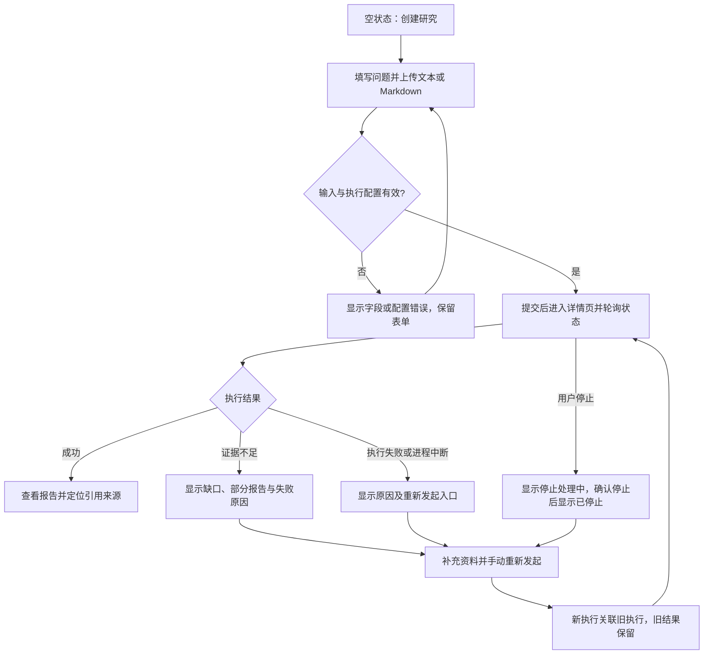
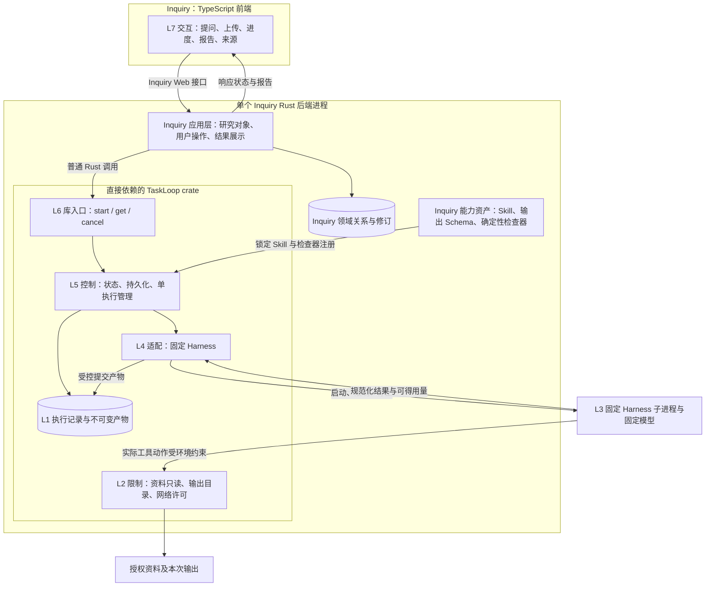

# Inquiry Issue #1：一期最小研究闭环

| 项目 | 内容 |
|---|---|
| 版本 | v0.3.0，2026-11-01 |
| 状态 | Draft；技术选型与最小化方向已由用户确认，本文新增接口细节为待评审契约 |
| 关联 | [Inquiry Issue #1](https://github.com/xforce-io/inquiry/issues/1) |
| 工作分支 | `feat/1-minimal-research-loop` |
| 术语 | [名词表](../glossary.md) |
| 事实源 | 本文件为一期产品及必要技术契约的唯一详细设计；Issue/评论仅保存概要、验收与链接 |

用户已确认：Rust 后端、TaskLoop crate 直接依赖、TypeScript 前端，并要求更新最小版本设计。本稿替代 L1 v0.2.0 中超出一期的自动补查、扩范围审批和自动恢复方向。沿用用户要求的 13 节结构：§3–4 定义产品范围/路径，§5–10 定义必要技术契约，§11 映射验收，§12–13 记录依赖与决定。L1: write（概要更新）；L2: write（仅覆盖一期必要接口与依赖）；keel-how: skip: 无现成机制可讲，仓库当前只有 README、名词表和设计材料，无产品代码。

## 1 背景

此前概要覆盖完整研究系统和通用执行框架，首期范围过大。现在先验证一个真实闭环：**上传资料 → 提出问题 → 执行一次研究 → 查看带来源的报告**。证据不足时展示缺口，用户补充资料后手动重新发起。

TaskLoop 主分支当前为 `fbe3c87e8f8614b7098ffe4d710040f572a3e833`，仅有 README、名词表和 RFC，尚无 Cargo 包。本文描述的是需要它交付的 Rust 接口，不是已存在、可调用的 SDK。现有 TaskLoop RFC 曾建议 Python；本次确认的 Rust crate 路线需要在 TaskLoop 后续事项中明确修订，不能把文档提交当可用依赖版本。

## 2 名词解释

领域术语见[名词表](../glossary.md)，不重复定义。接口新增的 ExecutionId、ExecutionRequest、ExecutionSnapshot、TaskLoopError 同步登记在名词表。

研究问题属于 Inquiry；一次发起关联一个 ExecutionId。TaskLoop 内部创建一个 Goal、一个叶子 Task 和一个 Run。首期固定一次尝试，不自动重试。一次研究由 Harness 按 Skill 完成阅读、提取与写作；这些局部步骤不拆成多个 TaskLoop Task。

## 3 目标与非目标

### 3.1 一期目标

- 一个本地单用户 Web 应用，TypeScript 前端调用 Inquiry Rust 后端。
- Inquiry 后端直接链接 TaskLoop crate，统一一个 Rust 异步运行环境，运行时不经过 TaskLoop HTTP、MCP 或独立服务。
- 支持 UTF-8 文本/Markdown 上传、问题提交、执行状态查询、带来源报告、执行取消和中断识别。
- 支持手动补充资料后发起新执行，保留旧结果及关联。

### 3.2 一期非目标

URL 获取、开放网络检索、自动补查、任务 DAG、动态重规划、自动切换模型/多 Agent、在线路由优化、金额实时硬预算、交互式审批平台、自动断点续跑、多用户、定时研究、通用工作流编辑器、独立 TaskLoop 服务均不属于一期。

一期固定一个经配置和验证的 Harness 与模型，不指定未经验证的默认商业模型。只允许读用户提交的资料及写本次输出；没有外部业务写动作。时间、并发和输入大小受硬限制，记录可获得的模型用量，不宣称实现实时精确费用控制。

## 4 能力

### 4.1 UI/UX 与用户路径（S1）

只有创建入口与研究详情两个主要页面。创建页收集问题和资料；详情页从上到下显示问题/资料版本、状态与停止操作、报告与可定位来源。无需独立任务管理后台、模型选择页、审批页或图谱页面。



输入至少一个非空问题、一份可读资料；一期最多 10 份资料、总原始内容不超过 10 MiB，拒绝非 UTF-8 和目录/可执行文件。URL 作为自动获取输入不支持，资料中的链接仅作为文本。提交前校验，服务端为最终校验者。

状态与动作：空状态提供创建；上传/提交中阻止重复点击并保留同一幂等键；运行中每 2 秒查询一次；来源或执行查询暂时失败显示可重试错误，不将运行误判成失败。终态停止自动轮询，页面刷新后从后端重建状态。来源打不开时显示引用错误，不能跳到“相近段落”冒充原引用。

成功意味着模型返回的回答状态为 `answered`，输出 Schema、必需字段、来源定位与摘要检查均通过；这是执行与格式/来源一致性门禁，**不自动认证结论真实或证据充分**。报告始终允许用户查证和质疑。`insufficient_evidence` 返回质量未通过，展示缺口与可用部分报告，不显示为成功。未来领域语义评价另行扩展。

停止按钮提交取消，先显示处理中；TaskLoop 确认本地执行停止后才显示已停止。已完成执行不能被取消覆盖。停止不保证撤回模型提供方已经产生的费用。后端重启识别遗留执行为已中断，并提供重新发起；不自动恢复模型会话。

### 4.2 领域模型（S2）

六类概念仍保留，但采用最小数据表达：研究问题保存用户输入与完成要求；资料保存不可变内容版本和位置；证据是报告中指向资料版本/段落的引用；判断与结论先作为结构化报告条目；报告固化本次输出、引用与限制。首期不为每类概念建立独立服务或通用图数据库。

Inquiry 保存研究问题、资料元数据、研究修订及 ExecutionId 关系；TaskLoop 保存执行事实与不可变输入/输出内容。证据引用使用资料 ID、内容摘要和段落 ID，引用必须指向本次实际提供的资料版本。手动补充资料形成新的研究修订和新 ExecutionId，保留 `previous_execution_id`。相同资料的引用继续指向原摘要，旧报告不能被新结果覆盖；冲突资料导致新报告修订判断时，展示新旧回答与版本关联，不要求首期自动生成语义差异摘要。

## 5 思路与折衷

### 5.1 最小衔接方式

**TypeScript 前端 → Inquiry Web 接口 → Inquiry Rust 应用代码 → TaskLoop Rust 库 → Harness 子进程。**

TaskLoop 作为 crate 编译进 Inquiry 后端。Inquiry 持有一个 TaskLoop 实例，负责其启动/关闭；TaskLoop 负责执行子进程及其状态。库不能在内部偷偷创建另一套独立异步 runtime；共享宿主运行环境的具体运行时版本由依赖交付时锁定。业务调用只有 start/get/cancel 三类；实例打开、关闭属于进程生命周期，不是独立远程服务。

### 5.2 取舍

| 决定 | 收益 | 代价与放弃项 |
|---|---|---|
| Rust 库直接依赖 | 有编译反馈，跨项目类型契约清楚，无额外网络边界 | 共享后端故障域；放弃一期独立服务/跨语言绑定 |
| 一个研究请求对应一个 Task | 先验证真实产品闭环 | 粗粒度进度；放弃任务 DAG 与自动补查 |
| 用户手动补资料并重发 | 保留迭代能力，减少自主决策复杂度 | 用户需介入；放弃运行中修改目标/预算 |
| 轮询 get | 简化前后端衔接 | 进度最多有轮询间隔延迟；放弃事件推送与消息队列 |
| 只读资料、固定执行配置 | 减少权限及路由面 | 暂不覆盖联网研究与外部写入 |
| 重启识别中断 | 终态与结果可追踪 | 不承诺无损续跑；已中断工作需重新发起 |

## 6 架构

### 6.1 分层与代码所有权（S3）



Inquiry 拥有问题/资料/报告的领域语义和界面，TaskLoop 拥有执行状态，双方各通过自己的模块入口写入。Inquiry 不直接写 TaskLoop 数据库；TaskLoop 不理解研究对象关系。物理存储均为本地文件/SQLite，一期分别保留领域表与执行表的所有权，不用共享可写表进行集成。

### 6.2 与原七层对应

L7 为 Inquiry 研究界面；L6 为 Inquiry Web 应用入口到 TaskLoop 库的命令/查询调用；L5 只启用单任务状态、资源限制和固定执行配置；L4 为 TaskLoop Worker/Harness 适配；L3 为第三方 Harness；L2 仅执行受控资料读取/本次产物写入；L1 为各自拥有的领域关系、执行记录与产物。原 RFC 的 Decision/Router 扩展边界保留，一期不实现自主规划、多候选路由或完整审批平台。

### 6.3 主路径与失败路径

Inquiry 校验并保存资料快照和待关联研究修订，调用 start；TaskLoop 原子记录幂等请求与执行标识后异步启动。Inquiry 用请求幂等键补偿“已启动但关联写入前崩溃”的情况，重试得到原 ExecutionId；同一键不能再次收费启动。前端轮询 Inquiry，后端调用 get 获得持久化快照与结果。执行后由 TaskLoop 调用启动时注册的 Inquiry 检查器进行输出/来源检查，再提交终态。

提交前失败不留下有效执行；提交后 Harness 启动失败成为可查询的 Failed。报告未通过检查同样 Failed，并可携带部分结果；取消走 Cancelling 到 Cancelled；崩溃遗留执行进入 Interrupted。所有错误均返回明确阶段和稳定错误码，不能靠日志文本猜状态。

## 7 模块

| 模块 | 所属 | 一期职责 |
|---|---|---|
| 前端 | Inquiry | 创建、资料上传、轮询详情、报告引用、停止与重新发起 |
| 应用与领域关系 | Inquiry | 研究修订/资料引用、请求幂等键、ExecutionId 关联 |
| Skill 与检查器 | Inquiry | 研究方法、报告 Schema、引用定位/内容摘要/必需字段检查 |
| 执行门面与存储 | TaskLoop | 三个业务调用、执行生命周期、持久化、结果读取与限制 |
| Harness Adapter | TaskLoop | 固定配置、子进程执行、事件/结果规范化、停止 |

Inquiry 检查器以启动时注册的稳定 ID/版本引用，不能把任意 Rust 闭包序列化写数据库。检查器一期为无外部副作用的确定性函数；需要模型的语义审阅不属于本检查器，也不另开隐藏模型调用。

## 8 API/CLI

### 8.1 TaskLoop crate 的三个业务调用

以下为**拟交付签名规格**，具体 crate 尚未实现；类型名和字段是依赖验收要求，不是现有 SDK 示例。

```rust
async fn start(&self, request: ExecutionRequest)
    -> Result<ExecutionId, TaskLoopError>;
async fn get(&self, id: ExecutionId)
    -> Result<ExecutionSnapshot, TaskLoopError>;
async fn cancel(&self, id: ExecutionId)
    -> Result<ExecutionSnapshot, TaskLoopError>;
```

| 对象 | 必需内容 | 边界 |
|---|---|---|
| ExecutionRequest | `request_key`、问题、不可变资料引用/摘要、锁定 Skill 引用、输出 Schema 引用、检查器 ID/版本、超时限制 | Harness/模型在实例配置中固定，单次请求不能提权或切换 |
| ExecutionId | 不透明执行标识 | Inquiry 只关联标识，不依赖 TaskLoop 内部表结构；内部关联 Goal/Task/Run 可在诊断信息返回 |
| ExecutionSnapshot | ID、状态、当前阶段、开始/结束时间、用量（可未知）、已校验结果或部分结果、结构化错误、配置/Skill 摘要、`revision` | 查询是持久化事实快照；一期返回足够显示的报告与引用数据，由库内部读取 Artifact，省去第四个产物 RPC/调用 |
| TaskLoopError | 稳定码、阶段、用户可读原因、是否可重试 | 禁止暴露凭据、原始敏感命令或将 unknown 用量转成 0 |

最小报告结构固定包含 `answer_status: answered|insufficient_evidence`、问题、判断条目、证据引用、结论、限制与缺口。每条引用包含资料 ID、内容摘要、段落 ID 与引用原文；get 的终态结果同时提供经过校验的引用段落片段，前端点击引用即可查看该版本原文位置，首期不依赖直接访问 TaskLoop 的存储 URI。执行中 get 不反复返回整份输入资料。

**start**：相同 request_key 与相同规范化请求摘要返回同一 ExecutionId；同键不同内容返回 `request_conflict`。先落盘后返回，外部执行在返回后异步推进。每实例只允许一个活动执行，另一个新请求返回 `busy`，一期不建排队系统。无效输入、配置不可用或 Skill 不兼容在启动前拒绝。

**get**：返回 Accepted / Running / Evaluating / Succeeded / Failed / Cancelling / Cancelled / Interrupted 之一。Accepted 代表已接收，不能显示成功；Inquiry 把 Failed 中的 `quality_not_met` 显示为证据不足。主状态是 TaskLoop 的 Goal/Task/Run 状态的受控外部投影，查询不创建独立的第二套状态事实。

**cancel**：幂等。对活动执行先持久化取消再停止派发和子进程，确认本地执行停止后终态 Cancelled；对终态直接返回原快照。成功提交与取消按同一事务版本串行化：先成功则保留成功，先取消则迟到结果不能改为成功。无法确认停止保持 Cancelling 并显示原因。

最小错误码为 `invalid_input, unavailable, unsupported_configuration, skill_invalid, busy, request_conflict, not_found, adapter_failed, quality_not_met, timeout, interrupted, storage_error`。I/O 暂时查询失败作为调用错误返回，不伪造执行终态。默认单次超时 10 分钟、停止宽限 5 秒；超时进入停止流程并以 timeout 失败，不能先标失败后任由子进程继续运行。

实例在 Inquiry 启动时打开、注册 Skill/检查器及固定执行配置，退出时停止接收新研究并关闭活动执行。重启对遗留活动执行核对所属子进程是否仍存活，必须先确认/终止旧进程再释放活动槽位；不能仅将状态改 Interrupted 后同时启动第二个有效执行。终态不可重新打开，重新发起使用新 request_key 和 ExecutionId。

### 8.2 Inquiry Web 与 crate 的区别

浏览器只调用 Inquiry 的 Web 接口，后端做请求校验、研究对象管理和结果呈现，再调用 crate。该 Web 接口不属于 TaskLoop API。前端每 2 秒轮询 Inquiry 详情，停止/重发通过 Inquiry 操作入口完成；一期不增加 WebSocket/SSE、RPC、MCP、跨语言 FFI 或浏览器直连 Harness。

### 8.3 版本依赖

一期使用 `https://github.com/xforce-io/taskloop.git` 的 Cargo Git 依赖，`rev` 固定为一个**已通过契约验收、包含可构建 taskloop crate 的完整提交 SHA**，并提交 Cargo.lock。升级是显式变更并重跑契约测试；不使用浮动 main，也不把开发机 path 依赖作为交付配置。先不要求发布 crates.io。

当前还没有符合条件的提交，因此本文不填虚假 rev、不提交无法解析的 Cargo.toml。实现时在 Inquiry 接入 PR 记录选定 SHA、crate 版本、最低 Rust 工具链、兼容接口与 Harness 版本，统一锁定构建工具链和前端依赖。Cargo 支持 Git/rev 及锁文件的事实依据见 [Cargo 依赖文档](https://doc.rust-lang.org/cargo/reference/specifying-dependencies.html) 和 [Cargo.lock 文档](https://doc.rust-lang.org/cargo/guide/cargo-toml-vs-cargo-lock.html)。

## 9 边界

### 9.1 Skill、结果与质量

Inquiry Skill 首期随 Inquiry Git 仓库维护，包包含方法说明、输入/报告 Schema 与声明式约束；包不执行安装钩子，首期不支持 Skill 依赖闭包。TaskLoop 在执行前锁定包版本与摘要，并保存供复现。研究任务使用固定能力配置，Skill 无权覆盖工具权限。

模型输出是候选结果：报告声明、引用和回执先校验再持久化成功。引用必须属于请求资料，位置和摘要可验证；引用存在不自动证明论证成立。报告中未回答问题或声明证据不足时返回 quality_not_met。人工判断语义质量不作为首期独立审批状态，用户可在报告页面查证并重新发起。

### 9.2 权限与安全

单用户本地使用，默认只监听回环地址；Web 写入口限制来源并按会话/防跨站请求规则处理。资料只读提供给执行器，输出目录独立；文件名不能决定任意磁盘路径。Harness 凭据来自操作者的进程专用配置，不上传到浏览器、不写入报告或日志。网络只允许模型提供方所需通道；不允许 Harness 自由浏览或调用外部写工具。若适配器无法验证这些能力，配置不可用，不能只靠提示词约束。

### 9.3 并发、可靠性与可观测

每个工作区仅一个宿主进程和一个活动执行；存储持有单实例锁。记录 ExecutionId、Skill/配置版本、阶段、起止时间、错误和可获得用量。任务、产物和研究关系落盘。首期不做自动重试/自动续跑，错误后由用户重发，旧记录保留；浏览器重复提交依靠 request_key 去重。

## 10 迁移/兼容/回滚

无既有产品数据，业务迁移 N/A。文档版本修订见 §13。TaskLoop 状态与产物由库管理，Inquiry 只读其公开接口；领域对象引用不能依赖库内部数据库结构。

每次升级前备份研究关系、执行数据库及其引用产物，验证所选 crate 可读数据版本。回滚前停止活动执行；旧版本不支持较新存储格式时拒绝启动并恢复一致性备份，不能静默丢记录。Rust API 破坏性变更必须更新接入代码和契约测试；首期不做长期多版本兼容层。

## 11 测试计划

当前没有产品实现，所有运行验证均为 not_run。以下是一期验收定义，不是测试通过报告。

| 验收 ID | 归属 | 前置与真实入口 | 可判定结果与禁止行为 | 证据/执行依赖 |
|---|---|---|---|---|
| S1.A1 | S1 | 单用户已配置 Harness；Web 创建问题并上传 2 份 fixture 资料，等待并查看来源 | 执行成功后报告可定位到原资料位置；刷新保留结果；不能凭 Accepted 显示成功 | 页面/请求记录、产物摘要；fixture agent 可执行，真实 Harness 另验 |
| S1.A2 | S1 | 同入口，资料不足，完成后补充资料再手动发起 | 旧结果 quality_not_met，缺口可见；新 ExecutionId 独立执行并关联旧结果；无自动补查 | 两次快照、修订关联；确定性注入 |
| S1.A3 | S1 | 运行时点击停止；另一路强制退出后端再重启 | 停止先处理中再确认；中断可见且可重发；旧执行未确认停止前不启动第二个有效执行 | UI/进程/数据库证据；agent 故障注入 |
| S2.A1 | S2 | 从新旧报告引用回溯资料；补入冲突资料后手动重发 | 六类概念有落地表达；来源版本/段落准确；旧判断与报告保留，新结果有修订关联 | 引用与版本链；agent 检查，语义质量人工复核 |
| S3.A1 | S3 | Inquiry 后端调用所选真实 crate 的 start/get/cancel，重复 start、并发提交和终态取消 | 三调用契约、幂等、busy、终态保护成立；从领域代码无法直接改 TaskLoop 状态 | 集成输出、锁定 SHA、编译/数据库证据；需要真实 crate |
| S3.A2 | S3 | 固定真实 Harness 运行上传资料任务，触发 Schema/引用错误、超时与停止 | 错误有明确代码；越界引用不通过；固定配置与权限限制得到验证，无凭据日志 | 脱敏事件、产物、进程与隔离探针；需要真实模型服务，mock 不替代 |
| S4.A1 | S4 | 开发者走读 §6、§8、§12 及依赖构建结果 | 分层/所有权明确，依赖完整 SHA 和 Cargo.lock 固定；实际依赖图无 TaskLoop 远程服务；未交付能力不得标完成 | 人工评审、依赖/构建证据；当前为 not_run |

以上全部为必需验收。未来主要验证文件约定 `.agents/skills/verify-inquiry/features/minimal-research-loop.md`（S1）、`sources-and-revisions.md`（S2）、`taskloop-crate.md`（S3）、`mvp-boundary.md`（S4）；当前未创建，不能当成已有验证证据。完整 Web 全状态验证随实现驾驶手册补齐，不改变本期范围。

### 11.1 E2E

从 Web 走成功、证据不足后手动重发、停止/中断三类路径（S1/S2），含空、加载、错误和成功反馈。真实 Harness 至少跑一次指定资料闭环，并留版本与引用证据（S3）；fixture 负责稳定复现边界。

### 11.2 Integration

真实 crate 的三调用契约、并发 busy、请求去重、取消/成功竞态、重启识别及旧进程清理、产物落盘与读取、Skill/检查器固定版本、断开的调用关联补偿、数据版本兼容（S2/S3）。Rust 后端到 TypeScript 前端的状态/错误 JSON 校验，以及来源越界拒绝同样覆盖。

### 11.3 Unit

输入大小/编码/路径校验、资料摘要和段落引用、报告 Schema、质量未通过判定、修订关联、状态到界面文案映射和错误码映射（S1–S3）。Rust 编译检查提供类型反馈，不能替代这些业务判定或真实隔离测试。

## 12 开放问题与依赖交付

### 12.1 对 TaskLoop 的最小依赖

| 依赖 | 交付内容 | Inquiry 可以如何推进 | 接入门槛 |
|---|---|---|---|
| D1 Rust crate 核心 | 可构建包、start/get/cancel、持久化、幂等、单执行限制、取消/中断识别、Skill/检查器注册 | 前端和领域模型可先开发；fixture 只验证 Inquiry 展示，不证明执行链 | S3.A1 通过；明确工具链/存储版本 |
| D2 真实 Harness 适配 | 固定配置、资料隔离、结果规范化、停止/超时、用量记录 | 先用确定性 fixture 开发，不把 fixture 当真实适配 | S3.A2 通过；真实版本和模型由操作者提供 |
| D3 兼容提交与接入验证 | 合并 D1/D2 后的可构建完整提交 SHA、接口/存储兼容说明与测试证据 | 满足后才把 crate 固定进交付配置 | 固定 rev 和 Cargo.lock，构建与一期 E2E 通过 |

以上为依赖事项定义，尚未为 TaskLoop 新建 Issue，也未修改其源码或 RFC。现有跟踪入口为 [TaskLoop Issue #1](https://github.com/xforce-io/taskloop/issues/1)。Inquiry 一期最终验收依赖 D1–D3；缺真实 crate/服务时标 blocked/not_run，不能临时在 Inquiry 另写调度器或引入隐藏 HTTP 适配宣称完成。

### 12.2 实现前需落定的技术项

- Rust 工具链、异步运行时及 Harness 兼容版本：由 D1/D2 实验给出并锁定，不能假定任意版本可用。
- 模型标识与凭据：操作者显式配置一个可用模型，未配置不启动研究。
- JSON 输出的具体报告 Schema、引用定位格式与 Web 错误映射：沿本文边界在实现票固定；不可减少必需引用或扩大执行权限。

## 13 关联与决定

### 13.1 已确认与提案

- 已确认：Rust 后端、TaskLoop crate 直接依赖、TypeScript 前端；用户要求收敛最小版本。
- 采用的最小范围：上传文本/Markdown、单任务单次执行、固定模型/Harness、轮询、取消、中断识别、手动补资料后新执行。
- 待评审技术契约：本文的类型/错误码、默认上限、进程生命周期与依赖交付要求。未自签 Approved。

### 13.2 对旧版范围的显式修订

| 原约定 | 一期修订 | 保留的 Story |
|---|---|---|
| 自动补查、运行中扩范围/预算审批 | 用户补资料后手动新执行，无自动追加任务 | S1/S3 |
| 8 类跨框架交互 | 首期 3 个 crate 业务调用；评价在执行内注册，补查通过新 start，审批/自动恢复推迟 | S3 |
| 指定 URL 获取 | 首期仅上传 UTF-8 文本/Markdown，URL 自动获取推迟 | S1 |
| 自动恢复与细粒度任务闭环 | 保存结果并识别中断，可重新发起；无无损续跑和自动重试 | S1/S3 |
| 多层架构作为实现范围 | 仍保留七层定位，首期只实现实际依赖子集 | S3/S4 |

Issue S1–S4 编号和顺序保留，验收文字随一期范围同步修订，未勾选完成。

关联：[Inquiry Issue #1](https://github.com/xforce-io/inquiry/issues/1) · [L1 概要评论](https://github.com/xforce-io/inquiry/issues/1#issuecomment-6555157047) · [TaskLoop RFC 基线](https://github.com/xforce-io/taskloop/blob/fbe3c87e8f8614b7098ffe4d710040f572a3e833/docs/RFC-0001-architecture.md) · [名词表](../glossary.md)。
