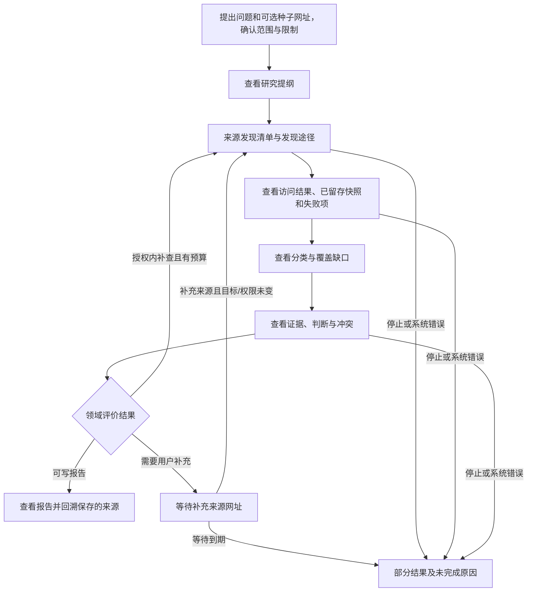
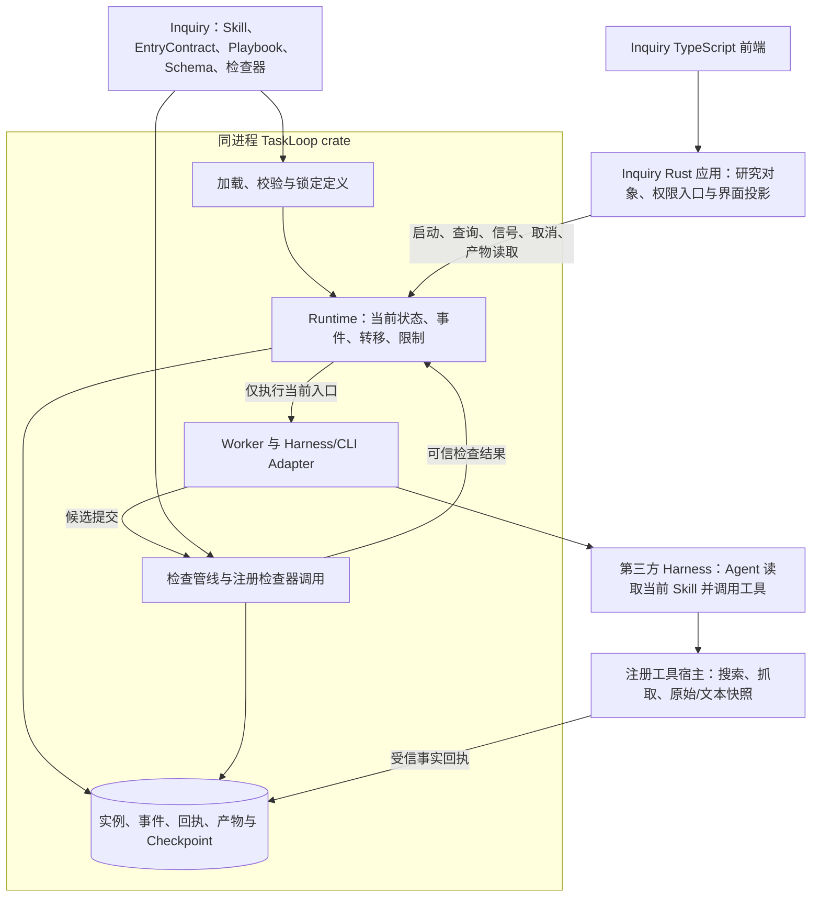

# Inquiry Issue #1：Skill、执行与状态编排基础契约

| 项目 | 内容 |
|---|---|
| 版本 | v0.4.2，2026-11-01 |
| 状态 | Draft，完整基础契约方案；未自签架构批准，未实现生产运行时 |
| 需求 | [Inquiry Issue #1](https://github.com/xforce-io/inquiry/issues/1)，S1–S4 |
| 技术基线 | TypeScript 前端、Inquiry Rust 后端、TaskLoop Rust crate 同进程直接依赖 |
| 术语 | [名词表](../glossary.md) |
| 事实源 | 本文件为详细设计；机器可读实例及验证样例见同号 [contract 目录](1-minimal-research-loop/contract/) |

本次交付是设计与契约见证，尚未实现应用或 TaskLoop Rust 运行时。建议先评审 §3 一期范围、§6 分层与状态控制权、§7–8 执行与检查契约、§12 接入门槛；完整修订由 Git 历史保留。

## 1 背景与依据

轻量部署不应删去深度研究的关键过程。Inquiry 应先广泛发现来源，再获取并留存、初步整理、提取证据和判断，最后形成可追溯报告，资料缺口允许有界补查和用户介入。

此前设计混用了三个含义：给 Agent 阅读的 Skill、可调用程序、由框架执行的状态机。由此无法解释谁控制阶段、TaskLoop 如何看到产物、哪些状态能被谁改变。本稿明确拆开这些契约，并用研究和文档审阅两个业务样例验证通用推进规则。

事实依据与本项目决定分开：

- [Agent Skills 规范](https://agentskills.io/specification)定义以 SKILL.md 为核心、可含脚本和资源的包，并未定义本文的执行入口、状态机或提交协议。本文增加的是可选集成契约，不改写标准 Skill 格式。
- [W3C SCXML](https://www.w3.org/TR/scxml/)说明状态、事件、条件和目标状态的通用关系；本文采用一个更小的有界配置模型，**不宣称 SCXML 兼容**，不实现其完整语言。
- [JSON Schema 2020-12 验证规范](https://json-schema.org/draft/2020-12/json-schema-validation)用于结构检查；本文额外定义文件、回执、业务关系和语义评价，不能把 JSON 形状正确当事实真实。

TaskLoop 当前仅有 RFC 基线提交 `fbe3c87e8f8614b7098ffe4d710040f572a3e833`，没有可构建的 Rust crate。本稿所有 Rust 接口都是依赖契约提案，不是现有 SDK。

## 2 核心定义与所有权

规范名见[名词表](../glossary.md)。以下对象即使放在同一仓库或包内，也有不同消费者和权限：

| 对象 | 定义者/维护者 | 消费者 | 含义与禁止事项 |
|---|---|---|---|
| Skill | Inquiry 等业务应用 | Agent/Harness | 方法、知识、资源与工具使用说明；Markdown 不直接改变宿主状态 |
| EntryContract | 业务应用 | TaskLoop 和适配器 | 一次任务的目标、Skill 引用、输入、输出、检查器与允许结果；不含任意 shell 命令或数据库写权限 |
| Playbook | 业务应用 | TaskLoop | 初始状态、状态类型、执行入口、允许转移、等待信号、终点和限制 |
| BindingRegistry | 宿主操作者/应用代码 | TaskLoop Worker | 将逻辑 ID 绑定到已安装的 Harness、CLI、工具和检查器；Skill 无权自行注册或提权 |
| FlowInstance | TaskLoop 创建 | TaskLoop；Inquiry 只读投影 | 锁定定义、当前状态、访问记录、事件与检查结果；唯一执行状态事实源 |
| 研究对象 | Inquiry | Inquiry 服务及界面 | 问题、资料、证据、判断、结论和报告关系；不复制一套可独立写入的执行状态 |

Playbook 可以作为 Skill 的附加资源，也可以独立存于业务应用。文件所在位置不改变控制权；启动时必须有明确引用及锁定摘要。普通标准 Skill 可作为 Agent 上下文使用，但没有集成契约和可观察边界时，只能视为一次黑盒工作，不能宣称具备内部阶段门禁。

**一次实例 → 一个 Goal；每个 work 状态的每次 StateVisit → 一个 Task；每次执行尝试 → 一个 Run。** 补查回到同名状态会创建新的访问与 Task；基础设施重试才是在同一 Task 下创建新 Run。等待状态不启动 Agent。ExecutionId 标识整个 FlowInstance，而不是某一个 Run。

## 3 目标、最小内核与非目标

### 3.1 必须做到

1. 不同业务通过定义表达不同流程状态与转移，TaskLoop 不硬编码“搜集、精读”等研究语义。
2. 运行时严格区分候选输出、检查通过的产物和已提交状态；Agent 自报完成不能越过门禁。
3. 输入、工具、产物、检查器、状态转移及外部信号均有可解析、可拒绝的契约。
4. 深度研究的收集、探活、留存、整理、证据和报告各自有可查看产物；允许有界回环与补充来源。
5. 定义和业务对象由 Inquiry 维护；TaskLoop 作为同进程 Rust crate 提供通用状态与执行机制。

### 3.2 轻量内核边界

一期只需平面状态机：`work / wait / terminal` 三种状态、每实例单活动 Run、多个实例独立排队、命名事件、枚举结果选边、有限回环、SQLite 事务和本地不可变产物。条件不支持任意脚本表达式，复杂领域条件由注册检查器计算成有限结果。也不引入独立服务、网络队列或跨语言 FFI。

自动重检、执行中断后原位续跑、动态插件安装、嵌套/并行状态、任意工作流 DSL、自动修改状态图、热迁移活动定义、跨服务分布式事务和自动学习路由不属于本版。模型可以在已声明边内建议补查；不能凭返回一个 next_state 创造新状态或重写验收。以后需要图外重规划，必须形成新定义/新实例或经过独立设计，不能暗中扩权。

## 4 Inquiry 研究闭环与用户路径

### 4.1 阶段、产物与结果

| work 状态 | 本阶段任务 | 必需产物 | 领域结果及下一状态 |
|---|---|---|---|
| scope | 明确子问题、检索方向和停止条件 | plan | ready → discover |
| discover | 在授权范围与资源限制内广泛发现来源 | candidates，包含发现途径和子问题 | ready → capture；need_input → await_sources |
| capture | 检查访问、保留失败项、抓取原始内容及规范化文本 | materials、原始/规范化快照、受信获取回执 | ready → catalogue；need_input → await_sources |
| catalogue | 去重、分类和检查覆盖缺口 | catalogue | ready → analyze；need_more → discover；need_input → await_sources |
| analyze | 整理支持/反驳证据、判断、冲突与限制 | analysis | ready → report；need_more → discover；need_input → await_sources |
| report | 基于已接受证据综合报告 | report，引用确切版本及位置 | ready → done；need_input → await_sources |

这些是 Inquiry 的状态 ID 和领域规则，不是 TaskLoop 的内置枚举。完整可解析定义见 [research.bundle.json](1-minimal-research-loop/contract/research.bundle.json)。`need_more` 的回环受次数、时间和请求预算限制。不能以“尽可能收集”为由无限调用。示例默认最多 30 次正常转移、单状态访问 3 次、24 个执行 Run；实际网络调用还需宿主配置查询/请求/字节上限。

探活记录包括请求地址、最终地址、时间、访问结果和内容可用性。HTTP 成功不等于获得可用正文。失败、拒绝、未尝试均需可验证的处置原因；正文未获取不能伪装为已保存。所有来源不可用时，capture 仍可完成“记录处置事实”这个任务，但业务结果为 need_input，不直接写报告。

### 4.2 用户路径与关键状态

创建页支持问题、可选种子 URL 和范围确认；详情页显示当前业务阶段、运行/等待/阻塞状态、已接受阶段产物、缺口、停止入口和最终报告。空状态提示创建；配置/输入错误保留输入并给出修正入口；工具运行与检查中分别显示；等待列出允许信号及输入要求；查询失败显示可重试错误，不伪造执行失败。

一期输入仅为问题、范围与 HTTP(S) 来源网址；等待时仅接收新的来源网址，严格对应 research-input 与 sources-added Schema。文件上传、PDF/OCR、跨实例资料导入和范围变更界面延后，避免在未定义导入契约时承诺支持。后续新增输入类型属于 Inquiry 的来源/工具/gate 扩展，不需要增加通用状态种类。

同一目标与权限下补充来源通过 signal 记录为新事实，保留原始输入与产物。改变问题、权限、完成标准或扩大资源上限须新建实例或明确修订流程，不通过普通来源信号暗改。取消先显示处理中，确认停止后才是已取消。

资料、证据和报告内容按摘要不可变保存。报告引用可沿“结论/判断 → 证据位置 → 规范化文本 → 原始抓取内容及回执”回溯。规范化转换记录工具/版本及输入输出摘要；纯文本可由同一份字节同时承担原始与规范化内容。旧快照和报告不因新一轮补查被覆写。

### 4.3 成功的准确含义

状态 `done` 表示通过已声明的报告门禁；宿主生命周期为 completed，业务结果为 report_ready。它不等于世界事实已被数学证明。引用定位、获取回执可程序检查；证据相关性、论证充分性需要业务规则、独立模型或人工评价，评价方法/版本与证据必须可见。只有格式检查时必须明确显示质量保障的范围，不能冒充深度语义评价。

`partial` 同样是一个合法终点，但业务结果为 insufficient_evidence；界面不得把它显示为研究成功。流程执行失败、阶段资料不足和用户主动取消必须可区分。

## 5 契约分层与设计决定

### 5.1 三份契约及一份宿主绑定

1. **Skill：给 Agent 的方法包。** 保持标准格式，参考 [研究 Skill 样例](1-minimal-research-loop/contract/skills/inquiry-deep-research/SKILL.md)。它说明如何收集、分析和引用，不拥有运行时数据库权限。
2. **EntryContract：给 Runtime/Worker 的执行边界。** 包含 instruction、skills、executor、tools、input_schema、requires、outputs、attachments、gate 和 outcomes。
3. **Playbook：给 Runtime 的编排定义。** 包含 id/version、input_schema、initial、states、limits；状态 ID 和分支由业务定义。
4. **BindingRegistry：给宿主的实际实现映射。** 由应用代码/操作者注册，不从未信 Skill 自动执行安装脚本或任意命令。

机器结构见 [bundle.schema.json](1-minimal-research-loop/contract/bundle.schema.json)。本方案没有要求所有标准 Skill 都改写成状态机，也没有假设每个 Skill 都有独立 CLI。已有 Skill 的集成契约可由业务应用在包外提供并共同锁定。

### 5.2 关键取舍

| 选择 | 解决的问题 | 代价及放弃项 |
|---|---|---|
| 方法说明与机器控制分离 | 兼容标准 Skill，控制语义可检查 | 需要维护一份显式集成契约；放弃从 Markdown 自动推断强制流程 |
| 阶段级受控调用 | 让门禁发生在下一阶段执行前 | 多次 Harness 调用；放弃整套研究一次黑盒运行却声称有强制中间门禁 |
| 三种平面状态与枚举结果 | 业务可配置分支和等待，内核有限 | 复杂条件交给检查器；放弃任意表达式、嵌套与并行引擎 |
| 外部信号显式进入 | 可解释用户介入和恢复 | 增加 signal 接口处理业务补充；技术恢复不复用业务信号 |
| 产物只读接口与状态查询分开 | 不在每次轮询返回整个资料集 | 增加 read_artifact；放弃把大文件塞进 get 快照 |
| 受信工具回执与候选文件分离 | Agent 不能编造抓取事实 | 工具宿主需要留账；单纯文件存在不能证明获取真实性 |

## 6 架构、状态与转移规则

### 6.1 分工与数据流

与七层对应：L7 为 Inquiry UI；L6 为 Web 应用服务到 crate 的公开接口；L5 为通用状态推进、限制、检查和固定路由；L4 为 Worker/Adapter；L3 为第三方 Harness；L2 为受控工具动作；L1 为领域关系与通用实例/产物存储。Inquiry 提供研究语义和定义；TaskLoop 是执行控制唯一写入者。原 RFC 的 Decision 在本版落实为受约束的领域结果求值，不让模型直接写状态或临时修改图。

### 6.2 三类状态分别保存

| 状态 | 示例 | 事实源与写权限 |
|---|---|---|
| 业务对象状态 | 报告草稿、已发布、归档 | Inquiry 数据；Inquiry 应用服务写入 |
| 流程状态 | discover、capture、await_sources | 锁定 Playbook 定义；TaskLoop FlowInstance.current_state 写入 |
| 技术生命周期 | running、waiting、blocked、cancelling、completed、failed、cancelled | TaskLoop 内置状态机；Runtime 写入 |

一次实例只有一个活动流程状态。`current_state=capture, status=blocked` 可以同时成立，表示业务仍在获取阶段，但检查器/恢复条件不可用。技术失败或取消可以保留最后业务状态，不伪造走过报告阶段。终态不可原地重开。

### 6.3 Playbook 状态语义

| kind | 必需定义 | 进入后的行为 | 可离开的条件 |
|---|---|---|---|
| work | entry、accepted 结果映射、rejected/failed 目标 | 创建 StateVisit/Task；解析已接受前置产物；启动一个受控 Run | 通过检查的结果、被拒绝结果或已确认的执行失败 |
| wait | 允许的信号及 payload Schema、target、timeout/target | 不启动 Agent，展示等待原因并持久化到期时间 | 获准用户信号或 Runtime 产生的到期事件 |
| terminal | status、business outcome、必需已接受输出 requires | 核验终点要求后提交终点，无新执行 | 无离开边 |

结果映射使用 JSON 对象，因此同一状态/结果只能有一个目标；解析拒绝重复 JSON 键。入口 outcomes 与 accepted 的键必须完全一致。所有目标、入口、执行器、工具、Skill、Schema、检查器都必须能解析；所有状态从 initial 可达并有终点路径。存在回环必须有访问/运行/转移及时间限制。

终点也有显式 requires：研究 done 必须引用 report 状态已接受的 report 输出，不能只因某条边指向 done 就跳过最终门禁；partial/failed 可声明空要求并携带部分结果/原因。缺少终点要求时保持原状态并 blocked，不记录虚假的到达事件。检查规则和终点要求都属于受审阅的业务定义；启动授权限定允许的定义摘要，Agent 不能换成一个立即完成的弱定义。

### 6.4 唯一推进算法

每个 work 完成后，Runtime 严格依次执行：

1. 验证实例仍活动、当前 StateVisit/Task/Run/执行代数与提交标识一致，定义摘要与锁定版本一致。
2. 通过适配器确认本次有界调用已结束；收集候选产物，检查完整性、格式及数据 Schema。
3. 调用锁定版本的 gate，提供只读输入、候选字节、已接受产物和受限回执查询能力。
4. gate 返回 pass 且结果属于入口声明的 outcomes，才产生内部 work.accepted 事件；fail 产生 work.rejected；error 不产生通过事件，实例保持原流程状态并 blocked。
5. 通过 `states[current].accepted[outcome]` 或显式失败边唯一求得目标，校验资源和访问上限。Agent 返回 next_state/decision 仅是未信建议，不能成为该映射的键以外的指令。
6. 原子提交已接受产物引用、检查记录、消耗、事件、状态版本和下一步 outbox；提交完成后派发新阶段。

举例：`catalogue + gate(pass, need_more) → discover`；`catalogue + Agent 声称 next=report` 不会转移；检查服务不可用也不能按“没发现问题”转移。

本版不支持任意 guard 脚本。领域条件先由 gate 求成有限 outcome，再由确定映射选边；复杂语义判断和确定状态提交是两个步骤。无匹配结果、多个含义不清的结果或协议错误均不能猜测推进。

### 6.5 原子性、重复与迟到事件

SQLite 单写者事务保存 `(execution_id, revision, current_state, state_visit, active_run/run_epoch)`。每次转移使用预期 revision；接收结果还必须匹配当前活动 Run 与 run_epoch。候选字节先写入不可变目录并确认持久化，再提交数据库引用；崩溃可留下未引用文件，但不能提交指向尚未持久化字节的接受记录，不宣称 SQLite 能与文件系统跨资源原子提交。状态、检查证据、接受清单和下一步 outbox 同事务，投递至少一次、按 Run ID 去重启动。

同 Run 的同一提交重放返回先前回执，不再触发状态推进；同标识不同清单报 conflict。旧 Run/旧访问/旧定义的结果只能隔离留证，不能改变当前状态。取消与成功提交串行化：取消先提交则拒绝迟到完成；完成先提交则取消返回原终态。

### 6.6 同一 Skill 的多个任务：定义共享，实例隔离

Skill/EntryContract/Playbook 是可复用的只读定义，不保存某个任务的 current_state。多个研究请求即使使用同一 Skill、同一版本、同一阶段名，也创建不同的 ExecutionId/FlowInstance。每个实例独立持有输入、revision、访问次数、Task/Run、预算、等待信号、检查记录、产物引用与终态。

| 资源/记录 | 隔离标识或约束 |
|---|---|
| 流程状态和 Checkpoint | workspace_id + execution_id；revision 仅在该实例内递增 |
| 状态访问 | execution_id + state_id + visit；同阶段名字不能作为全局键 |
| Task/Run | 全局唯一 ID，并通过外键校验归属实例；局部计数须带实例命名空间 |
| staging、cwd、配置与 Harness 会话 | 按 execution_id/run_id 独立绑定；Skill 包只读共享，不以 Skill 目录作为运行数据目录 |
| 产物/回执/检查证据 | 全局唯一逻辑 ID 或 execution_id + 局部 ID；读取必须校验归属/授权；物理字节可按摘要去重，不能因此共享逻辑访问权 |
| 完成回调 | 先校验实例归属，再校验 Run/visit/epoch/定义及宿主绑定的输出目录，再查该实例幂等记录 |
| start 幂等 | workspace + principal + start + request_key；同 Skill 不代表重复请求，不同业务请求使用不同 key |
| signal/cancel 幂等 | workspace + execution_id + command + request_key；A 的 key 或 revision 不消耗 B 的记录 |
| 取消 | 只停止该实例所拥有的 Run/进程组；不得按 CLI/Skill 名称批量终止 |

**接收多个任务与并行执行是两个限制。** 一期允许有界接收多个实例，本稿建议默认 max_admitted_instances=8、max_concurrent_runs=1；达到接收上限，在创建前明确返回 admission_full，已接收并返回 ID 的请求必须落盘，不能丢弃。幂等回执先于容量判断，同一已接收请求重放不因满载失败。

待执行工作复用已有数据库 outbox，不增加队列服务。每次只派发一个阶段；阶段结束将该实例下一阶段排到已有待办之后，避免单实例长期独占 Worker。wait/blocked 不占 Worker 槽位但仍计入实例接收上限；cancelled/completed/failed 释放实例名额，cancelling 在确认停止前不释放执行槽位。提高全局 Worker 并发不改变实例状态归属，也不等于支持一个实例内的并行分支。

同一实例内仍只允许一个活动工作 Run；同一 Skill 的多个任务在不同实例间可排队/交错推进。一个实例内部 fan-out/join 仍不属于本版。单写者 SQLite 负责短事务提交，不要求所有实例的 Agent 推理串成一个共享状态。

BindingRegistry 的 managed 能力还必须包含 isolated_workspace 与 isolated_context；相同 Skill/模型也不能共用可变会话或单例业务文件。仅把旧 CLI 限制为串行，不能保证它不会读取上一个任务遗留状态；无法提供独立 cwd/配置/会话/输出或显式实例命名空间的适配器不得声明受控隔离能力。

重启时分别恢复所有实例的状态与待办：未派发工作保留原标识继续排队；已开始但未确认结束的 Run 按 §9.3 单独阻塞/核对；A 的异常不能把 B 一并标失败。接收回执、信号幂等记录与产物归属也必须一同恢复。

Inquiry 的研究对象、Web 路由和前端状态也须关联明确的 ExecutionId；两个详情页不能按当前 Skill 名称共用一个“当前任务”变量。轮询、signal 和 cancel 都从目标研究对象解析实例并校验授权。显式授权的跨实例产物复用未来可登记为新输入，一期不提供该入口；不能因共用 Skill 或内容摘要就隐式读取另一实例的数据。

## 7 模块：执行入口、CLI 与产物检查

### 7.1 EntryContract 如何使 Skill 可编排

- instruction 说明本次工作的业务目标；skills 是锁定的标准包引用，允许多个 Skill 配合。
- executor 是宿主逻辑 ID，tools 是本次必要工具 ID。实际允许范围为操作者策略、启动授权、入口声明和执行器能力的交集，缺必要能力在执行前拒绝。
- flow.input_schema 校验创建输入。Entry 的 input_schema 校验通用任务上下文：flow_input、已接受 input_artifact_ids 和 signal_fact_ids。
- requires 声明前置状态/输出槽位及 latest/all 选择；只能解析到已接受记录。缺前置时 blocked，不能用 Agent 草稿补位。进入补查轮次时创建新访问，all 保留历史资料，latest 选择确切最新的已接受整理/判断版本。
- outputs 声明固定必需槽位和 Schema。attachments 可以额外声明受限前缀、文件数和总大小，用于一批来源快照；不接受任意输出路径和无界附件。
- gate 是宿主注册的检查器 ID/版本；outcomes 是允许的业务分支集合。

完整机器字段见样例，额外字段在本版一律拒绝。没有 binding 的 Skill 仍可供 Agent 阅读，但不能假装有可控执行入口。

### 7.2 不同 CLI 如何识别

逻辑入口、CLI 名字和工具名字没有一一对应关系。一个 Agent 入口可能调用多个 CLI；多个 Skill 也可以复用一个 CLI。宿主 [注册表示例](1-minimal-research-loop/contract/registry.example.json)明确绑定：逻辑 executor → kind → 已安装实现/参数数组 → adapter → 版本/能力；检查器和工具另有注册项。

对于原生第三方 CLI，不要求它改写 stdout；适配器把其原生输出、退出情况和文件收集为 RunSubmission。TaskLoop 只验证统一的适配结果。调用必须使用受信参数数组，禁止把 Skill 文本拼进 shell 命令；启动前核验实际路径和版本/摘要。不能从 PATH 扫到同名程序就自动信任，也不假定所有 CLI 都支持取消、结构化输出或隔离。

Harness 适配必须声明并实证具备有界入口执行、产物收集、取消和工具权限约束。即使复用会话，每次也只授权当前入口的工具、输入和输出目录；未通过当前门禁之前，不启动下一阶段。获取工具还应核对请求来源属于本次候选/授权范围。一期 BindingRegistry 是 Rust 宿主中的静态映射，只接一个已验证 Harness 和一组检索/抓取工具；不建设动态插件发现、安装或热加载系统。第二业务仅用作契约可替换性测试，不交付第二个应用。框架控制的是可观察动作、产物接受和状态提交，不声称控制模型内部的思考顺序。无法满足边界者只能作为黑盒执行，不能标为受控阶段适配。

### 7.3 TaskLoop 如何看到 Agent 的产物

TaskLoop 在派发前创建 Run 专属 staging 目录并给出固定槽位/附件范围。Agent 使用工具写候选文件；有界 Harness 调用结束，受信适配器按实际目录收集清单并填入宿主关联标识。Agent 自报“完成”或在聊天中贴 JSON 都不足以完成交卷。

统一 [RunSubmission Schema](1-minimal-research-loop/contract/submission.schema.json)包含 protocol_version、execution_id、task_id、run_id、state_id、visit、contract_digest、run_epoch、artifacts(slot/path)。这些标识由宿主适配上下文填写和核对，来自受限通道，不靠请求体自称 origin=runtime 判断权限。执行结束/失败来自 Worker 监督结果，不由候选 JSON 自行认证；RunSubmission 不是对所有原生 CLI stdout 的格式要求，也不是可以直接推进状态的事件。

Worker/工具宿主没有实例数据库写凭据；只可提交候选。TaskLoop 拒绝绝对路径、路径逃逸、软链、重复槽位、缺失文件和未声明输出。读取时按目录句柄安全打开、限制大小，固定所校验的字节，再复制/原子落入不可变存储；不能先校验一个文件再接受被 Agent 替换的另一份内容。

### 7.4 四层检查与来源真实性

| 检查层 | 谁实现 | 证明什么 | 不证明什么 |
|---|---|---|---|
| 协议和执行关联 | TaskLoop | 来自当前有效执行、版本/标识匹配、允许交卷 | 业务内容正确 |
| 文件与 Schema | TaskLoop | 真实文件、字节摘要、必需字段、类型/枚举等 | 资料来自真实网页、论证成立 |
| 回执与领域关系 | Inquiry 注册工具/检查器 | 抓取记录与实际字节相符、候选完整处置、引用版本/位置对应 | 外部网页陈述必然为真 |
| 研究语义评价 | Inquiry 的规则、独立模型或人工策略 | 按明确评价方法判断相关性、覆盖、冲突与结论充分性 | 任意模型或自动规则都不会误判 |

抓取工具宿主在实际请求与保存时生成不可由 Agent 写入的 ArtifactReceipt：来源/请求/最终 URL、时间、处置状态、原始内容摘要、规范化摘要及转换版本、所属 Run。模型可以产生 candidates/materials 候选清单，不能伪造受信回执。检查器必须对照回执账和实际文件；仅让模型在 sources.json 中填写 http_status=200 不构成探活证据。

捕获失败项保留事实回执或可验证的授权/预算处置原因；不要求所有网址都在线。HTML 原始内容与规范化文本分别绑定，报告引用规范化位置并可回溯原始快照。样例用纯文本的同一字节展示该关系，不宣称已测试真实网页解析。

### 7.5 gate 返回结果及分支

[CheckResult](1-minimal-research-loop/contract/check-result.schema.json)包含 verdict、outcome、evidence_refs、violations：

- pass：必需检查完成且通过，outcome 必须是入口允许的一个值，证据引用非空，无违规项。
- fail：候选未满足契约，outcome 必须为空，保留具体违规；按 rejected 边处理，本版样例不自动重试失败工作。
- error：检查器不可用、无法完成检查，outcome 必须为空；blocked，绝不当作 pass。

`pass + need_input` 表示“本阶段已如实完成并确认缺资料”，不表示“研究成功”。Agent 可以建议 decision=ready；只有宿主 gate 依据实际输入/产物和其评价策略生成的 CheckResult 才有分支资格。gate 返回未知 outcome、缺证据或损坏协议时保持阻塞。适配边界必须把检查器未预期异常、超时和不可用转换为 error；不得让异常外溢后仍显示 running，也不得当作候选内容失败。候选读取发生存储 I/O 故障同样 blocked/storage_error；缺文件、路径越界或 Schema 不合格才是可判定的候选拒绝。Rust panic 隔离或进程重启后中断处理必须实测，Python 异常见证不替代该保证。

Runtime 在每次检查前创建绑定 Run、契约摘要、检查器版本及候选字节摘要的调用记录。evidence_refs 必须解析到本次授权范围内真实存在的检查记录、受信回执或已接受产物；不能只检查字符串非空。模型/检查器随意填写一个 proof ID 不构成证据，检查结果与其调用上下文一起不可变留存。

需要模型评价时，由 TaskLoop 执行独立的受限检查工作并记录成本/版本，生成者的自评不能冒充独立审阅。若策略要求人工判断，进入声明的 wait 或保持检查阻塞，不能在缺判断时自动通过。领域评价器是可信扩展代码，能够给出错误业务判断；契约保证其身份、输入、证据和控制边界，不宣称解决所有语义正确性。

## 8 crate 接口、信号与身份

### 8.1 接口按职责确定

撤回把所有交互挤进三个调用的假设。实例接口为 start/get/signal/cancel；另有只读 read_artifact，避免状态轮询传输大文件。均为同进程 Rust 调用，不增加远程 TaskLoop 服务。

| 调用 | 输入 | 返回与约束 |
|---|---|---|
| start | ExecutionRequest：request_key、锁定定义引用、业务 inputs、授权引用、资源限制 | ExecutionId；先验证/锁定/落盘后返回，同键同请求返回原标识，同键异请求 conflict |
| get | ExecutionId、调用者访问上下文 | ExecutionSnapshot：lifecycle、current_state、visit、revision、待信号说明、当前阶段进度、已接受产物引用、检查与错误摘要 |
| signal | ID、event_name、payload、request_key、expected_revision、受信调用者上下文 | 信号接受回执及新 revision；不能指定 target_state，不能直接写状态 |
| cancel | ID、request_key、受信调用者上下文 | 当前快照；幂等，终态原样返回，停止确认前保持 cancelling |
| read_artifact | Artifact ID、访问上下文、可选范围 | 授权的不可变字节/流与摘要；不暴露本地任意文件路径或凭据 |

可解析字段见 [start 请求](1-minimal-research-loop/contract/start-request.schema.json)、[快照](1-minimal-research-loop/contract/snapshot.schema.json)、[signal 请求](1-minimal-research-loop/contract/signal-request.schema.json)和 [cancel 请求](1-minimal-research-loop/contract/cancel-request.schema.json)。调用者认证上下文由宿主传入，不在可伪造的 JSON payload 中声明。启动时有效限制取操作者授权、Playbook 上限和请求上限的较小值；请求不能提高流程或宿主授权的上限。

初始化/验证定义/注册能力/关闭是宿主生命周期操作，不是需要部署的新服务。具体 Rust 类型可由对应 JSON Schema 和语义契约实现；本文件不假装存在已编译 SDK。

### 8.2 外部业务信号

例如 await_sources 仅允许 sources.added，payload 必须满足 [sources-added.schema.json](1-minimal-research-loop/contract/sources-added.schema.json)。Inquiry 后端完成用户认证/授权后构造可信上下文；Agent/工具子进程拿不到该宿主调用能力。字符串 actor=user 本身不是认证。

接收顺序：查幂等回执 → 校验当前 revision → 验证处于 wait 且该事件被声明 → 校验调用者权限与 payload → 追加不可变信号事实 → 事务转移。相同键重放不再推进；同键不同内容冲突；旧版本、越序、未声明或无权信号拒绝，不能静默排队到未来某个状态再执行。

wait 进入时持久化 entered_at 与 deadline，取等待期限和实例绝对期限的较早值。接收新信号的事务在追加事实前核对宿主当前时间；到期即按 timeout 边结算并返回 signal_expired，不能因定时器尚未调度就接受过期输入。超时与信号共享 revision/单写者顺序，只有一个结果提交。已接受信号的幂等重放仍返回原回执，不重新推进。

Runtime 专用事件（work.accepted/work.rejected/wait.timeout/runtime.*）不可由 Agent 或普通用户提交。信号只能携新事实或决定，不能携要执行的 SQL、命令或目标状态。

### 8.3 技术阻塞与一期恢复边界

一期不提供 runtime.retry_check、runtime.retry_interrupted 或通用 resume/goto。检查不可用、协议损坏、缺前置产物及执行中断均保留原状态、候选与原因并 blocked；用户可以查询、读取已接受产物和取消。确认旧进程停止后可重新发起新实例，旧实例与产物继续保留，不能显示为自动续跑。

重启恢复分三类：未派发待办继续排队；等待实例恢复原期限/信号记录；已执行但未确认提交的 Run 撤销执行权并阻塞。不能仅清状态就启动另一份。未来若引入原位重检/重试，需另行定义权限、不可变候选、停止回执、副作用和次数规则；本稿不提前冻结这些协议。参考模型的 recheck 仅为后续扩展的约束见证，不属于一期公开 API 或必需交付。

Rust 接口使用不同的 ID 类型和生命周期枚举；业务 current_state 是经定义验证的 StateId，而不是把所有业务状态编译成内核枚举。gate 只能获得只读 GateContext 与受限产物/回执读取能力，返回拥有独立所有权的 CheckResult；不能传入可修改 Runtime、实例仓储或状态控制的句柄。模型中的 GateView 验证引用边界，不是针对任意恶意宿主代码的安全沙箱。

### 8.4 错误与状态检查

稳定错误至少包括 definition_invalid、binding_missing、capability_denied、input_invalid、artifact_invalid、check_unavailable、gate_protocol_invalid、signal_not_allowed、signal_expired、revision_conflict、request_conflict、wrong_execution、output_root_mismatch、admission_full、stale_attempt、limit_reached、interrupted、storage_error。调用错误、工作失败、资料不足和合法部分终点分别表达。

get 查询失败不改变实例状态。current_state 从持久化记录读取，不从聊天文本猜测；业务应用可用 revision 做幂等投影，丢事件后重新 get，不与 TaskLoop 争写同一状态。

## 9 边界：可靠性、版本与安全

### 9.1 状态事实与业务投影

一期只有一个 SQLite 文件和一个本地不可变产物目录。TaskLoop 拥有实例、事件、StateVisit、Task/Run、检查、回执、接受产物和 outbox 表；Inquiry 拥有领域关系与 ExecutionId 表，通过 crate 接口读取执行事实，不直接更新 TaskLoop 表。表所有权是模块边界，不要求拆成数据库或服务。界面按 execution_id+revision 幂等投影；投影滞后可重新 get，不自行将执行改为成功。首期不引入跨库补偿器、分布式事务或对象存储服务。

### 9.2 版本与定义锁

启动解析所有 Skill/Entry/Playbook、Schema、检查器、适配器和 Profile，保存完整来源提交/内容摘要及版本快照。解析器拒绝重复键、未知协议 major、未支持必需能力、路径逃逸、未注册实现、缺失结果映射、无终点图和无界循环。Schema 使用本地锁定的 2020-12 文件；本版 profile 使用完整文件，暂不解析任何 `$ref`，不在检查时联网抓取可变定义。以后支持本地引用时需增加闭包锁定与路径检查，不能默认外部引用可信。

活动实例继续使用原锁定定义。升级创建新实例；原状态/旧 Run 结果不能跨版本提交。若未来需要迁移，需显式映射状态/上下文/产物并重新评审，本版不自动迁移。Rust crate 用经真实接入验证的完整 Git SHA 和 Cargo.lock 固定；当前没有可填写的可用 crate 提交，不伪造 rev。

### 9.3 崩溃、取消与重试

已提交 Checkpoint 后重启，直接读取已接受事实与待派发记录，不重新请求模型“重演决策”。已开始且未确认提交的 Run 进入 blocked/interrupted 并提升 run_epoch；旧 Worker 无权提交。一期不原位重启该 Run，按 §8.3 核实停止、取消并由用户重新发起。run_epoch 只是实例内单调递增的执行代数，用于取消/重启后拒绝迟到结果；不引入分布式租约、心跳或续租服务。等待状态恢复保留到期时间和信号回执。

取消先持久化并撤销执行权，再停止进程组；只有实际停止确认后取消完成。迟到费用仍记录。程序退出或进程停止不能撤回远端已经发生的动作，本研究 profile 限定只读来源和本次产物写入。本版正常工作失败走 failed 边，不自动重试；一期没有原位中断恢复操作。补查是显式业务回环，创建新 StateVisit/Task，与恢复尝试区分。

### 9.4 资源与信任

一实例单活动工作 Run，工作区单宿主写者。示例回环限制见 §4；宿主另配置活动执行时间、绝对期限、检查调用预算、网络查询/请求/字节限额和产物大小。到达上限生成受信 limit_reached 事实并停止派发，保留当前阶段与部分产物；不能无声降低门禁或继续换模型消耗。wait 24 小时到期走 partial，是本业务声明，其他业务可不同。

工具执行采用启动授权与入口需求交集，Skill 不能自授网络/文件权限；搜索与抓取须限制协议、重定向、目标网络及内容大小，防止通过候选 URL 访问宿主内网或凭据。密钥不进入 Skill、候选文件、前端或通用日志。候选网页和模型输出都是数据，不能提升为宿主指令。

回执由受限工具宿主写入独立通道，原始候选目录不可修改账目。结果验收后保存固定字节，不接受内容变化但引用不变。原始响应、页面渲染和研究语义仍存在实际实现风险，需真实工具/Harness 验证，不能用 Schema 测试替代。

### 9.5 固定路由、授权与最小观测

一期直接使用 executor 绑定的固定 Harness/模型配置，启动时锁定提供方、模型标识和参数；不单建 Router 服务或自动模型切换。更换模型配置由新实例采用；以后按入口选择其他 executor 不改变状态/产物契约。独立模型语义评价按需接入 gate，不作为所有阶段的强制第二次模型调用。

启动确认问题、范围和资源授权；一期工具只有来源读取与本次产物写入，不引入通用审批工作流。工具要求超出授权时拒绝，用户需调整配置后新建实例。最小观测复用已有事件/检查/回执记录，关联 ExecutionId、Task/Run、revision、定义摘要，记录开始/结束、错误、耗时及可取得的用量；不额外部署日志或指标平台。无法取得的模型用量明确标未知，时间/请求/字节上限仍必须由宿主执行。

## 10 与 v0.3.0 的兼容及回滚

| v0.3.0 假设 | 本稿决定 | 原因 |
|---|---|---|
| Skill 同时承担程序/状态机含义 | 标准 Skill、EntryContract、Playbook、宿主绑定分离 | 解决消费者、控制权和可检查性混淆 |
| 一研究只对应一个 Task/Run | 一实例/Goal，多个状态访问/Task，Run 为尝试 | 有明确阶段执行与验收边界 |
| 仅上传资料、手动重发 | 收集→探活留存→整理→证据→报告，声明有界回环/等待 | 满足用户确认的研究方法要求 |
| 永远只有 start/get/cancel | start/get/signal/cancel + read_artifact | 明确人工介入、恢复与大产物读取 |
| 模型返回 answered 和引用即可完成 | 通用检查、受信回执、领域 gate 与业务结果分离 | 避免格式、自评与真实质量混同 |

技术选型保持 Rust 后端、crate 直连、TypeScript 前端。尚无产品数据，因此业务数据迁移 N/A。旧稿由 Git 历史保留，不维持两份生效详细设计；Issue 与概要链接指向本稿。旧接口只能作为历史提案，不能据其开始实现。

发布/回滚时先停止新派发并处理活动 Run，备份实例记录与引用产物；旧 crate 不识别新存储/协议时拒绝启动，不能按旧状态名猜测映射。外部来源快照保留原版本。

## 11 测试计划、需求覆盖与验收

### 11.1 本次已执行的设计验证

[verify_contract.py](1-minimal-research-loop/contract/verify_contract.py)是离散、串行的设计见证模型，使用标准 JSON Schema 校验器。它不启动真实 Agent、CLI 或网络，不是 TaskLoop 的 Python 实现，也不改变 Rust 技术选型。

[verification-result.json](1-minimal-research-loop/contract/verification-result.json)记录逐项案例与结果。研究样例覆盖六个 work 状态；[文档审阅样例](1-minimal-research-loop/contract/document-review.bundle.json)使用 inspect/revise/approved 和不同信号/检查器，验证通用推进函数不依赖研究状态名。

[trace.examples.json](1-minimal-research-loop/contract/trace.examples.json)给出成功、补查回环、等待前后与取消的具体轨迹，含 revision、每次访问、产物摘要、检查调用及证据引用，可沿一次状态转移核对完整链路。轨迹与验证结果都记录见证模型源码摘要。

来源获取使用受信 fixture 回执和固定字节；检查了伪造回执、改动内容、引用其他版本、错误段落、路径逃逸、软链、缺失产物。其余领域语义 gate 明确为 fixture，不宣称证明来源相关性或结论真实性。

### 11.2 用户问题逐项闭环

| 要求 | 规范依据 | 已有设计见证 |
|---|---|---|
| C1 Skill 到底是什么 | §2、§5.1 | 两个标准 SKILL.md、注册包版本/摘要校验 |
| C2 流程放在哪、谁控制 | §5–6 | research.bundle 的状态表与通用推进模型 |
| C3 不同业务如何定义状态 | §6.2–6.3 | research 与 document-review 使用同一引擎，不同定义/检查器 |
| C4 初始、终态、转移如何定义 | §6.3–6.4 | 缺目标、缺分支、终态有出边、不可达状态等反例 |
| C5 如何知道当前状态 | §6.2、§8.1、§9.1 | 持久化快照字段、revision；模型等待恢复保留历史 |
| C6 谁可以产生转移 | §6.4、§8.2 | Agent 伪造事件、指定 next_state 被拒；结果建议不等于 gate 结论 |
| C7 不同 CLI 名字如何识别 | §7.2 | 注册执行器/gate/工具/Skill，未知 ID 拒绝；真实二进制安装仍待实现验证 |
| C8 Agent 产物如何到 Runtime | §7.3 | RunSubmission、受控目录和固定/附件槽位；缺文件与越界拒绝 |
| C9 Schema 如何检查 | §7.4 | 真实 JSON Schema 验证正反例，不靠 Agent 自评 |
| C10 领域/语义检查如何接入 | §7.4–7.5 | CheckResult/gate 注册、真实来源/引用关系检查；语义判断边界明确 |
| C11 检查失败或不可用如何处理 | §6.4、§7.5、§8.3 | rejected 路径、检查 error/异常阻塞；无证据/未知 outcome 不推进；原位重检仅后续扩展见证 |
| C12 来源探活留存如何可信 | §4、§7.4 | 独立工具回执、内容摘要、原始/规范化关系；模型伪造失败 |
| C13 补查/人工输入/回环如何处理 | §4、§6、§8.2 | need_more 回环、sources.added 校验与去重、等待到期与访问上限 |
| C14 重复、迟到、取消竞态 | §6.5、§9.3 | 重复提交不二次推进、不同重放冲突、取消/完成的两种先后 |
| C15 崩溃和升级如何处理 | §9.2–9.3、§10 | 模型旧尝试失效、等待历史恢复、定义漂移拒绝；真实数据库/进程恢复待实现 |
| C16 如何仍然轻量 | §3.2、§5.2、§8 | 三种平面状态、单写者、枚举选边、同进程 crate，无分布式服务 |
| C17 Inquiry/TaskLoop/Harness 如何分工 | §2、§6.1、§7 | 对象所有权和调用图，方法/执行/检查/提交的完整链路 |
| C18 同 Skill 多任务的状态如何隔离和保持 | §6.6、§9.3 | 独立实例/命名空间、交错及双实例执行、错投回调/目录/回执拒绝、取消/信号/预算隔离、排队恢复、SQLite 双连接 CAS 见证 |

### 11.3 实现验收与测试层级

| Story / 验收 | 前置及真实入口 | 必需可判定结果 | 执行与证据边界 |
|---|---|---|---|
| S1.A1 / S1 | 配置真实搜索/抓取/Harness，从 Inquiry Web 提问并确认范围 | 用户能查看提纲、来源清单、访问/快照、分类、证据和报告；引用回溯到保存版本 | E2E，真实服务与页面/产物证据；当前 not_run |
| S1.A2 / S1 | 注入覆盖缺口、用户补来源、访问失败和停止 | 声明的回环/等待/部分终点生效，取消后无下一阶段；失败来源不伪装成功 | E2E，fixture 复现边界，真实停止另验；当前 not_run |
| S2.A1 / S2 | 从报告查看资料版本与新一轮补查记录 | 六类领域对象有落地表达；旧报告/快照保留，当前引用版本正确 | Integration + E2E，数据库和字节/引用证据；当前 not_run |
| S3.A1 / S3 | Inquiry 后端链接实际 Rust crate，加载两类业务定义并调用公开 API | 定义校验、状态/转移、signal、产物读取和绑定契约成立，无业务状态写死在内核 | Integration + Unit，真实 crate/CLI/Harness 才证明接入；当前 not_run |
| S3.A2 / S3 | 真实执行中在提交/检查/转移/投递边界崩溃，注入取消、旧 Run 回报和等待期限/信号竞态 | 事务/幂等/执行代数保证一致，旧尝试和过期信号不能推进，已接受产物不丢 | Integration，SQLite/监督进程/实际进程与时钟证据；参考模型不替代，当前 not_run |
| S3.A3 / S3 | 同 Skill 同时提交 A/B，令 A 等待/取消、B 继续，重启并错投 A 回调/目录/回执到 B | 实例、会话、状态、目录、产物、预算和幂等隔离；已接收任务可恢复，容量满明确拒绝；A 不推进或取消 B | Integration + E2E；当前仅参考模型和最小 SQLite CAS 见证通过，真实 Rust/会话/进程测试 not_run |
| S4.A1 / S4 | 人工走读 C1–C18 和依赖交付，重跑契约样例 | 每项有明确方案和验证边界，版本/依赖/范围同步，不将设计见证冒充产品完成 | 文档走读 + Unit 设计模型；架构批准仍待人工 |

未来主要功能文件为 `.agents/skills/verify-inquiry/features/research-flow.md`（S1）、`sources-and-revisions.md`（S2）、`taskloop-contract.md`（S3）、`contract-boundary.md`（S4）。当前未创建，不能当现有验证证据。所有产品必需项使用 pass/fail/blocked/not_run，不用未执行替代通过。

### 11.4 参考模型局限

模型只证明显式案例中的离散转移与检查规则。它的 origin/actor 是可信通道标签，并非实际鉴权；完整实例恢复仍用快照复制，另有真实 SQLite 最小表的双连接 revision 竞争及控制行恢复见证，但不证明完整 Checkpoint/outbox 事务。多实例队列是单 Worker 模型，双实例线程测试只验证各自模型对象，不证明实际 Harness 会话或进程隔离。等待时间是显式测试输入而非真实时钟；不证明文件系统 TOCTOU 防护、进程组停止、网络隔离、真实 CLI 兼容、真实定时器竞态、token/费用账或模型语义质量。源码中研究和审阅 gate 是宿主示例实现，通用转移操作不硬编码这些业务名称。产品实现必须补齐 §11.3 的真实证据。

## 12 依赖、推进顺序与开放项

### 12.1 在实现前已经决定的边界

Skill 不等于 CLI；Playbook 不由 Markdown 自动推断；业务定义可放 Skill 资源或应用中但必须显式锁定；TaskLoop 唯一提交流程状态；适配器提交候选，检查器提交有证据的结论；普通用户只能提交声明的信号，Agent 不能拥有控制通道；领域对象状态继续归 Inquiry。这些不是留给实现者随手选择的开放问题。

### 12.2 最小依赖交付

| 依赖 | 必需交付 | 验收门槛 |
|---|---|---|
| D1 契约与模型 | 结构 Schema、研究/第二业务定义、Skill 样例、逐项反例与来源追溯设计 | 本次设计材料与见证模型已形成；人工评审后作为 Rust 实现依据 |
| D0 真实 Harness 能力探针 | 一个阶段、一个真实工具调用/受信回执、候选文件提交/检查、取消，以及同 Skill A/B 的目录/会话隔离 | 所选版本实际执行通过；缺能力先换适配方案，不先建设完整运行时 |
| D2 TaskLoop Rust 核心 | 定义加载/锁定、三类状态解释、多实例命名空间/接收上限/公平待办、事件/信号、每实例 CAS、Checkpoint/outbox、限制、产物存取、取消与错误 | 实际 crate 的通用、多实例与故障测试；不得只用 reference model 宣称交付 |
| D3 受控 Harness/CLI 适配 | 有界阶段调用、独立工作目录/会话/配置、工具授权、产物收集、真实取消、逻辑 ID 绑定；不要求原位重检/续跑 | 真实二进制/模型版本及隔离测试；不能靠 CLI 名字或能力自报，也不能只靠串行执行规避串数据 |
| D4 Inquiry 能力与工具 | 研究 Skill、Playbook、搜索/抓取回执、规范化、领域 gate、UI 与对象投影 | 六阶段真实研究闭环及引用链；检查器语义质量单独评估 |
| D5 固定依赖接入 | Cargo 完整提交 SHA、锁文件、工具链/Schema/接口兼容说明 | 实际构建和一期 E2E；当前无可用 crate SHA |

推进按 D1 人工评审 → D0 真实能力探针 → D2/D3 最小接入与 D4 单条研究闭环 → D5 固定依赖和真实验收。D0 未通过不能声称所选 Harness 可兑现本契约；本轮未执行该探针，也未启动产品开发。当前只更新 Inquiry 设计，不修改 TaskLoop 源码/RFC或创建额外 Issue。

### 12.3 实现时需实测固定的项目

具体模型、Harness 版本、Rust 工具链/异步运行时、真实检索提供方、抓取及规范化组件、语义 gate 的可靠性与阈值需实测后锁定。不能以这些版本尚未选择为由模糊控制权，也不能把它们写成已验证能力。并行状态、图外动态重规划、完整迁移和外部写工具另立后续设计。

## 13 ADR、版本修订与关联

v0.4.2 复核收敛：对齐网址输入与界面；移除一期原位恢复协议；明确单库/静态绑定；将真实 Harness 探针前置；修复见证模型检查器异常和存储读取异常未阻塞的问题；执行代数字段统一为 run_epoch。扩展点保留在 EntryContract/Playbook、注册适配器与 gate，不预建插件或恢复平台。所有决定仍待人工评审。

| ADR | 本稿决定 | 放弃项与原因 |
|---|---|---|
| ADR-01 | 标准 Skill + 可选 EntryContract/Playbook 集成 | 放弃把所有 Skill 强制变成 CLI/状态机，保留互操作性 |
| ADR-02 | 业务定义流程，Runtime 持有实例和提交状态 | 放弃 Agent 自行推进全部流程但框架声称有阶段门禁 |
| ADR-03 | 平面 work/wait/terminal + 有限 outcome 映射 | 放弃完整 SCXML/BPMN 和任意 guard 代码，限制初版复杂度 |
| ADR-04 | 注册适配器与受信回执，候选/接受分离 | 放弃按命令名推断协议、相信模型填写访问状态或 pass |
| ADR-05 | 四个实例接口 + 产物只读接口 | 放弃提前冻结三个调用而缺少外部信号与大产物读取 |
| ADR-06 | 不可变版本、单写者 Checkpoint、fencing 与幂等 | 放弃活动流程热改与 exactly-once 外部副作用承诺 |
| ADR-07 | Skill 定义只读共享，运行状态和上下文按实例隔离，多实例复用有界 Worker 池 | 放弃按 Skill 名称保存单例状态/目录/会话；默认串行 Worker 不等于只能接收一个实例 |
| ADR-08 | 一 SQLite/本地产物目录、静态绑定、网址输入；阻塞后取消并重新发起 | 放弃一期文件导入、插件系统和原位恢复协议；扩展先由实际用例驱动 |

均为 Proposed，真实评审决定在 Issue 记录，不由设计作者自批。用户确认的技术栈保持不变；完整契约方案本轮提交评审，产品实现尚未开始。

关联：[Issue #1](https://github.com/xforce-io/inquiry/issues/1) · [契约目录](1-minimal-research-loop/contract/) · [验证结果](1-minimal-research-loop/contract/verification-result.json) · [TaskLoop RFC 基线](https://github.com/xforce-io/taskloop/blob/fbe3c87e8f8614b7098ffe4d710040f572a3e833/docs/RFC-0001-architecture.md) · [名词表](../glossary.md)。
