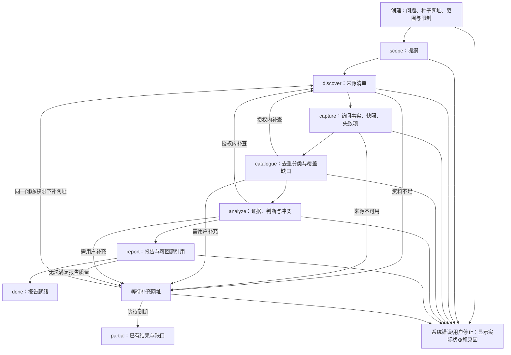
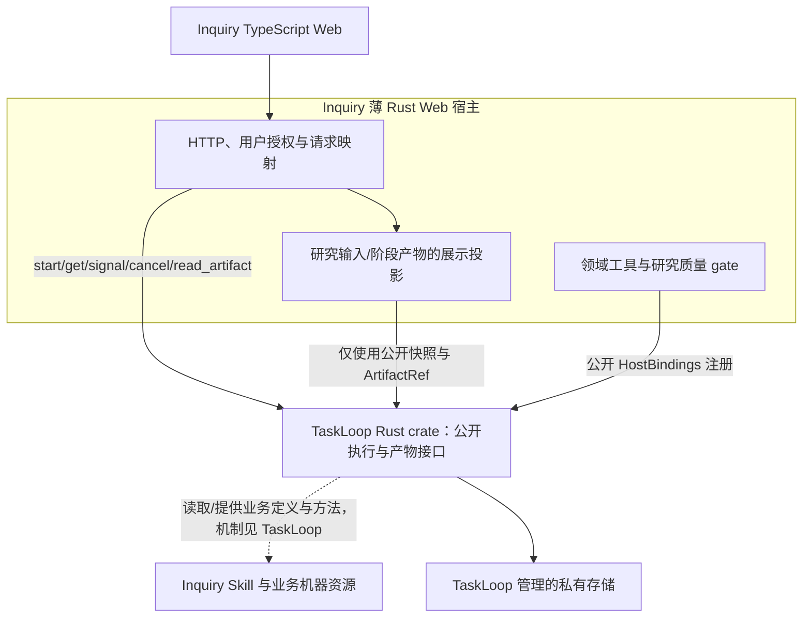
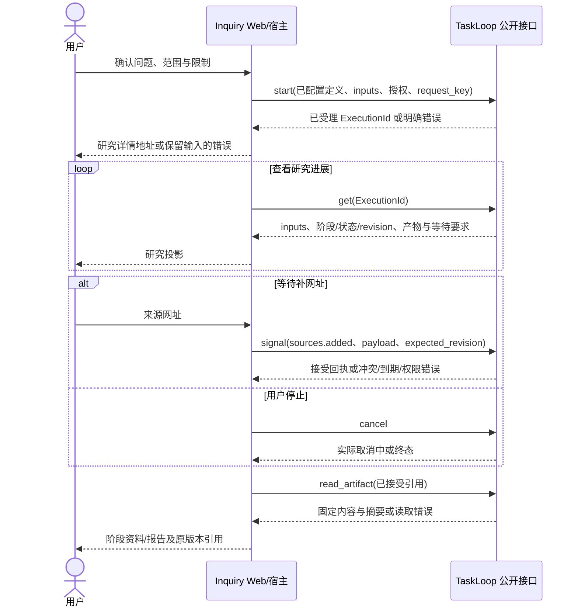

# Inquiry Issue #1：最小研究闭环与 TaskLoop 对接

> 本稿保留设计票的前置基线；实现票的当前规格与真实质量实验登记以 [Issue #2 L2](2-research-web-mvp.md) 为准。

| 项目 | 内容 |
|---|---|
| 版本 / 状态 | v0.5.0，2026-11-02，Draft；供人工评审，尚未实现 |
| 需求 | [Inquiry Issue #1](https://github.com/xforce-io/inquiry/issues/1)，S1–S4 |
| L1 基线 | [原评论中的 L1 v0.5.0](https://github.com/xforce-io/inquiry/issues/1#issuecomment-6555157047)；用户本轮确认收敛应用与框架职责 |
| TaskLoop 依赖 | [Issue #2](https://github.com/xforce-io/taskloop/issues/2) 的 [L2 v0.1.0](https://github.com/xforce-io/taskloop/blob/feat/2-minimal-runtime-contract/docs/design/2-minimal-runtime-contract.md)，协议 1，当前为设计提案 |
| 事实源 | 本文件为 Inquiry 唯一 L2；[contract](1-minimal-research-loop/contract/) 只含本应用业务资源与验证 |
| 术语 | [名词表](../glossary.md) |

L1: write v0.5.0（原评论）；L2: write v0.5.0。本轮不增加业务入口，收敛对 TaskLoop 的依赖和职责。旧 v0.4.x 中的通用推进、内部执行协议、存储/调度/恢复机制已由 TaskLoop Issue #2 承接，不能继续作为 Inquiry 规格。keel-how: skip: 无现成机制可讲；当前无应用或 Rust 运行时代码。

## 1 背景

最小研究闭环应先收集来源，再探活留存、整理、分析和生成报告。Inquiry 定义这些研究语义；TaskLoop 通过少量公开接口承载执行。此前将框架内的状态算法、执行标识、内部持久化与调度等写在本应用设计中，形成越界和双份事实源，本版撤回该组织方式。

本文件只规定用户路径、研究数据/方法/质量规则、应用接入和对框架的可观察要求。TaskLoop 如何实现隔离、事务、派发和恢复，仅见其自身 L2。所引用 crate 还未交付，不能把设计提案写成既有 SDK 或已通过产品测试。

## 2 名词解释

领域名词见[名词表](../glossary.md)。研究问题、资料、证据、判断、结论、报告是内容关系，不是六张强制数据库表。一期以初始输入和版本化 JSON/内容产物表达，不另建领域状态仓储。

ExecutionId 为 TaskLoop 的公开不透明标识。一期一项研究对应一个实例，研究 URL 直接使用它；不创建第二个业务执行标识或在两套存储间维护启动关联。未来项目、人工编辑或独立发布有真实需要时再引入应用对象，不提前建设关联补偿框架。

## 3 目标与非目标

目标：问题输入 → 研究提纲 → 来源发现 → 访问与留存 → 分类/缺口 → 证据/判断 → 报告可观察、可追溯；资料不足可有界补查或等待用户补来源；用户可停止；多个研究互不串扰。

技术边界：TypeScript Web、薄 Rust Web 宿主、TaskLoop Rust crate 同进程调用。宿主只负责 HTTP、授权、TaskLoop 接口转换与领域工具/gate 注册；研究方法在 Skill，阶段定义在 Playbook。应用不读取 TaskLoop 表、内部执行协议或 Worker，不维护第二套流程状态。

非目标：上传/PDF/OCR、研究图编辑、独立 Planner/动态模型路由、跨实例资料导入、人工编辑/发布/归档、多用户托管、外部业务写动作、独立 TaskLoop HTTP 服务、应用自建执行/恢复系统。框架内部的能力/算法不在本文扩写。

## 4 能力

### 4.1 UI/UX

只有创建页和研究详情页。创建页填写问题、可选种子网址、范围并确认允许的资源限制；没有资料也可以通过授权搜索开始。详情页顶部显示问题、实际阶段/技术状态和停止入口；主体为六阶段产物导航，选中后查看已接受清单/正文、失败来源与检查摘要。报告引用打开保存版本和位置，不直接用当前网页替代历史快照。

| 用户可见状态 | 反馈与允许操作 |
|---|---|
| 空 / 加载 | 空页提示创建；加载展示正在读取，不伪造阶段完成 |
| 输入错误 / 未受理 | 保留填写内容和 request_key，指出字段或授权/容量原因，可修正或同键重试 |
| 运行 / 检查中 | 显示框架报告的阶段与进度；正式面板只显示已接受产物，不用模型草稿覆盖 |
| 等待补充网址 | 展示缺口及来源表单；按当前 revision 提交；过期/冲突刷新后解释实际状态 |
| 阻塞 | 展示原因和保留结果，可取消；不提供原位恢复或“忽略检查继续”按钮 |
| 取消中 / 已取消 | 前者表示仍在确认停止，禁止显示已停止；取消完成后保留已有产物 |
| 完成 / 部分终点 / 失败 | 报告就绪、证据不足、执行失败分别显示；不把 completed 一律称为研究成功 |
| 查询暂时失败 | 显示可重试读取错误，不修改研究执行状态 |

### 4.2 主路径及分支

图定义本应用用户路径；精确阶段/分支见业务 bundle。停止、错误和阻塞不是业务 partial 的别名。改变问题、权限或完成标准须新研究，不通过补网址信号暗改目标。

### 4.3 研究阶段与业务结果

| 阶段 | 必需产物 | 领域规则与结果 |
|---|---|---|
| scope | plan | 明确子问题、搜索方向和停止原因；ready → discover |
| discover | candidates | 每条来源有发现途径与对应子问题，保留收集停止原因；ready → capture，need_input → 等待 |
| capture | materials、原始/规范化内容、获取事实 | 所有候选有处置；正文成功不能只看 HTTP 状态；ready → catalogue，need_input → 等待 |
| catalogue | catalogue | 去重分类、覆盖缺口；ready → analyze，need_more → discover，need_input → 等待 |
| analyze | analysis | 证据明确定位，判断关联支持/反驳证据并保留限制；ready → report，need_more → discover，need_input → 等待 |
| report | report | 结论和引用来自已接受证据，限制可见；ready → done，need_input → 等待 |

业务定义上限：最多 30 次正常转移、单阶段访问 3 次、24 次执行尝试，等待来源最多 24 小时且不得超过实例绝对期限。查询/获取/字节上限在宿主授权配置中固定并显示；这些数值约束“尽可能搜集”的范围，不承诺无限或穷尽全网。运行时如何落实限制属于 TaskLoop。

done 的业务结果为 report_ready，须有已接受 report；partial 为 insufficient_evidence，可无最终报告并保留缺口；failed 为执行失败。门禁通过意味着满足已声明评价标准，不保证世界事实永远正确。

## 5 思路与折衷

| 决定 | 原因与放弃项 |
|---|---|
| 研究方法/业务图/产物 Schema 归 Inquiry | 高内聚；放弃在框架内硬编码研究语义 |
| 框架五个公开操作与不透明标识 | 不接触内部表和调度；放弃复制通用 Runtime 或共享数据库迁移 |
| 一期研究标识即 ExecutionId，内容由输入/已接受产物投影 | 省去双标识与创建补偿，仍由 Inquiry 拥有业务 Schema；暂不满足独立发布/人工编辑 |
| 有界阶段产物与显式来源事实 | 比黑盒一轮调用多，但能查看中间质量和留存；放弃靠聊天“完成”判定 |
| 固定 Harness/模型配置，语义 gate 按需 | 先验证最小闭环；放弃多 Agent/自动路由平台和每步强制双模型 |

## 6 架构

### 6.1 应用分层与依赖边界

图只将 TaskLoop 作为依赖，不展开其 Worker、状态事务或恢复机制。PKG 是被读取的资源，不主动调用 TaskLoop。宿主中的领域工具/gate 是本地 Rust 回调或已受控程序；Skill 文案不能自己执行网络请求或获得权限。

若参照原七层：Inquiry 负责 L7 界面、L6 应用接入及领域资源/工具/规则；TaskLoop 封装 L5 执行控制及其以下的执行机制。层号不是七个服务，也不要求应用理解每个框架内部层。

### 6.2 主路径与失败交接

start 超时或响应丢失时，宿主保留原 request_key 并同键重试，拿到同一 ExecutionId；不先建第二个实例或创建应用状态表。get/读取失败只更新界面错误。TaskLoop 的内部保证、具体重启策略和执行停止协议均见依赖 L2，本应用只按其返回的状态展示。

## 7 模块与领域契约

### 7.1 形式与所有权

| 模块/资源 | 形式与职责 |
|---|---|
| Web | TypeScript 页面和 HTTP 客户端；不直接调用 crate 或读本地文件 |
| Web 宿主 | Rust 进程；HTTP/授权/接口转换，注册领域能力；无第二套阶段推进器 |
| Skill | 本仓库只读方法包，当前版本见 SKILL.md；说明阶段研究方法，不保存运行数据 |
| 业务机器资源 | research.bundle.json、业务 Schema；消费 TaskLoop 的格式，不在本仓库定义格式语言 |
| 研究工具 | inquiry.search / inquiry.fetch；真实查询、获取、规范化与获取事实，边界在 §7.3 |
| 领域 gate | 按入口检查真实来源/字节/证据与研究质量，返回 TaskLoop CheckResult；不写执行状态 |

一期包随 Inquiry 发布，宿主在配置中指定本地路径、版本和公开绑定。方法由 TaskLoop 提供给其执行 Agent；不为每个任务复制安装目录，不把整个包当应用服务。框架加载/挂载机制只引用 TaskLoop §6.2，不在此重述实现。

### 7.2 领域模型及留存关系

| 概念 | 一期表达与约束 |
|---|---|
| 研究问题 | 原始 inputs.question/scope/seed_urls，确认后不可被补网址覆盖 |
| 资料 | candidates 的来源标识/发现关系，materials 的处置及保存内容，原始/规范化版本各有摘要 |
| 证据 | analysis.evidence：本次分析内唯一 ID、已保存内容 Artifact ID/摘要、段落和引文 |
| 判断 | analysis.judgments：文本、support/counter 证据 ID、限制；每个引用必须解析到同一 analysis 的 evidence |
| 结论 | report.conclusion；必须能由已接受判断和证据支持，缺口不得伪装消失 |
| 报告 | answer_status、conclusion、citations、limitations；每条 citation 对应已接受 analysis 的证据，且可回溯具体保存内容 |

原始内容和规范化内容均保留，规范化版本记录转换工具/版本和输入输出摘要；纯文本可复用同一字节。段落按保存的 UTF-8 规范化文本以空行（\n\n）分割、从 0 编号；引文必须是对应段落的原文片段。报告定位该版本并可回溯原始获取事实。新一轮补查不会改写旧内容或旧报告；latest/all 的业务选择在 bundle 声明。

### 7.3 搜索/获取事实与业务门禁

inquiry.search 保留真实查询、发现来源与停止原因；inquiry.fetch 对候选逐条实际获取或记录授权/预算/访问失败原因。限制 HTTP(S)、重定向、目标网络、请求次数/大小，禁止读内网和宿主凭据。网页内容和工具输出按数据处理，不能升级成宿主指令。

本应用的[获取事实 Schema](1-minimal-research-loop/contract/acquisition-fact.schema.json)只定义来源、请求/最终 URL、时间、访问结果、原始/规范化摘要、转换版本与可用性。实例/执行/工具来源关联由 TaskLoop 的 ArtifactReceipt 提供，不在业务 payload 里重复定义 run_id。Agent 填一个 HTTP 200 不能成为可信事实；领域 gate 从受信事实接口取得数据，而非相信候选自填回执。

| 门禁 | 业务要求 |
|---|---|
| scope/discover | 问题不被换掉；子问题/查询可解释；来源有发现途径和对应子问题；无来源时给出 need_input 而非伪造来源 |
| capture | 每个候选有实际处置；获取事实与保存字节/摘要一致；HTTP 成功但无正文不可称可用；全部不可用时 need_input |
| catalogue | 去重/分类和覆盖缺口可解释；need_more 在已授权范围；需要用户信息时 need_input |
| analyze | evidence 唯一且定位确切字节；support/counter 全部解析；ready 至少有证据和判断且每条判断有关联证据；支持/反驳和限制不被遗漏或虚构；缺口选择需可说明 |
| report | answered 的引用非空并来自已接受 analysis；引文/摘要/段落与快照一致；论证充分性和限制按已声明评价策略判断 |

字段/引用关系可程序检查；相关性、覆盖和论证质量按业务 rubric、独立模型或人工评价，方法/版本/证据必须可见。只有格式检查时，界面必须如实说明质量保障范围。生成者自评不冒充独立评价；业务不返回目标状态，只返回 CheckResult 的有限 outcome，实际推进由框架负责。

## 8 API/CLI 与对接需求

### 8.1 对 TaskLoop 的唯一依赖面

| 需求 | 使用方式 | TaskLoop 承诺 / 验收 |
|---|---|---|
| D1 接收并查询研究 | start/get；定义/授权由宿主选择；inputs 原样保存 | L2 §6.2/§8.1，T1/T5/T6；未落盘不能返回成功，重试不创建重复研究 |
| D2 挂载研究能力与质量检查 | 公开 HostBindings；业务包提供当前方法、输入输出 Schema 和 gate | §6.2/§7.2–7.3，T1/T2；不要求应用接触内部适配提交协议 |
| D3 补来源和停止 | signal(sources.added)、cancel | §8.2/§9，T3/T4/T5；等待/冲突/到期/取消中可观察 |
| D4 展示与回溯产物 | get 的 inputs、current_state、status、revision、business_outcome、waiting_signals、accepted_artifacts；read_artifact | §8.1，T2/T5/T6；产物引用含 state_id/visit/slot/摘要，不反查内部 Task/Run |
| D5 多研究和故障边界 | 只依赖上述操作和错误/状态，不访问内部执行数据 | §9/§11，T3/T4；独立状态/会话/产物、保留已接受事实，未知执行不被自动重复 |

除上述公开调用和宿主初始化外，无 TaskLoop HTTP、内部表、内部调度/事件投递、恢复信号、执行代数或进程控制依赖。通用 Schema 与语义仅认 TaskLoop；本应用不复制或修改其协议。真实适配器选型和能力证明由 TaskLoop 负责，Inquiry 对接验收确认能满足 D1–D5。

### 8.2 Inquiry HTTP 接口

| 接口 | 请求与映射 | 可观察结果 |
|---|---|---|
| POST /api/research | {request_key, inputs, limits?}；inputs 按 research-input 校验；宿主补定义/授权和有效限制后调用 start | ExecutionId 即研究 id 和详情地址；请求未受理保留输入；响应丢失同键重试 |
| GET /api/research/{id} | 归属/授权校验后 get | 公开快照和领域展示投影；不包含内部数据库/执行协议 |
| POST /api/research/{id}/sources | {request_key, expected_revision, payload}；payload 为 {urls, reason}；固定 event_name=sources.added | 接受或明确冲突/到期，不能传任意事件、目标状态或改问题 |
| POST /api/research/{id}/cancel | {request_key} → cancel | 实际 cancelling 或终态，不以 HTTP 受理代替停止确认 |
| GET /api/research/{id}/artifacts/{artifact_id} | 归属/授权校验后 read_artifact | 固定内容、摘要与位置；不接受任意路径 |

宿主为单用户工作区提供可信调用者上下文，鉴权不接受 JSON 中的 actor 字符串自证。输入错误 400、无权按宿主策略拒绝、幂等/版本冲突 409、容量满 429、暂时不可用 503；稳定原因码取 TaskLoopError。get/读取暂时失败不渲染成执行失败。前端轮询公开快照，先不引入 WebSocket/订阅服务。

### 8.3 版本与依赖锁

Rust 后端通过 Cargo 直接依赖 TaskLoop；接入时固定经真实 Rust/Harness 验证的完整 Git SHA 与 Cargo.lock。当前 TaskLoop 仅交付设计，尚无可填写的可用 crate SHA；设计链接不是运行时版本，集成不得以“模型通过”代替构建/验收。

业务 bundle 使用 TaskLoop 协议 1，`task-input.schema.json` 是其公开保留内建引用，本目录不复制它；其余业务 Schema 本地随包发布。业务输入/证据格式与 Skill 有自己的版本，框架负责锁定本次闭包。能力/协议不兼容时启动失败；应用不读框架表做兼容补丁。

## 9 边界

业务状态名、补查条件、等待网址 payload、报告质量与来源真实性属于 Inquiry。通用状态解释、产物接受/执行关联、私有存储、幂等与恢复算法属于 TaskLoop；TaskLoop 如何做到不在本稿规定。Harness 推理/工具循环由框架适配复用。

一期业务数据以原始 inputs 和已接受版本化产物保存，物理存储由 TaskLoop 封装；这不把研究 Schema 所有权交给框架。Inquiry 只维护可重建展示投影，不另建同步权威或共享连接；以后独立业务存储通过公开 ID/产物关联，不能依赖框架内部表。

TaskLoop 拒绝或阻塞时宿主如实显示；Inquiry 不直接修表、推进阶段、强制 pass 或重启内部执行。需要改变目标/权限/质量标准时新建研究。所有研究工具和质量规则由 Inquiry 测试，不将领域判断正确性甩给框架。

## 10 迁移、兼容与回滚

当前无产品数据，无运行时迁移。v0.4.x 的通用 Schema、推进模型/轨迹、第二业务样例已迁到 TaskLoop Issue #2；Git 历史保留旧稿，不保留另一份生效通用规格。Inquiry 仅保留研究 bundle/Schema/Skill 和领域验证，获取事实移除内部 run_id，analysis 明确 evidence 与判断关联。

原先“研究对象 ID → ExecutionId”的双标识设计撤回；一期直接使用公开 ExecutionId，原双库/关联恢复与 Worker 细节不构成依赖。本版没有生产数据，未来确需独立对象时另行设计映射和迁移。

升级业务包和框架先验协议/依赖兼容，不热改活动研究；旧报告和快照可读。回滚复用框架公开生命周期操作，不能由应用修改私有存储。版本不识别时拒绝，不猜测映射。

## 11 测试计划

| ID / Story | 入口与情形 | 可判定结果 | 层级与证据边界 |
|---|---|---|---|
| I1 / S1 | Web 创建、查看六阶段和报告 | 用户可查看每阶段已接受产物，报告引用回到保存内容 | E2E；真实 UI/crate/Harness not_run |
| I2 / S1 | 来源不可用、覆盖缺口、补网址、冲突/到期、停止 | 补查/等待/部分终点可区分，未确认停止不显示已停止，查询错误不改执行状态 | E2E；确定性边界 fixture 与真实取消分开验收，当前 not_run |
| I3 / S2 | 来源/字节/获取事实、evidence/判断/报告引用正反例 | 无正文不算可用，证据唯一且定位正确，悬空支持/引用拒绝，限制保留 | Unit：本应用领域见证；真实网页解析/语义质量不由 Schema 证明 |
| I4 / S3 | 宿主仅使用 D1–D5，响应丢失同键重试，A/B 交错研究 | 无重复研究，无读表/内部调度，展示信息仅从公开快照/产物取得 | Integration + E2E；TaskLoop T1–T6 是依赖前置，真实接入 not_run |
| I5 / S4 | 逐项检查资源所有权、公开接口、依赖锁与验收映射 | 通用机制只在 TaskLoop；D1–D5 全部有对应承诺，不将设计提交冒充 crate | 文档走读 + Unit 静态契约检查；设计复核记录见关联 |

[领域见证](1-minimal-research-loop/contract/verify_research_contract.py)只校验业务 Schema/来源/证据关系，不再包含通用状态推进器。框架模型结果在 TaskLoop 单独维护，不能当 Inquiry 已跑通。真实研究质量需要固定问题集、引用真实性与相关性、覆盖/反证/限制评价，并记录评价方法；本次未运行真实研究。

## 12 开放问题与推进门槛

已定：研究包/业务 Schema/gate 属于 Inquiry；五个公开框架操作；无需额外 TaskLoop 服务或应用执行状态表；一期六阶段、网址输入、有界补查与等待、单用户、固定模型配置。

实现前置：TaskLoop Issue #2 的真实能力探针和最小 Rust crate 交付；它必须证明方法与输入可见、受限工具/候选交接、取消、多实例隔离及故障边界。Inquiry 只通过集成测试确认承诺，不代替设计该机制。检索/抓取供应方、规范化组件与语义 gate 策略需实测后锁定；失败先修适配/业务策略，不降低门禁冒充成功。

顺序：两份设计人工评审 → TaskLoop 能力探针/最小交付 → Inquiry 单条研究闭环接入 → I1–I5 与研究质量评估 → 固定真实依赖。当前停在设计交付，不开始产品实现。

## 13 ADR 与关联

| ADR | 决定 / 放弃项 |
|---|---|
| 01 | Inquiry 定义研究行为与质量，TaskLoop 封装运行机制；放弃在应用中维护通用框架规格 |
| 02 | 薄 Web 宿主 + Rust crate；放弃额外执行服务与应用自建调度 |
| 03 | 一研究一 ExecutionId，输入/产物构建投影；放弃一期双标识、第二状态表和关联补偿 |
| 04 | 工具获取事实与内容证据可追溯，业务 gate 自负语义；放弃 HTTP 成功/格式正确等于研究正确 |
| 05 | 当前阶段方法由框架提供，包只读；放弃 Skill 主动调用 Runtime、包目录保存任务状态 |

均为 Proposed。关联：[原 L1 评论](https://github.com/xforce-io/inquiry/issues/1#issuecomment-6555157047)、[TaskLoop Issue #2](https://github.com/xforce-io/taskloop/issues/2)、[领域资源](1-minimal-research-loop/contract/)、[本轮设计复核](1-minimal-research-loop/review.md)。
