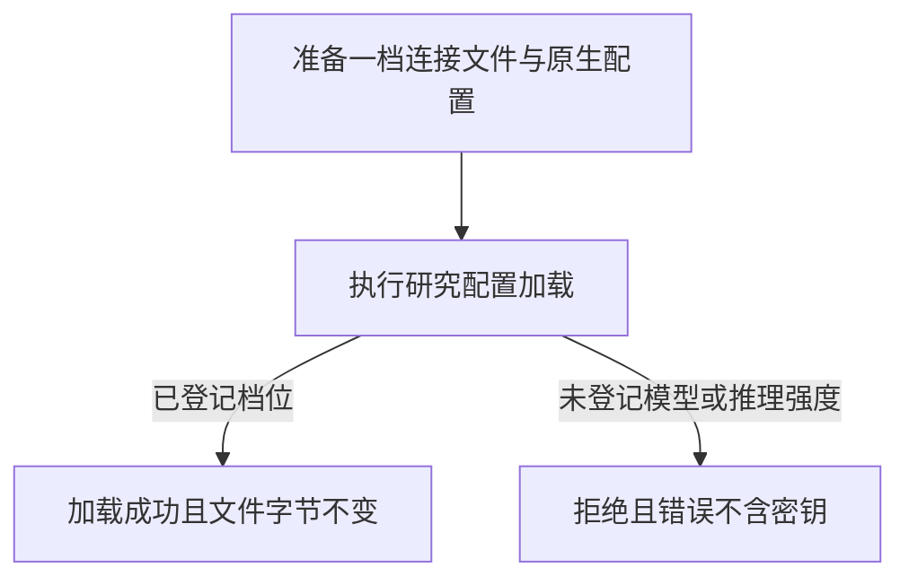
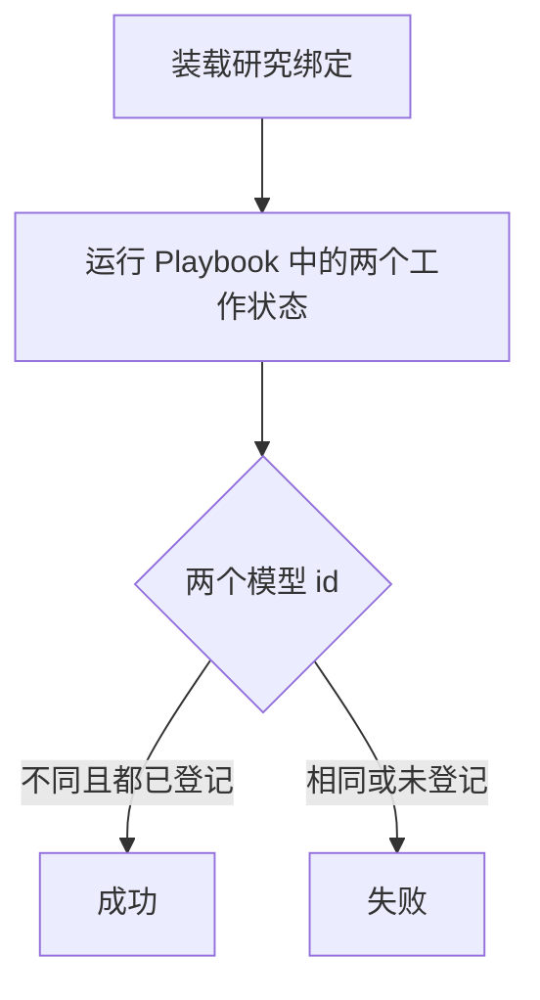

# 不同工作状态使用各自登记的模型档位

- Issue: [#11](https://github.com/xforce-io/inquiry/issues/11)
- 状态: Draft
- 版本: v0.1
- 确认来源: 本会话目标的验收标准。用户要求创建本 Issue 并完成开发、测试、审查与合并。本文不自批 Approved。
- 技术设计: [technical.md](technical.md) v0.1
- 关联: [#12](https://github.com/xforce-io/inquiry/issues/12)

## 1. 背景与目标

一次研究的工作状态共用一个模型与一个推理强度。分析与其余工作状态的工具调用预算已经分开，模型没有分开。

可观察目标：已登记的两档都能加载且四份配置文件不被改写；同一次 Playbook 中至少两个工作状态解析到两个不同的已登记模型 id；未登记模型与未登记推理强度被拒绝且错误不含密钥正文；分析预算仍为 80，另一工作状态仍为 40。

## 2. 范围与非目标

交付：加载接受登记集合中的每一档；Playbook 按工作状态绑定档位。

非目标：同一状态因题目更难而改档（[#12](https://github.com/xforce-io/inquiry/issues/12)）；TaskLoop 判断难易或在流程 schema 上增加模型字段；第三轮质量实验；把公共 `grok-4.7` 当作 Grok 4.7 Fast；改分析 80 次或其余工作状态 40 次；改写封存实验记录。

宿主事先准备连接文件与专用原生配置。Inquiry 只检查，不改写，也不复制登录。

## 3. 用户与产品概念

开发者准备配置并装载研究。使用者不在页面上挑选模型。

模型档位见 [名词表](../../glossary.md)。较高档是 `gpt-6.1-sol` 与 `high`。较低档是 `gpt-6-astra` 与 `medium`。

## 4. 产品交互总览

无新页面。配置加载与 Playbook 绑定是开发者路径。

## 5. 信息架构与入口

入口是研究配置加载，不是网页菜单。一次加载读取一份执行配置、一份连接文件和一份专用 `config.toml`。两档各加载一次。示例连接仍是较高档。

## 6. Stories 与完整交互

### S1. 两档配置都能加载

单步加载，无分支图。角色是开发者。前置是两档均已登记，连接文件与原生配置分别写明模型 id 与推理强度。触发是对每一档执行配置加载。成功是该档加载成功。异常是文件被改写，则本 Story 失败。读回两份连接文件和两份原生配置，字节与加载前一致。

### S2. 两个工作状态使用不同模型

角色是开发者。前置是 Playbook 已把至少两个工作状态分别绑到 S1 的两档。触发是用已装载绑定运行这两个状态。成功是读到两个不同的已登记模型 id。

### S3. 未登记的模型或推理强度被拒绝

单步校验。角色是开发者。前置是登记集合只有 S1 的两档。分别用未登记模型、未登记推理强度加载。两次都拒绝。文件字节不变。错误信息不包含配置中的密钥正文。

### S4. 工具调用预算不随档位改变

单步读取。角色是开发者。前置是工作状态已按 S2 绑定。分析的工具调用预算是 80。另一个工作状态是 40。

## 7. 产品规则与边界

- R1：登记集合只有较高档 `gpt-6.1-sol/high` 与较低档 `gpt-6-astra/medium`。
- R2：加载不改写连接文件和专用原生配置。
- R3：提供 `codex_binary` 且模型为较高档时，私有启动器对子进程注入 `high`，配置文件可以写 `medium` 且不被改写。
- R4：未登记模型（含公共 `grok-4.7`）与未登记推理强度都拒绝。错误不含密钥正文。
- R5：分析预算 80，其余研究工作状态 40。档位不改变预算。
- R6：Playbook 默认把分析绑到较高档，其余工作状态绑到较低档。

## 8. 验收与效果验证

| ID / 关联 | 前置 | 路径 | 结果与禁止行为 | 证据 / 执行 / 属性 |
|---|---|---|---|---|
| S1.A1 / S1 / R1 R2 | 两档的连接文件与原生配置已写好 | 对较高档加载，再对较低档加载，然后读回四份文件 | 两次加载成功。四份文件字节不变。不改写配置 | `cargo test --locked --offline --test execution_config registered_tiers_load` 的通过记录。agent 可执行。必需 |
| S2.A1 / S2 / R1 R6 | Playbook 已绑定两档 | 用已装载绑定运行分析与另一个工作状态，读取模型 id | 两个模型 id 不同，且都在登记集合内 | `cargo test --locked --offline --test tier_binding`。agent 可执行。必需 |
| S3.A1 / S3 / R4 | 登记集合只有两档，配置中含密钥正文 | 用未登记模型加载；用未登记推理强度加载 | 两次拒绝。文件不变。错误不含密钥正文 | 同上 execution_config 测试。agent 可执行。必需 |
| S4.A1 / S4 / R5 | 状态已绑定不同档位 | 读取分析与另一工作状态的工具调用预算 | 分析 80，另一状态 40 | tier_binding 测试读取预算表。agent 可执行。必需 |

验证对象是配置加载的返回与文件字节、Playbook 绑定解析出的模型 id、预算数字。通过的测试名不能代替这些断言；断言在测试源码中。不把网页 Trace 路径当作本 Issue 的模型验收。

## 9. 折衷与开放问题

放弃把公共 `grok-4.7` 或 Grok 4.7 Fast 放进登记集合。放弃在 TaskLoop 流程上增加模型字段。单连接的文章编排仍使用调用方提供的那一档执行器；研究 Playbook 的档位绑定不改文章图的调用次数。

较低档是否能在当前 Codex 上实际跑通，留给真实执行。加载成功只证明配置被接受。
