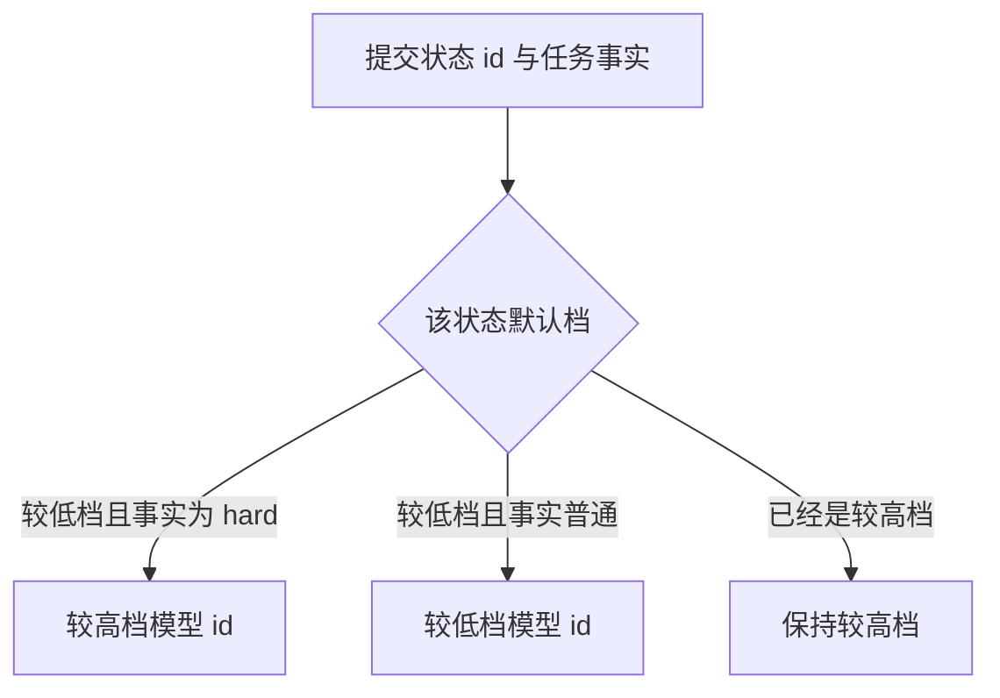

# 同一状态按任务难易选择已登记模型档位

- Issue: [#12](https://github.com/xforce-io/inquiry/issues/12)
- 状态: Draft
- 版本: v0.1
- 确认来源: 本会话目标的验收标准。用户要求创建本 Issue 并完成开发、测试、审查与合并。本文不自批 Approved。
- 技术设计: [technical.md](technical.md) v0.1
- 关联: [#11](https://github.com/xforce-io/inquiry/issues/11)、[其产品设计](../11-state-model-tiers/product.md) v0.1

## 1. 背景与目标

工作状态有了默认档位之后，同一状态仍会一直使用默认档。更难的题目无法改用已登记的较高档。

可观察目标：默认较低档的一个工作状态，在任务更难时得到较高档；普通任务仍得到较低档；选择结果只是已登记档位 id，TaskLoop 流程 schema 没有难易判断，也没有模型字段。

## 2. 范围与非目标

交付：Inquiry 按任务事实为同一状态改选另一已登记档位。

非目标：改分析 80 次或其余工作状态 40 次；把难易判断放进 TaskLoop；在 TaskLoop 流程 schema 上增加模型字段；第三轮质量实验。登记集合沿用 [#11](https://github.com/xforce-io/inquiry/issues/11)，不新增第三档。

## 3. 用户与产品概念

开发者提交状态 id 与任务事实。使用者不单独选择档位。任务事实里的 `difficulty` 只接受 `ordinary` 或 `hard`；缺省视为普通。模型档位见 [名词表](../../glossary.md)。

## 4. 产品交互总览

无新页面。

## 5. 信息架构与入口

入口是研究绑定上的档位选择，不是新的网页。研究输入可以带可选 `difficulty`。冻结的旧研究问题不带该字段，仍走状态默认档。

## 6. Stories 与完整交互

### S1. 更难的任务改用较高档

单步。角色是开发者。前置是该工作状态默认较低档，较高档已登记，任务事实标明更难。提交这一个状态 id 与事实。读到的模型 id 是较高档，不是默认较低档。定量是 1 个状态。

### S2. 普通任务保持默认档

单步。同一状态，任务事实没有标明更难。读到的仍是默认较低档。定量是 1 个状态。

### S3. 难易选择留在 Inquiry

单步核对。选择结果只是一个已登记档位 id。TaskLoop 流程定义拒绝额外的难易字段和模型字段。定量 N/A。

## 7. 产品规则与边界

- R1：只有任务事实 `difficulty` 等于 `hard` 时，默认较低档的状态改选较高档。
- R2：缺省、`ordinary` 或其他值都不升级。
- R3：默认已经是较高档的状态不因事实而改到较低档。
- R4：选择不改变工具调用预算。
- R5：TaskLoop 流程 schema 不增加难易判断，也不增加模型字段。

## 8. 验收与效果验证

| ID / 关联 | 前置 | 路径 | 结果与禁止行为 | 证据 / 执行 / 属性 |
|---|---|---|---|---|
| S1.A1 / S1 / R1 | 一个状态默认较低档 | 用该状态 id 与 `difficulty=hard` 运行已装载绑定 | 记录较高档模型 id。只观察这 1 个状态升级 | `cargo test --locked --offline --test tier_binding`。agent 可执行。必需 |
| S2.A1 / S2 / R2 | 与 S1 同一状态 | 用不含更难标记的任务事实再运行 | 记录默认较低档。1 个状态保持 | 同上。agent 可执行。必需 |
| S3.A1 / S3 / R5 | S1 与 S2 已能调用 | 核对选择结果，并向 TaskLoop 流程定义写入难易字段和模型字段 | 结果只对应已登记档位。两处写入都被流程 schema 拒绝 | 同上。agent 可执行。必需 |

## 9. 折衷与开放问题

放弃按多个难度级别逐级换档。放弃让 TaskLoop 读取难易。文章问题 schema 不增加 `difficulty`，因此文章编排不因该字段改档。
