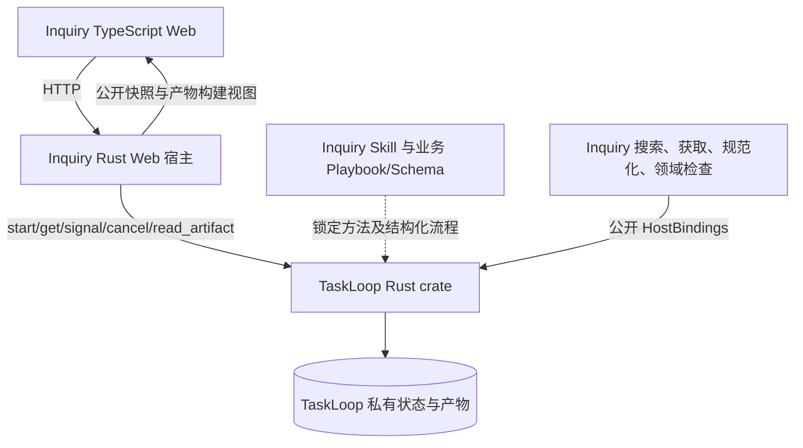

# Inquiry Issue #2：真实研究 Web 与质量实验

版本：v0.1.0；状态：实现前草案，实验协议在任何研究/基线报告生成前登记。当前只准备设计，不提前启动产品实现。
需求：[Issue #2](https://github.com/xforce-io/inquiry/issues/2)。L1 reuse：[Issue #1 L1 v0.5.0](https://github.com/xforce-io/inquiry/issues/1#issuecomment-6555157047)，加本次用户明确要求真实研究质量对照与 computer use 验证；L2 write：本文件为实现票唯一 L2。前置领域设计见 [Issue #1 L2 v0.5.0](1-minimal-research-loop.md)，历史稿保留，不作为第二份实现规格。

## 1 背景

设计阶段已确认六阶段研究、TypeScript Web、薄 Rust Web 宿主和 TaskLoop crate 直连。本票交付真实产品，证明来源与报告连通，并用固定问题验证研究质量。TaskLoop 当前候选仍在交付门禁中，不能把未合入提交写成已交付依赖。

## 2 名词解释

沿用[名词表](../glossary.md)。研究状态由 TaskLoop 保存；资料、证据、判断及报告是 Inquiry 的业务产物。评价报告内容的盲评与代码独立审查是不同活动，不能互相代替。

## 3 目标与非目标

目标：用户提交问题后，真实收集、探活、留存、整理与分析，得到可回溯报告；资料不足、阻塞、取消和成功有清楚反馈。最小产品只提供创建与详情两类页面。

非目标：上传/PDF/OCR、多用户托管、人工编辑发布平台、独立 Planner/动态模型路由、第二套执行状态机、TaskLoop HTTP 服务、未经授权的公网部署。研究质量通过实际实验判断，不预先宣称高于所有模型。

## 4 能力

### 4.1 UI/UX

创建页以问题输入和“开始研究”为主要操作，可选网址与范围收起展示；开始前可见实际资源限制。未受理时保留填写内容与幂等键，显示可操作错误。

详情页顶部保留问题与生命周期状态。研究过程中以六阶段导航呈现当前工作和已接纳产物；报告就绪后默认阅读结论，仍可查看过程。引用打开同页来源面板，定位保存版本的段落并高亮短引文；关闭后保持报告阅读位置。刷新从公开快照恢复，不以浏览器内存伪造已完成阶段。

| 状态 | 可见反馈与恢复 |
|---|---|
| 空/加载 | 创建入口或读取中；不伪造进度 |
| 运行/检查 | 当前阶段、已接纳内容、停止入口；草稿不冒充正式产物 |
| 等待资料 | 显示缺口及网址表单；提交带当前 revision，冲突后刷新解释 |
| 阻塞/失败 | 显示实际原因并保留已有产物；阻塞可停止，改变目标须新建研究 |
| 取消中/已取消 | 等待确认与确认完成分开，不把受理等同停止 |
| 报告就绪/证据不足 | 完整报告与部分结果分开，不把 completed 一律叫成功 |
| 暂时读取失败 | 保留上一可见内容，提供重试，不改变执行状态 |

不提供框架配置、内部执行标识或数据库操作界面。技术元数据仅在有助于来源版本核对时呈现。

## 5 思路与折衷

- 使用五个公开业务操作与 HostBindings；放弃额外执行服务及应用状态表。
- Skill 给研究方法，Playbook 给业务阶段与分支；应用只提供领域工具/检查和视图，不再实现调度。
- 一期固定模型配置，检索/获取是实际工具调用；放弃动态模型选择和模拟报告。
- 引用一致性和论证质量分别评价；格式及精确引文检查不冒充独立语义评审。
- 网页留存私有，公开实验报告只发布必要短引文、来源链接、摘要与评分；不把完整第三方网页提交到公开仓库。

## 6 架构

主路径：创建 → scope → discover → capture → catalogue → analyze → report → 报告及保存来源。catalogue/analyze 可有界返回 discover；资料不足进入等待，补网址后继续；等待到期为部分结果。

失败路径：来源失败保留处置，不能伪造可用；检查拒绝/不可用按框架结果显示；查询失败仅影响显示；停止后等真实确认。通用推进、事务、恢复与执行器内部只在 TaskLoop 讨论。

## 7 模块与领域契约

Web 负责输入和阅读；Web 宿主负责 HTTP/可信调用者、公开接口转换和领域能力注册；研究方法、业务 Schema 与质量规则归 Inquiry。

六阶段沿用前置设计：plan、candidates、materials、catalogue、analysis、report。原始/规范化字节留存，证据用 Artifact ID、SHA-256、从0开始的段落及原文片段定位。判断显式关联支持、反驳和限制，报告只引用已接纳分析证据。

采集阶段产生动态快照附件。后续所需捕获产物通过公开 Requirement 的 `include_attachments: true` 显式授权，仅消费所选生产访问；不绕过工具桥读文件。该能力须由最终已验证 TaskLoop 提交提供。

获取事实必须进入可读取的已接纳业务产物，供页面展示请求/最终网址、时间、可用性与内容版本。materials 可携带领域获取事实；领域检查逐项比对当前受信工具回执与真实字节，接纳后才能作为展示依据。应用不新增读取 TaskLoop 私有回执或表的接口。

## 8 API/CLI 与依赖

沿用既定 HTTP：POST /api/research、GET /api/research/{id}、POST .../sources、POST .../cancel、GET .../artifacts/{artifact_id}。一研究一 ExecutionId；幂等键、revision 和错误按公开契约传递，不另造状态。

宿主构造单用户可信身份，不接受 JSON 自报 Caller。产物路径必须属于该研究公开快照中的引用；同一主体的其它研究也不能经错误的研究路径混读。仅监听本地工作区，校验 Host/Origin，使用同源安全会话；具体配置在运行说明中固定。

网络工具只支持受限 HTTP(S)，每跳校验目标网络与 DNS，禁止内网/环回/保留地址、凭据 URL 和任意协议；限制重定向、并发、时长与字节。代理环境也须保持最终目标 IP 约束，不能仅在本地检查域名后交给代理重新解析。失败按真实原因留存。

Cargo 固定最终经 TaskLoop 审查/CI/合入的完整 SHA 与 Cargo.lock。当前候选不是已交付依赖，接入前不得编造可用版本。除公开初始化及五操作外，不依赖内部 Worker、表或调度。

## 9 边界

Inquiry 决定研究内容、来源处理及业务质量；TaskLoop 决定实例执行与合法状态提交；Agent 只完成当前阶段并交候选。已接纳内容是展示事实源，应用投影可重建。

模型输出和网页内容均是不可信数据。报告 Markdown 不执行 HTML/脚本或自动加载任意远程资源；来源面板显示安全文本。引用校验通过只证明定位和版本一致，不保证所有判断必然正确。

## 10 迁移、兼容与回滚

N/A：无既有产品数据或运行服务迁移。发布前固定业务包版本和依赖；不热改正在运行的研究。旧内容读取与版本不识别行为须测试。无公网部署目标；本地运行说明不等于生产部署授权。

## 11 测试与实验预登记

### 11.1 产品验证

| Issue | 必需结果 | 验证层级及证据 |
|---|---|---|
| S1 | 真实六阶段闭环、报告及保存来源回溯 | E2E：真实 Web/crate/Harness；记录候选、研究ID、实际工具事实与 computer use 路径 |
| S2 | 获取事实/保存版本/引用负例拒绝，网络边界无越权 | Unit / Integration：真实解析与受控服务器反例；E2E：实际公开来源获取及引用回溯 |
| S3 | 两研究隔离，同键重试、补网址、冲突/到期、停止与刷新明确 | Integration + E2E；确定性边界与实际停止分别记账，不以模拟冒充真实 |
| S4 | 以下固定研究对照达到已登记阈值 | E2E：真实报告、真实基线、独立盲评、引用/事实核对与原始失败记录 |
| S5 | 两类页面、七类主要操作顺畅，无阻断使用问题 | E2E：最终候选 computer use 实际驾驶；截图、状态及保存结果对应；完整状态的确定性测试单独记录 |

实现期间须建立 `.agents/skills/verify-inquiry/SKILL.md` 和功能地图，覆盖 S1–S5 后才能交接驾驶验证。当前尚未实现、未执行，不能写 pass。独立代码审查、CI、人工门和合入仍为交付必经步骤，不要求它们在启动自身之前已经完成。

### 11.2 固定 demo 与报告条件

固定问题：**截至实验启动时间，一个5人SaaS团队应如何选择 Playwright、浏览器 Agent 或混合方案，以在未来8周提高浏览器任务自动化的可靠性，同时控制成本和权限风险？**

共同背景：现有 TypeScript/React、GitHub Actions，每周两次发布，30条关键浏览器流程，无专职测试人员；既有可控产品页面，也有偶发变化的第三方后台。报告需区分自有产品回归与第三方操作，不能把工具层与 Agent 决策层误当互斥选项。

必须回答：适用边界与失败模式、可靠性证据及其局限、运行/维护成本、权限与人工介入、最小架构、8周试点与退出/验收条件。成本估算标明假设；测试/厂商基准不能直接冒充生产成功率。目标报告长度为3000–5000中文字符，明显超出须如实记录，不能用长度差异制造优势。

在首份报告生成前，把相同问题、背景、截止时间、长度约束和完整提示词写入不可变实验目录并记录摘要。当前尚无研究或基线报告；此前模型探针仅回复 OK，不构成实验样本。

### 11.3 模型和顺序

直接生成基线固定为 `gpt-6-astra`，不允许提供方模型回退；官方[模型说明](https://developers.openai.com/api/docs/models/gpt-6-astra)将其定位为最强能力模型，实际账号访问已做无报告探针。正式实验使用 max 推理配置；若不可运行，应记录受阻，不换弱模型凑通过。

基线允许一次完整推理并按共同提示词生成报告，不提供研究工具、研究中间产物或人工纠错。提示要求区分事实、估算与未知，不编造引用。生成3份独立直接报告，均保留；比较采用其中评分最高者，不能挑最弱样本。

先通过真实产品固定第一份研究报告，再生成并封存基线，避免第一份研究借用基线内容。研究模型及推理配置、全部工具/阶段/补查、耗时和可得用量另记，不声称计算量相同。若研究迭代改进，保留每版失败、Skill/代码版本和输入摘要，不把最后一版说成首次即成功。

### 11.4 独立盲评与阈值

报告去除模型、方法及运行身份，保留影响质量的正文、引用和限制，以随机编号和顺序交给两个独立上下文评分。评价者不得读取研究实现对话、报告生成上下文或先前分数；使用两个明确记录的评价模型/配置，不冒充人工专家。

| 维度 | 分值 | 判断依据 |
|---|---|---|
| 事实准确性 | 25 | 关键技术/权限/可靠性主张可核对，估算与未知不冒充事实，无重大错误 |
| 证据质量 | 20 | 来源适用且一手优先，引文/链接实际支持主张，限制和反证保留；数量不独自决定分数 |
| 覆盖 | 20 | 回答全部共同问题与团队背景，区分回归与第三方任务，不遗漏决定性约束 |
| 推理与折衷 | 15 | 结论由证据推出，解释替代方案、失败边界、冲突和选择条件 |
| 可执行性 | 15 | 最小架构、8周安排、量化试点、成本假设、人工介入和退出条件具体可用 |
| 清晰度 | 5 | 结论易找，结构简洁，信息密度高，限制可理解 |

每份评价必须提供各维分数、关键缺陷及对应正文/来源位置，不能只给总分。两位评价的均分为报告总分；任一指出重大无依据结论或重大事实错误，先逐条审计，不得仅靠平均分掩盖。

通过条件同时满足：Inquiry均分≥85/100；相较3份基线中最高均分至少高15分；两位评价者均认为Inquiry优于该基线；无经审计确认的重大无依据结论；至少12条有效引用覆盖8份一手来源文档。引用逐条核对保存版本/原文和主张支持关系；基线引用也应实际核对，不能因其未出现在研究资料包中便判伪造。

这里的“显著”是事先声明的15分质量差距；单个主题、两次模型评价不足以声称统计显著或普遍超越所有SOTA。最终结论只能覆盖本主题、这些报告及记录的基线条件。未达阈值如实记 fail，不改权重、问题或阈值，不能隐藏失败尝试。

### 11.5 实验产物与信息边界

保留：预登记提交/提示词及摘要、实际模型与日期、原始报告、匿名映射（评分完成后揭示）、两份原始评分、逐条事实/引用核查、全部研究尝试与版本、模型/工具运行记录、最终对照结论。

公开材料仅含报告、必要短引文、链接/摘要和可公开评分；原始网页留存、私人运行目录及凭据不提交公开仓库。短引文按来源累计控制，避免大段复制。未知用量保持 unknown，不补零；不把模型运行次数当作上游请求次数。

## 12 开放问题与推进门槛

TaskLoop 尚待追加审查授权和真实交付；在此之前只准备本稿，不开发依赖未交付版本的产品。检索/规范化组件需实测后固定，预算需与候选处置、原始/规范化留存及工具调用上限自洽；不能把预算跳过项说成已访问。

实验完整提示词、随机化和不可变输出路径须在运行前登记；本稿先固定主题、条件、评分和阈值。真实报告质量、Web可用性、独立审查、CI及合入均未完成。

## 13 关联

- [Inquiry Issue #2](https://github.com/xforce-io/inquiry/issues/2)
- [前置设计 Issue #1](https://github.com/xforce-io/inquiry/issues/1)
- [TaskLoop 实现 Issue #3](https://github.com/xforce-io/taskloop/issues/3)
- [TaskLoop 公开契约](https://github.com/xforce-io/taskloop/blob/feat/3-minimal-runtime-mvp/docs/design/3-minimal-runtime-mvp.md)
