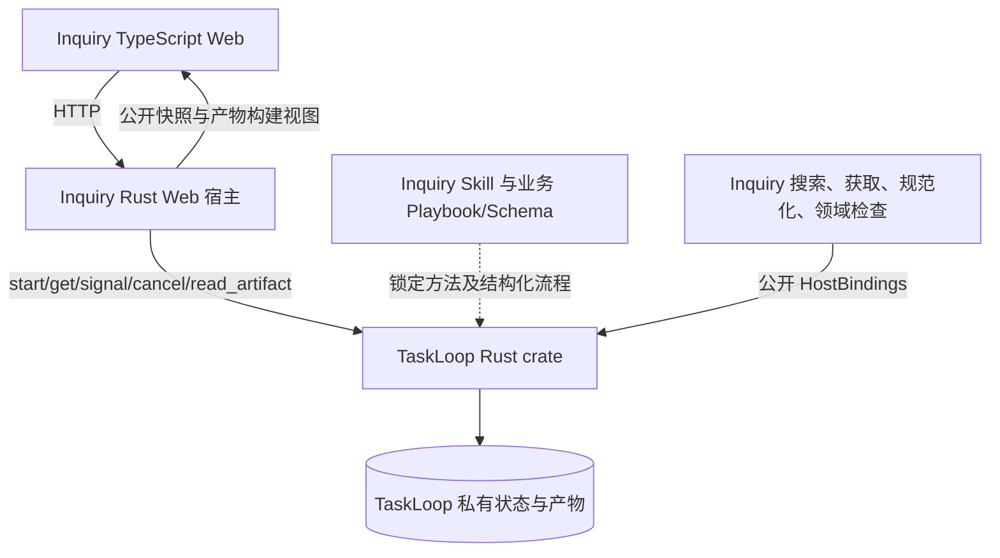

# Inquiry Issue #2：真实研究 Web 与质量实验

版本：v0.1.8；状态：两次真实质量实验均FAIL，原协议和全部结果保留；2026-11-07用户确认阶段预算修复及Vertex功能复验，未合入。
需求：[Issue #2](https://github.com/xforce-io/inquiry/issues/2)。L1 reuse：[Issue #1 L1 v0.5.0](https://github.com/xforce-io/inquiry/issues/1#issuecomment-6555157047)，加本次用户明确要求真实研究质量对照与 computer use 验证；L2 write：本文件为实现票唯一 L2。前置领域设计见 [Issue #1 L2 v0.5.0](1-minimal-research-loop.md)，历史稿保留，不作为第二份实现规格。

## 1 背景

设计阶段已确认六阶段研究、TypeScript Web、薄 Rust Web 宿主和 TaskLoop crate 直连。本票交付真实产品，证明来源与报告连通，并用固定问题验证研究质量。TaskLoop 已通过完整独立审查、真实Harness和双平台CI，并由PR #4合入main；Inquiry固定经审候选 `1c69bcf8a1bc0a7d9a4564bbe93f8b13d7317d04`，其合入提交为 `9197afac45be43992cd72ef6e0549d92175d3d49`。

## 2 名词解释

沿用[名词表](../glossary.md)，本次新增工具调用预算与提交保留额度。研究状态由 TaskLoop 保存；资料、证据、判断及报告是 Inquiry 的业务产物。评价报告内容的盲评与代码独立审查是不同活动，不能互相代替。

## 3 目标与非目标

目标：用户提交问题后，真实收集、探活、留存、整理与分析，得到可回溯报告；资料不足、阻塞、取消和成功有清楚反馈。最小产品只提供创建与详情两类页面。

非目标：上传/PDF/OCR、多用户托管、人工编辑发布平台、独立 Planner/动态模型路由、第二套执行状态机、TaskLoop HTTP 服务、未经授权的公网部署。研究质量通过实际实验判断，不预先宣称高于所有模型。

## 4 能力

### 4.1 UI/UX

创建页以问题输入和“开始研究”为主要操作，可选网址与范围收起展示；开始前可见实际资源限制。未受理时保留填写内容与幂等键，显示可操作错误。

详情页顶部保留问题与生命周期状态。研究过程中以六阶段导航呈现当前工作和已接纳产物；报告就绪后默认阅读结论，仍可查看过程。引用打开同页来源面板，定位保存版本的段落并高亮短引文；关闭后保持报告阅读位置。刷新从公开快照恢复，不以浏览器内存伪造已完成阶段。

| 状态 | 可见反馈与恢复 |
|---|---|
| 空/加载 | 创建入口或读取中；不伪造进度 |
| 运行/检查 | 当前阶段、已接纳内容、停止入口；草稿不冒充正式产物 |
| 等待资料 | 显示缺口及网址表单；提交带当前 revision，冲突后刷新解释 |
| 阻塞/失败 | 显示实际原因并保留已有产物；阻塞可停止，改变目标须新建研究 |
| 取消中/已取消 | 等待确认与确认完成分开，不把受理等同停止 |
| 报告就绪/证据不足 | 完整报告与部分结果分开，不把 completed 一律叫成功 |
| 暂时读取失败 | 保留上一可见内容，提供重试，不改变执行状态 |

不提供框架配置、内部执行标识或数据库操作界面。技术元数据仅在有助于来源版本核对时呈现。

## 5 思路与折衷

- 使用五个公开业务操作与 HostBindings；放弃额外执行服务及应用状态表。
- Skill 给研究方法，Playbook 给业务阶段与分支；应用只提供领域工具/检查和视图，不再实现调度。
- 一期固定模型配置，检索/获取是实际工具调用；放弃动态模型选择和模拟报告。
- 引用一致性和论证质量分别评价；格式及精确引文检查不冒充独立语义评审。
- 网页留存私有，公开实验报告只发布必要短引文、来源链接、摘要与评分；不把完整第三方网页提交到公开仓库。

## 6 架构



主路径：创建 → scope → discover → capture → catalogue → analyze → report → 报告及保存来源。catalogue/analyze 可有界返回 discover；资料不足进入等待，补网址后继续；等待到期为部分结果。

失败路径：来源失败保留处置，不能伪造可用；检查拒绝/不可用按框架结果显示；查询失败仅影响显示；停止后等真实确认。通用推进、事务、恢复与执行器内部只在 TaskLoop 讨论。

## 7 模块与领域契约

Web 负责输入和阅读；Web 宿主负责 HTTP/可信调用者、公开接口转换和领域能力注册；研究方法、业务 Schema 与质量规则归 Inquiry。

六阶段沿用前置设计：plan、candidates、materials、catalogue、analysis、report。catalogue以gaps保存可公开补齐、且妨碍有依据条件性回答的证据缺口；以limitations保存研究限制。尚无团队实测量、未核对的历史价格/时点等如可诚实限定并给出待测方案，不自动阻止报告；不能伪装为已验证事实，也不降低真实引用或质量门槛。原始问题/背景/约束的唯一事实源为不可变inputs；plan仅保存subquestions/search_queries/stop_reason，不要求模型再次复写原始问题，也不允许计划改写inputs。历史含question的旧plan只读展示兼容，不迁移字节。方法包/流程版本0.3.4：每次发现最多8次搜索，失败或无相关结果也必须提交实际候选或空清单进入等待，预留写产物的工具预算；该历史方法使用框架40次硬上限；当前0.3.5预算增量见下文。搜索使用真实Brave网页结果，不把挑战页/空解析当已发现来源。原始/规范化字节留存，证据用 Artifact ID、SHA-256、从0开始的段落及原文片段定位。判断显式关联支持、反驳和限制，报告只引用已接纳分析证据。 方法0.3.4针对已确认的“可执行报告、假设与事实分开”契约补足分析要求：完整成本与止损、健康执行和缺陷检出的不同指标、逐类样本与资源相容的试点范围，并避免将工具过程日志重复放入成稿；这些要求由Skill指导，不冒充领域检查已能证明语义质量。业务Schema、六阶段、接口及执行预算不变，0.3.3原报告/评分字节不迁移。

### 7.1 方法0.3.5：有界读取与提交保证

依据：候选d969a3e在用户指定的Vertex真实研究中，分析阶段40次有效工具调用后，提交也被拒绝；原失败证据保留在本机忽略目录work/verify/2-20261107-vertex。用户随后明确同意“分析80次、剩余额度可见、保证收尾、保留总限制，并用同题复验”（会话go）。L1 reuse：既有S1/S3/S5主路径与失败语义；本增量只补有限资源下的行为，未改变S4实验标准。

Inquiry通过TaskLoop公开RuntimeOptions与ToolBridge承载领域预算，不读取框架内部计数或修改TaskLoop。宿主运行上限80；Inquiry逐次原子受理的分析上限80，其余阶段40；最后2次仅允许artifact.write，用于一次提交及一次修正。已受理但失败的调用计入Inquiry预算；被Inquiry拒绝的读取不进入TaskLoop，也不消耗提交余额。总上限达到后提交同样拒绝，不能无限写。取消、期限、权限、输出Schema及字节限制仍由原框架校验，不因预留而放行非法内容。

每阶段工具说明在首调前公布限制；成功响应外层新增_inquiry_budget，含limit/used/remaining/read_remaining/submission_reserve，错误摘要附剩余额度。并发下返回的是当时全局余额，不承诺每条响应只递增一。元数据不属于受信result、receipt或保存正文，不能复制入fact或引用。分析优先按关键词读取实际正文，不强制翻完所有页面；每次最多8段，预算不足时基于已核对证据形成限定判断，证据不足则提交现有need_input/缺口，不伪造ready。

折衷：80是本次可验证容量起点，放弃无限预算、所有阶段统一80、仅靠提示词预留及修改框架依赖。保留2次提交不保证模型一定提交、内容一定通过检查或研究一定成功；它只消除“读取用尽后无法写”的结构性死路。不新增自动恢复、第二套执行状态或新的用户页面。总处理时长保持30分钟；当前无独立货币费用硬上限，不把调用次数冒充账单预算。

采集阶段产生动态快照附件。后续所需捕获产物通过公开 Requirement 的 `include_attachments: true` 显式授权，仅消费所选生产访问；不绕过工具桥读文件。该能力须由最终已验证 TaskLoop 提交提供。

获取事实必须进入可读取的已接纳业务产物，供页面展示请求/最终网址、时间、可用性与内容版本。materials 必须携带完整领域获取事实（source_id、请求/最终网址、时间、HTTP状态、处置、原因、原始/规范化摘要、转换版本、可用性与附件槽）；领域检查逐项比对当前受信工具回执与真实字节，接纳后才能作为展示依据。应用不新增读取 TaskLoop 私有回执或表的接口。

## 8 API/CLI 与依赖

沿用既定 HTTP：POST /api/research、GET /api/research/{id}、POST .../sources、POST .../cancel、GET .../artifacts/{artifact_id}。一研究一 ExecutionId；幂等键、revision 和错误按公开契约传递，不另造状态。

宿主构造单用户可信身份，不接受 JSON 自报 Caller。产物路径必须属于该研究公开快照中的引用；同一主体的其它研究也不能经错误的研究路径混读。仅监听本地工作区，校验 Host/Origin，使用同源安全会话；仅监听127.0.0.1，默认端口3410；Host/Origin与实际监听端口精确对应，API需要HttpOnly/SameSite=Strict会话，写操作还需同源Origin。具体配置在运行说明中固定。

网络工具只支持受限 HTTP(S)，每跳校验目标网络与 DNS，禁止内网/环回/保留地址、凭据 URL 和任意协议；限制重定向、并发、时长与字节。代理环境也须保持最终目标 IP 约束，不能仅在本地检查域名后交给代理重新解析。仅80/443端口；每页正文上限1MiB、最多5次重定向、单次获取总边界约32秒；原始正文私有保存，规范化截断需明确标记。失败按真实原因留存。

Cargo 固定最终经 TaskLoop 审查/CI/合入的完整 SHA 与 Cargo.lock。固定依赖为上述已审且已包含于main的完整候选SHA。除公开初始化及五操作外，不依赖内部 Worker、表或调度。

## 9 边界

Inquiry 决定研究内容、来源处理及业务质量；TaskLoop 决定实例执行与合法状态提交；Agent 只完成当前阶段并交候选。已接纳内容是展示事实源，应用投影可重建。

模型输出和网页内容均是不可信数据。报告 Markdown 不执行 HTML/脚本或自动加载任意远程资源；来源面板显示安全文本。引用校验通过只证明定位和版本一致，不保证所有判断必然正确。

## 10 迁移、兼容与回滚

0.3.5更新方法包和执行器预算身份，旧研究数据与失败字节不迁移；新宿主使用独立运行目录，旧目录仍由原锁定候选读取，不宣称跨配置恢复。回滚使用原候选与原私有目录。发布前固定业务包版本和依赖；不热改正在运行的研究。旧内容读取与版本不识别行为须测试。无公网部署目标；本地运行说明不等于生产部署授权。

## 11 测试与实验预登记

### 11.1 产品验证

| Issue | 必需结果 | 验证层级及证据 |
|---|---|---|
| S1 | 真实六阶段闭环、报告及保存来源回溯 | E2E：真实 Web/crate/Harness；记录候选、研究ID、实际工具事实与 computer use 路径 |
| S2 | 获取事实/保存版本/引用负例拒绝，网络边界无越权 | Unit / Integration：真实解析、受控反例及完整六阶段合成闭环（合成闭环不代替真实模型）；E2E：实际公开来源获取及引用回溯 |
| S3 | 两研究隔离，同键重试、补网址、冲突/到期、停止与刷新明确 | Integration + E2E；确定性边界与实际停止分别记账，不以模拟冒充真实 |
| S4 | 以下固定研究对照达到已登记阈值 | E2E：真实报告、真实基线、独立盲评、引用/事实核对与原始失败记录 |
| S5 | 两类页面、七类主要操作顺畅，无阻断使用问题 | E2E：最终候选 computer use 实际驾驶；截图、状态及保存结果对应；完整状态的确定性测试单独记录 |

实现期间须建立 `.agents/skills/verify-inquiry/SKILL.md` 和功能地图，覆盖 S1–S5 后才能交接驾驶验证。功能地图主要归属：S1→[research.md](../../.agents/skills/verify-inquiry/features/research.md)，S2→[sources.md](../../.agents/skills/verify-inquiry/features/sources.md)，S3→[reliability.md](../../.agents/skills/verify-inquiry/features/reliability.md)，S4→[quality.md](../../.agents/skills/verify-inquiry/features/quality.md)，S5→[web.md](../../.agents/skills/verify-inquiry/features/web.md)。手册已建立，正在实现验证；未执行的验收仍记not_run，不能写pass。独立代码审查、CI、人工门和合入仍为交付必经步骤，不要求它们在启动自身之前已经完成。

### 11.2 固定 demo 与报告条件

固定问题：**截至实验启动时间，一个5人SaaS团队应如何选择 Playwright、浏览器 Agent 或混合方案，以在未来8周提高浏览器任务自动化的可靠性，同时控制成本和权限风险？**

共同背景：现有 TypeScript/React、GitHub Actions，每周两次发布，30条关键浏览器流程，无专职测试人员；既有可控产品页面，也有偶发变化的第三方后台。报告需区分自有产品回归与第三方操作，不能把工具层与 Agent 决策层误当互斥选项。

必须回答：适用边界与失败模式、可靠性证据及其局限、运行/维护成本、权限与人工介入、最小架构、8周试点与退出/验收条件。成本估算标明假设；测试/厂商基准不能直接冒充生产成功率。目标报告长度为3000–5000中文字符，明显超出须如实记录，不能用长度差异制造优势。

在首份报告生成前，把相同问题、背景、截止时间、长度约束和完整提示词写入不可变实验目录并记录摘要。当前尚无研究或基线报告；此前模型探针仅回复 OK，不构成实验样本。

### 11.3 模型和顺序

直接生成基线固定为 `gpt-6-astra`，不允许提供方模型回退；官方[模型说明](https://developers.openai.com/api/docs/models/gpt-6-astra)将其定位为最强能力模型，实际账号访问已做无报告探针。正式实验使用 max 推理配置；若不可运行，应记录受阻，不换弱模型凑通过。

基线允许一次完整推理并按共同提示词生成报告，不提供研究工具、研究中间产物或人工纠错。提示要求区分事实、估算与未知，不编造引用。生成3份独立直接报告，均保留；比较采用其中评分最高者，不能挑最弱样本。

先通过真实产品固定第一份研究报告，再生成并封存基线，避免第一份研究借用基线内容。研究模型及推理配置、全部工具/阶段/补查、耗时和可得用量另记，不声称计算量相同。若研究迭代改进，保留每版失败、Skill/代码版本和输入摘要，不把最后一版说成首次即成功。

### 11.4 独立盲评与阈值

报告去除模型、方法及运行身份，保留影响质量的正文、引用和限制，以随机编号和顺序交给两个独立上下文评分。评价者不得读取研究实现对话、报告生成上下文或先前分数；使用两个明确记录的评价模型/配置，不冒充人工专家。

| 维度 | 分值 | 判断依据 |
|---|---|---|
| 事实准确性 | 25 | 关键技术/权限/可靠性主张可核对，估算与未知不冒充事实，无重大错误 |
| 证据质量 | 20 | 来源适用且一手优先，引文/链接实际支持主张，限制和反证保留；数量不独自决定分数 |
| 覆盖 | 20 | 回答全部共同问题与团队背景，区分回归与第三方任务，不遗漏决定性约束 |
| 推理与折衷 | 15 | 结论由证据推出，解释替代方案、失败边界、冲突和选择条件 |
| 可执行性 | 15 | 最小架构、8周安排、量化试点、成本假设、人工介入和退出条件具体可用 |
| 清晰度 | 5 | 结论易找，结构简洁，信息密度高，限制可理解 |

每份评价必须提供各维分数、关键缺陷及对应正文/来源位置，不能只给总分。两位评价的均分为报告总分；任一指出重大无依据结论或重大事实错误，先逐条审计，不得仅靠平均分掩盖。

通过条件同时满足：Inquiry均分≥85/100；相较3份基线中最高均分至少高15分；两位评价者均认为Inquiry优于该基线；无经审计确认的重大无依据结论；至少12条有效引用覆盖8份一手来源文档。引用逐条核对保存版本/原文和主张支持关系；基线引用也应实际核对，不能因其未出现在研究资料包中便判伪造。

这里的“显著”是事先声明的15分质量差距；单个主题、两次模型评价不足以声称统计显著或普遍超越所有SOTA。最终结论只能覆盖本主题、这些报告及记录的基线条件。未达阈值如实记 fail，不改权重、问题或阈值，不能隐藏失败尝试。

### 11.5 实验产物与信息边界

保留：预登记提交/提示词及摘要、实际模型与日期、原始报告、匿名映射（评分完成后揭示）、两份原始评分、逐条事实/引用核查、全部研究尝试与版本、模型/工具运行记录、最终对照结论。

公开材料仅含报告、必要短引文、链接/摘要和可公开评分；原始网页留存、私人运行目录及凭据不提交公开仓库。短引文按来源累计控制，避免大段复制。未知用量保持 unknown，不补零；不把模型运行次数当作上游请求次数。

### 11.6 共同报告提示词（运行前仅填时间）

下列正文用于研究问题/范围及3次直接生成，不在看过结果后增删要求。运行器只填 `CUTOFF_UTC`，保存填充后的原始字节与摘要；生成顺序、工具可用性及模型配置另记，不混入问题正文。

```text
你要为一个5人的SaaS团队撰写一份可用于决策的中文研究报告。
研究截止时间：CUTOFF_UTC。

问题：应如何选择Playwright、浏览器Agent或混合方案，以在未来8周提高浏览器任务自动化的可靠性，同时控制成本和权限风险？

背景：团队现有TypeScript/React和GitHub Actions，每周两次发布，约30条关键浏览器流程，无专职测试人员。既有自有产品的回归测试，也有偶发变化的第三方后台操作。没有已经测得的本团队成功率或完整成本数据。

请回答：
1. 区分自有产品回归与第三方操作；说明三种方案的适用边界，避免把工具层与Agent决策层误当互斥选项。
2. 分析可靠性证据、典型失败模式与证据局限；明确哪些厂商/公开测试结果不能直接外推为本团队生产成功率。
3. 分析运行及维护成本、权限风险、人工介入、数据边界和不可逆操作控制。
4. 给出最小架构、替代方案、选择条件，以及8周试点安排、验收指标与退出条件。
5. 结论先行，说明支持和反对结论的依据、关键未知与需要补测的事项。

正文目标3000–5000中文字符，不含参考资料清单。关键事实给可核对的来源链接；引用片段应简短且准确，不编造URL、访问记录、引文或测量结果。成本和成功率估算必须标明假设，不把它们当既有事实。无法验证的当前信息直接说明未知。保持信息密度，避免用重复篇幅制造完整感。
```

基线执行约束另由宿主设置：无工具、无来源包、无研究中间产物；实际 `gpt-6-astra` / max，不允许回退。研究执行仍允许已授权真实工具，不将“无工具”混进其研究问题。两者均使用上述同一问题、背景和结果要求。

### 11.7 盲评输入与输出固定格式

评价者A：`gpt-6-astra` / max；评价者B：`gpt-6.1-sol` / high。二者均为独立新上下文、只接收匿名报告与中立来源核查包，不读取作者/实现聊天。两者同属一个提供方的局限在结果中披露，不称为两名人工专家或跨提供方验证。

匿名报告标签固定为 R1–R4；实验启动前生成并封存随机种子、映射与摘要；映射对象为研究报告及 baseline-1/2/3，研究 ExecutionId 在受理后另行关联，不影响已封存映射。A按 R1、R3、R2、R4 顺序评价，B按 R4、R2、R3、R1 顺序评价。映射只在评分完成后揭示，不根据分数重排或换标签。

匿名输入保持完整正文、引用和限制，去除模型/方法/运行身份。引用统一显示为来源链接与必要引文，不把框架内部 Artifact ID 或私有路径暴露给评价者。原始报告及去标识过程保留；不得删除缺陷、补写引用或润色基线。

固定评价指令：

```text
你是独立报告评价者。只依据本次给出的匿名报告、共同问题、固定评分规则及中立来源核查包评分。不要猜测或奖励其作者、模型、生成方式、篇幅或引用数量。
按事实准确性25、证据质量20、覆盖20、推理与折衷15、可执行性15、清晰度5逐项打分。每项给整数分和具体理由，指出对应正文或来源；不能只有总分。估算如清楚标记假设，不因其不是实测而自动判错；事实性断言不能靠语气自信获得支持。
指出重大事实错误/无依据结论及证据。某引用若未包含于核查包，标记待核查，不直接认定伪造；尚有影响判定的待核查项时不要给最终通过结论。你的分数不是研究作者的自评，也不是代码审查结论。
输出每份报告的六项分数、总分、具体优缺点、重大问题和未决核查。全部评价完成后给出排序与决定性差异，不能在看到其它评价者分数后调分。
```

评分后按固定规则计算均分与最佳基线差值，逐条核对重大问题。原始评价不可覆盖；若来源审计改变结论，另存修订理由与新版本，保留旧结果。任何尚未解决的决定性核查都阻止质量通过。

### 11.8 第二次独立实验：全文检索选型（已获产品确认）

L1依据：[新实验提案v0.1](https://github.com/xforce-io/inquiry/issues/2#issuecomment-6598955002)。用户于2026-11-03明确选择“批准这一次新实验，失败后交回决定”；授权范围仅本次新题与预算，不是合入批准，不自动追加第三次实验。§11.2–11.7保留为首轮原协议，首轮FAIL永久保留，不被新结果改写。

本次唯一共同提示词为[已填时间的完整原文](../experiments/20261103T115519Z/common-prompt.txt)，固定截止2026-11-03T11:55:19Z：在10万份中英网页、单机8GB、Rust宿主、两名开发者合计每周2人日、没有团队实测或既有检索实现的背景下，比较SQLite FTS5/Tantivy/Meilisearch，覆盖分词/混合检索、更新删除、恢复迁移、固定来源版本及引用定位、许可证/安全/完整成本和8周试点。它是评估场景，不增加一期产品的检索功能。

研究方法固定0.3.4，模型gpt-6-astra/high；研究第一份报告封存后，生成3份独立gpt-6-astra/max无工具直接基线，保留全部并比较均分最高者。两份盲评仍为Astra/max与Sol/high；A顺序R1,R3,R2,R4，B顺序R4,R2,R3,R1；新随机映射与摘要在首个Run之前登记，评分完成后揭示。中立核查包实际核对双方来源，未知不判伪造，不给评审作者聊天或彼此分数。

沿用六维25/20/20/15/15/5及原评分指令。领域相关的“覆盖”按本次完整共同问题及约束判定，不能再以旧题的“回归/第三方任务区分”评分；“可执行性”评价本题最小架构、8周安排、量化检索/更新/恢复试点、成本假设、维护与退出。其余定义及重大问题/未决核查要求不变。没有新奖励项，不因知道首轮结果调整权重或压低基线。

通过仍须同时满足：Inquiry均分≥85；相对3基线最高均分≥15；两评审方向均优；无经审计确认的重大无依据结论；至少12条有效引用覆盖8份一手来源文档；决定性未决核查不得存在。第一份研究固定后才能开始基线；原报告保留全部有利与不利内容，仅可作可审计的去标识和显示转换，不润色。新题可能再次失败，基线>85时不得以百分制上限为由改变阈值。失败保留并交用户决定，不自动再选题、再评或开启第三次实验。

本票继续使用inquiry-2，累计既有27次模型/3668.110秒不清零。累计总上限调整为47次模型/18000秒；本次独立额外上限20次模型/7200秒（累计Run耗时，不是并行墙钟）。每批执行前以原history前缀追加实绩，检查累计和本次双重上限，无法计量的token/上游请求保留unknown；不足以完成完整链条时收口而非跳过基线或审计。第一次预算与失败记录不修改。

S1/S4需方法0.3.4真实实跑；S2/S3及S5依赖核对未变来源/接口/界面，最终候选驾驶与独立代码审查、CI、人工门和合入仍必需。无公网部署授权。

### 11.9 2026-11-07获批的Vertex预算功能复验

本次是用户指定产品任务的修复复验，不是第三次质量实验，不执行基线或盲评，不改变§11.2–11.8与历史FAIL。冻结候选后使用与第一次Vertex完全相同的prompt字节（含原截止时间）与空种子URL、新ExecutionId、新私有数据目录；原失败不覆写。模型仍gpt-6-astra/high。新一轮最多24次阶段执行、30分钟处理；不以失败后自动换题或重复生成取得通过。

| ID / 归属 | 前置与路径 | 可判定结果 / 禁止行为 | 证据与层级 |
|---|---|---|---|
| S1.B1 / S1 | 真实Inquiry创建页提交同一Vertex问题，观察至终点 | 6阶段完成报告；引用可定位保存版本；不允许用fixture、人工代写或旧报告替代 | E2E，研究ID、版本、阶段审计、报告/引用截图；主要research.md |
| S3.B1 / S3 | 普通阶段与分析分别耗尽读取额度，随后提交，再触发总上限 | 普通阶段38、分析78次读取后拒绝继续读，2次写仍可用；总额40/80后均拒绝，错误/取消/Schema约束不被绕过 | Unit + Integration，真实TaskLoop的78次读取及产物接纳；主要reliability.md |
| S3.B2 / S3 | 首次工具说明及成功/失败工具响应 | 额度初始可见、余额真实、失败调用计入；受信回执与保存产物不被改写 | Unit + E2E审计；主要reliability.md |
| S5.B1 / S5 | 报告引用面板关闭并刷新 | 原报告与资料可读，失败仍明确，未声称质量对照通过 | E2E截图和公开快照；主要web.md |

仅适用本次增量验收，不能凭此将Issue #2全表或S4改为pass。无新增用户入口，现有创建→进度→报告/失败路径沿用§4.1；无需额外用户交互图。

## 12 开放问题与推进门槛

原方法0.3.3已经生成首份真实报告；全部失败、人工补网址、三份基线和两份盲评见[实验记录](../experiments/20261103T063810Z/README.md)。Inquiry均分93，最强基线96，原S4为FAIL。§11原协议与阈值不改；基线96时百分制最大可领先4分，不能靠反复生成满足原定+15。

方法0.3.4已经完成第二次实际研究、三份直接基线和两份独立盲评，见[完整结果](../experiments/20261103T115519Z/README.md)。Inquiry89.5，最强基线91，差−1.5，两评价方向均未优。19处引用的位置/字节/版本匹配不等于语义门禁通过；版本/许可/默认能力等未决核查仍保留。不能从两个不同主题的分数变化推断方法改进的因果效果。

用户授权的“仅一次新实验，失败后交回决定”已执行。本轮16次模型/2802.825秒；同票累计43次/6470.935秒，未超新增20次/7200秒及总47次/18000秒，剩余额度不自动消费。S1/S2/S3/S5有实际路径及对应确定性边界证据，但S4仍FAIL，因此不送独立代码审查、不创建PR、不合入或部署。

原§11.2–11.8协议逐字不改，原始冻结全文可在登记候选aaa1ea6与私有封存文件核对。新的题目、方法或评价规则不在本次失败后的自动执行范围内，须交回用户决定；不自动第三次实验，不用工程可用性替代原质量目标。

## 13 关联

- [Inquiry Issue #2](https://github.com/xforce-io/inquiry/issues/2)
- [前置设计 Issue #1](https://github.com/xforce-io/inquiry/issues/1)
- [TaskLoop 实现 Issue #3](https://github.com/xforce-io/taskloop/issues/3)
- [TaskLoop 公开契约](https://github.com/xforce-io/taskloop/blob/feat/3-minimal-runtime-mvp/docs/design/3-minimal-runtime-mvp.md)
