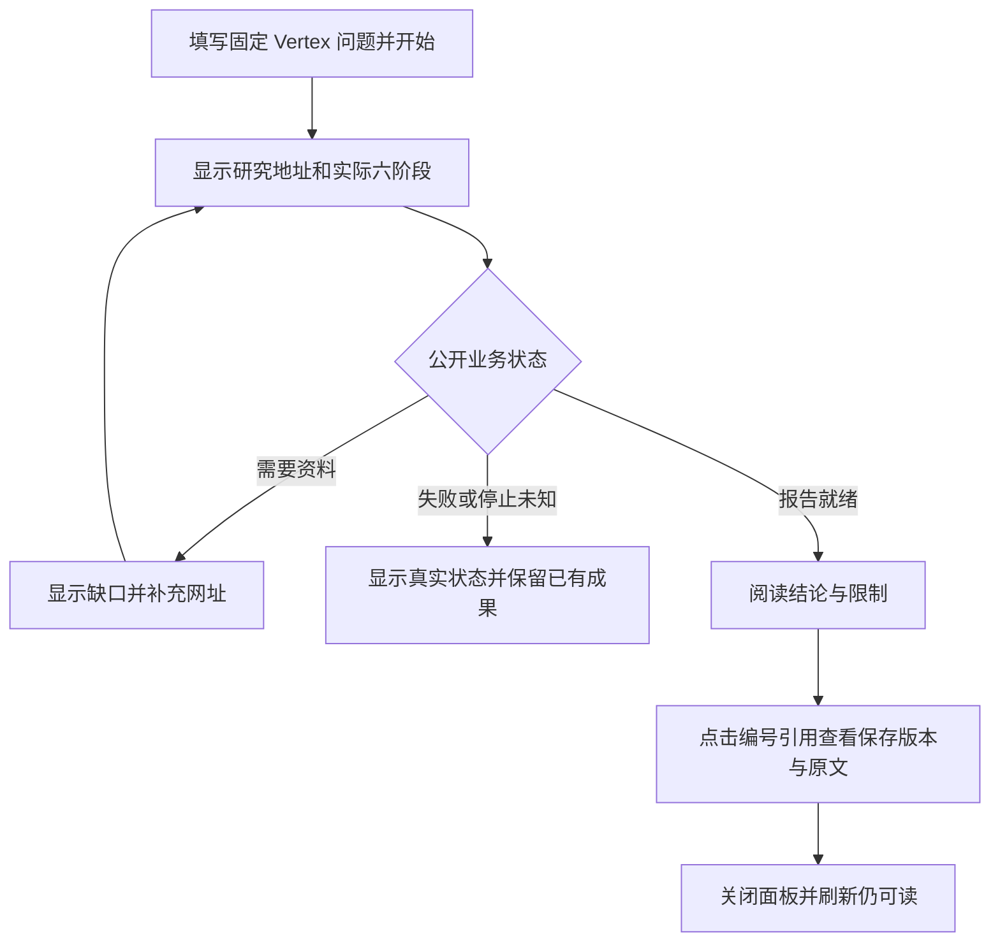

# #3 Milkie 执行迁移与研究 Trace 闭环

版本：v0.3（Draft）。[Issue #3](https://github.com/xforce-io/inquiry/issues/3)。L1: write（Issue 评论概要）；L2: write（本文件，遵循用户指定十三节、唯一详细事实源）。产品依据是本会话确认的 Milkie 适配、TaskLoop 统一 Trace 治理及 Epic S7；沿用 #2 创建/报告/引用路径，不新增监控页面、不改变研究质量门槛。本票包含尚未合入的研究应用基线 d028d69，不代表批准合入 #2。

## 1 背景

源码机制已核对：`src/main.rs::Audited` 直接包裹 CodexExecutor，仅转发 execute/stop，`ObservedBridge` 另写私有 research-audit.ndjson；它不能透明传递新 Executor 的观测/清理契约。`src/budget.rs::BudgetBridge` 在应用层重复计数80/40并保留2次提交；TaskLoop 原单次240秒仍会先截断。`src/domain.rs::limits` 的任务 active 上限已经是1800000ms（30分钟），不在迁移中提高。`src/web.rs` 仅通过 Runtime 公共接口获取业务/产物，创建/引用六阶段不应依赖 Trace。方法0.3.5还引用旧 _inquiry_budget，需要随新预算来源同步。

原 Vertex 两次失败的目录、输入、资料、429与人工补网址保持原样；分析41次仍有39次预算但到240秒终止，仅作为原问题依据。#2 S4 两轮质量比较均失败，不能借本迁移改为通过或启动第三轮质量实验。

## 2 名词解释

本设计涉及的 Milkie、Sidecar、Trace、RunBudgetPolicy 见 [名词表](../glossary.md)。ExecutionId 同时关联研究地址、业务快照与 Trace 查询；它们并非同一类记录。模型调用尝试、模型迭代、工具调用数和 provider 用量不能互相替代。

## 3 目标与非目标

用户通过原页面在新链路完成一份真实六阶段 Vertex 报告和至少一条保存版本引用回溯；开发者通过公开接口关联同一研究的阶段/Agent/工具/检查及预算事实，明确失败、等待、停止未知和观测缺口。

非目标：新的执行状态机、独立监控页面、模型隐藏推理、研究质量再评分或自动放宽预算、自动合入/公网部署。Trace 失败不能把业务成功改失败，Trace 完整也不能代替报告或停止确认。

## 4 能力

主机通过固定配置提供实际 Milkie CLI、连接文件和专用 config/session/storage 路径；不默认复用全局账号目录、不复制登录材料、不回退旧 CodexExecutor。研究仍保持原模型 gpt-6-astra/high 契约，无法证明有效配置时不声称真实验收成功。模型迭代限制不从工具数推算；Codex 不支持时不擅自设置。

阶段预算交给 TaskLoop：inquiry.analyze 为80次，其余五阶段40次，提交保留2次。阶段/检查时间显式继承任务剩余，时间收尾余量0（保留原没有时间余量的行为，不自定10分钟或新余量）；30分钟任务 active、既有 wall/字节/网络/重试边界保持。模型从 _taskloop_budget 获知余额，产物/回执不携带此元数据。

默认只采安全元数据；容量、保留期限与源采集限制由宿主配置显式给出，非法或缺失不带着猜测的默认开始服务。应用不实现第二套清理、脱敏、拼接或排序逻辑。

### 4.1 UI/UX

S1 沿用现有创建页→研究详情→引用面板，不新增产品页面：

S2 为现有本地会话保护下的只读诊断 API：按研究 ID 查询分页 Trace/导出与预算。空：旧实例无历史 Trace 返回未采集/未知，不补造；错：无效游标、会话失效、实例不可见分别明确反馈；成功：业务与观测状态分别返回，保留 source 关联和缺口。分页/增量沿用 TaskLoop 原契约；无自动全量采集、无隐藏写操作。当前不增加前端诊断面板。

## 5 思路与折衷

直接注册公开 MilkieExecutor，移除截断观测契约的 Audited/ObservedBridge 以及重复 BudgetBridge；保留历史审计文件，新的诊断以 TaskLoop 公共接口为准。放弃继续维护未受统一策略治理的原始工具正文日志、让应用读取内部 SQLite 或 JSONL 源文件，以及为了单次成稿增大任务总预算。

宿主显式配置 Trace 限额而非新增一组隐藏默认；这增加启动配置要求，但保持治理可核对。新 SDK 路由是本地会话内的薄转换，不把实现字段放进用户报告/引用流程。无法观测的原生细节保留 unavailable，不模拟完整。

## 6 架构

分层：TypeScript 页面 → Inquiry Web 宿主（研究方法/公开网页工具/会话边界）→ TaskLoop（业务、授权、预算、Trace治理）→ Milkie Sidecar（Harness适配/源观测/工具转发）→ Codex。旧五个研究业务操作保持职责，不让 Trace 驱动推进。

主路径：启动前核对配置/固定版本与来源 → 注册 MilkieExecutor/预算/Trace 策略 → 创建研究 → 真实 Agent 调宿主工具 → 原领域 gate 接受产物 → 报告和引用展示；诊断以同 ExecutionId 查询公共 Trace 与 budgets。

失败路径：配置不支持/版本不匹配不降级；429、网页失败、等待补网址如实保留；取消先 cancelling 再确认，StopUnknown 不叫已停；Trace采集故障依据TaskLoop返回完整性，不替代业务结果。退出（SIGINT/SIGTERM及HTTP服务异常）等待 Runtime.shutdown；已确认的原生业务结果与有界观测补读分离，关闭等待采集资源结束后再清未刷盘标记。不能仅终止Web就宣称原生执行已停。

## 7 模块

启动装配负责固定配置与依赖身份；budget 模块仅生成 RunBudgetPolicy，不再计数；domain 的网页工具/领域 gate 不改研究规则；web 仅增加公开诊断接口转换；方法包仅更新预算元数据名称及当前执行契约引用，不改研究标准。功能地图区分 #2 历史质量实验与 #3 迁移验收。

## 8 API/CLI

本地 HTTP 只读入口拟为 `/api/research/{id}/trace`、`/trace/export`、`/budgets`，沿用既有 host/origin/session 保护与 Caller::local；研究不存在不得读其它实例内容。Trace 参数/游标直接映射公开 TraceQuery，返回 TaskLoop 版本化结构，导出按页有界。无新公开 CLI，无正文内容读取入口（本票仅元数据模式）。

启动通过 `INQUIRY_EXECUTION_CONFIG` 指定绝对JSON文件，字段为 node、milkie_cli、connection_file、config_dir、session_dir、trace；trace含 policy_id、max_events_per_run、max_bytes_per_run、source_max_events、source_max_bytes、max_total_events、max_total_bytes、max_runs、retention_ms，均必填，无容量/TTL默认。路径必须存在且为相应文件/目录，原生config/session互不包含且不与框架store重叠；已存在框架存储目录须先解析符号链接后的真实位置，悬空或不可解析路径拒绝。连接只接受contractVersion=1及fields.transport=agent-cli/runtime=codex/model=gpt-6-astra；不接收env或隐式模型来源。原生config.toml须high且无profile覆盖，解析失败不输出内容。配置/连接/原生设置摘要进入宿主绑定。示例与当前启动契约见README和docs/examples，示例数值不是生产决定；不在程序中自动找全局登录/复制凭据。TaskLoop/Milkie 精确依赖 SHA 及构建身份进入验收记录，health 不继续谎报旧依赖 SHA。配置不能改变已锁定研究模型而不报告；gpt-6-astra/high 的原生有效设置须核对。

## 9 边界

原研究页面不展示模型隐藏推理。元数据模式不导出原始网页、完整提示词、登录材料或原始异常。TaskLoop 私有表/源日志均非应用 API。旧产物保留且不自动重跑；旧未采集的 Trace/预算来源保持未知。人工补网址与429、超时必须记录，不叫首次自主成功。真实研究最多本次获准的同题迁移功能复验，不将失败自动转成重跑授权。

## 10 迁移/兼容/回滚

#3 隔离工作树从仓库默认基线承接 d028d69 的现有应用提交；原 #2 工作树不动。Cargo 固定经审 TaskLoop 新 SHA，Milkie CLI固定候选身份；未完成审查的依赖不得冒充已批准。

旧业务数据库由TaskLoop兼容读取；可读产物不依赖新Trace。绑定变更不恢复旧未知执行，旧活动研究先保留事实并按公开状态处理；新验收使用独立私有目录。回滚保留新旧数据和失败证据，停止本次拥有进程，不删库或原生会话，不承诺旧二进制能读取新Trace存储。

## 11 测试计划

主要功能文件：S1 为 research.md，关联 sources.md/web.md；S2 为新增 execution.md，关联 reliability.md。所有行必需，冻结候选后记录原始证据，当前不预写 pass。

| ID | 前置与完整路径 | 结果/禁止结果 | 证据与层级 |
|---|---|---|---|
| S1.A1 | 真实模型专用环境；从创建页提交原固定 Vertex 输入，观察六阶段并阅读报告 | 至少1份本次真实六阶段报告；不能用旧报告、fixture或人工代写替代 | E2E：冻结输入/候选/环境、浏览器操作、研究ID、公开快照/产物摘要；实际运行审计，未知用量不补0 |
| S1.A2 | S1.A1同研究；点至少1条编号引用→查看保存段落/短引文→关闭→刷新 | 保存内容版本一致，关闭返回报告，刷新仍可读 | E2E：实际浏览器操作/截图与公开ArtifactRef核对，不能用HTTP测试代替 |
| S2.A1 | 同一真实研究；开发者按其ExecutionId查询/增量/导出Trace和预算 | 关联阶段/Agent/工具/检查，耗时和最后活动/缺口可查；预算来源含80/40+2，不读内部表 | E2E：公开HTTP和TaskLoop结构、同研究对应摘要、分页/导出；Integration覆盖空/错/越权/预算 |
| S2.A2 | 新研究取消/故障和两次旧Vertex证据；查询已知失败、等待/补网址与停止事实 | 旧失败不改写，新介入完整记录，停止未知与trace缺口分开；不宣称#2 S4通过 | E2E：真实取消、旧失败证据索引；Integration覆盖会话/跨研究/游标/缺失Trace与故障；Unit覆盖配置校验与预算装配 |

编译/格式/Clippy/现有后端全套/前端构建必须通过；确定性测试只证明相应契约。旧两轮质量结果保留，不进行第三轮SOTA实验。

## 12 开放问题

1. 真实 Codex及第二Harness专用配置/会话路径仍待宿主提供；已发问题未获答，不能复制全局登录或以fixture消除此缺口。
2. high原生继承已在迁移候选通过真实Codex0.166.0→本机401模拟provider请求核对：请求reasoning.effort=high；同路径验证失败Trace关联、第二实例原生取消及SIGTERM正常关闭。此证明仅覆盖实际传输/配置/停止，不是模型成功或真实账号验收；真实研究仍需专用环境。
3. Trace容量与TTL等由宿主显式配置，尚未确定的默认不在本票擅自补齐。

## 13 关联

[Epic TaskLoop #5](https://github.com/xforce-io/taskloop/issues/5)、[TaskLoop #6](https://github.com/xforce-io/taskloop/issues/6)、[#7](https://github.com/xforce-io/taskloop/issues/7)、[#8](https://github.com/xforce-io/taskloop/issues/8)、[#9](https://github.com/xforce-io/taskloop/issues/9)、[Milkie #277](https://github.com/xforce-io/milkie/issues/277)、[#278](https://github.com/xforce-io/milkie/issues/278)、[Inquiry #2](https://github.com/xforce-io/inquiry/issues/2)。既有产品及质量门槛见 [#2设计](2-research-web-mvp.md) 与 docs/experiments 原始登记/结果。
