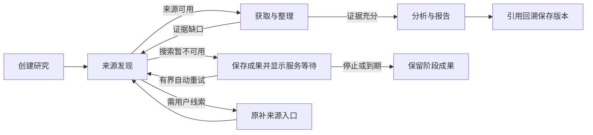

# Issue #5：补查上下文与搜索恢复

版本：v0.1。关联 [Issue #5](https://github.com/xforce-io/inquiry/issues/5)。L1概要在本票评论，用户路径及细化验收见本文件 §4.1/11；L2唯一事实源为本文件。确认来源：2026-11-07会话“端到端 fix”，沿用已有有界补查、停止、保存来源与报告引用契约。此次工程修复不改85/+15质量标准，不自动开启第四次质量实验。

## 1 背景

第三次实验在20份资料留存后补查；实际输入仅含原计划，8次搜索全部429后等待用户补网址。原两次FAIL、第三次BLOCKED及源Trace缺口保留。调查见inquiry/work/verify/2-third-investigation/findings.json F1/F2，旧公开入口和原始输入可对照。

## 2 名词解释

沿用[名词表](../glossary.md)中的证据缺口、研究限制和Playbook。搜索服务暂不可用是来源发现服务未能取得可验证搜索结果的可恢复条件，不等同于用户缺少网址。

## 3 目标与非目标

目标：首次、整理后及分析后检索均按正确上下文运行；搜索暂时故障后有受控恢复与明确用户反馈；当前真实链路报告/引用闭环可核对。非目标：更换弱基线、降低研究门槛、绕过网络边界、自动替换搜索供应方、改写旧实验、引入第二套业务状态机或公网部署。

## 4 能力

discover声明可选历史依赖，首次为空；补查时按已接受版本取得catalogue/analysis缺口、全部历史candidates和materials索引。候选同时保存本轮实际查询及搜索回执，校验与受信工具事实一致，供后续入口去重和定向补证。历史快照只有原有受控工具授权路径可读。

搜索对429及可重试服务故障进行有限重试，尊重Retry-After并共享服务冷却；网络尝试有独立计量，不把工具次数当请求次数。持续不可用进入专门等待状态，进行有界自动等待与重试，不要求填写网址。确有用户信息缺失仍使用原补来源路径。

### 4.1 UI/UX

沿用创建页和详情页，不新增页面。主路径：创建→计划/发现→获取/整理→缺口补查→分析→报告→点击引用→保存版本。搜索等待时顶部显示“搜索服务暂不可用，稍后自动重试”，说明已保存资料，保留既有“停止研究”操作；不要求补网址。恢复后继续阶段列表；恢复次数或期限耗尽时明确说明服务仍不可用并保留阶段成果，既有“新研究”入口可开始后续任务。取消/期限按原语义保留成果。空报告仍显示阶段成果，不能呈现假报告。刷新后从公开快照恢复相同状态；不显示内部协议、路径或原始异常正文。

## 5 思路与折衷

复用TaskLoop显式可选依赖、受信工具回执和等待/信号，不由应用注入未授权历史。放弃为每类历史组合复制整套阶段、提示Agent猜测历史、隐藏429、无限重试和更换供应方凑成功。服务恢复与证据补齐在用户可见结果上分开，但都由现有Runtime推进。

## 6 架构

Web宿主负责授权和信号；Playbook定义搜索服务等待；搜索工具负责有限网络恢复和冷却；gate用实际回执区分服务故障与资料不足；TaskLoop负责持久化/推进/预算；Milkie负责实际Harness。主路径为受信搜索结果→候选→保存资料→缺口→授权补查→报告；失败路径为暂不可用→保存等待→合法重试/取消/期限；越权、非法Schema和真实无依据引用继续拒绝。

## 7 模块

resources/Skill定义上下文和产物；domain搜索与gate保留受信原因及历史；net保留Retry-After等必要响应信息；web/API转换公开等待和有界恢复；前端展示和发起信号。运输冷却为可重建宿主资源状态，不替代任务权威状态。

## 8 API/CLI

复用既有创建、查询、停止和补来源API，不新增用户动作端点。Playbook增加搜索服务等待状态，等待60秒后自动返回discover；沿用sources.added合法补充信号以符合现有等待契约，页面不新增补网址要求或恢复按钮；进入该状态仍受既有每状态3次访问限制，第3次发现仍不可用则结束为明确的服务不可用阶段成果，不再安排恢复。候选queries保存实际query、receipt_id及status，由gate核对；旧产物按原锁定Schema只读，不迁移。公开页面不输出工具错误原文或私有地址。

## 9 边界

每个搜索工具调用最多3次网络尝试，总恢复等待至多30秒；共享冷却遵守服务端Retry-After，超过本次可等边界时立即返回明确不可用而非提前请求。取消打断等待与网络操作；工具次数、24次Run、每状态最多3次访问、30分钟处理及来源容量原限制不扩大。未给Retry-After时服务冷却默认为60秒；服务等待最多进入2次，恢复达到访问上限则保留阶段成果，不自动无限循环。仅HTTP(S)公开目标、每跳DNS与固定IP规则保持。模型仍gpt-6-astra/high，不回退。

## 10 迁移/兼容/回滚

方法/定义版本随新候选固定，旧实例/失败/输入/报告字节不改写。新定义依赖支持可选产物依赖和修复Trace的固定TaskLoop SHA。修复基于已批准的应用集成分支feat/2-research-web-mvp（当前3175578）；本票PR回到该分支，旧#2未达质量门槛的应用不因此进入main。回滚用原候选和原专用目录，不混用锁定定义。无线上部署阶段。

## 11 测试计划

| 验收 | 前置与入口 | 可判定结果 / 禁止结果 | 层级与证据 |
|---|---|---|---|
| S1.A1 | 从页面首次创建，尚无历史 | 发现入口只收到合法可选集合并可正常运行 | E2E真实页面/模型输入；Integration首次输入；必需 |
| S1.A2 | 整理或分析提出缺口，进入补查 | 接收真实缺口及历史查询/候选，补证围绕缺口；越权读取仍拒绝 | Integration两条回路与原生输入；E2E实际补查；必需 |
| S2.A1 | 429后恢复、持续不可用 | 有限恢复遵守Retry-After；服务等待、自动恢复和刷新可辨，不误要求网址 | Unit受控时钟/请求；Integration故障网络适配器；E2E当前页面受控故障，fixture边界明确；必需 |
| S2.A2 | 冷却中取消/到期、停止重复或版本冲突 | 无继续请求/业务副作用，结果和保存资料真实，冲突可恢复 | Unit / Integration及页面停止；必需 |
| S3.A1 | 冻结候选、当前专用真实环境 | 至少1份6阶段真实报告、1条引用回溯，原失败不改写；同研究Trace可核对 | E2E真实页面、真实Harness、来源与Trace；必需 |

主要功能地图：.agents/skills/verify-inquiry/features/recovery.md，关联research.md、sources.md、execution.md、reliability.md。确定性故障不冒充真实服务故障恢复；真实报告只证明本票闭环，不替代独立质量实验。

## 12 开放问题

服务端触发429的具体规则不可见，使用真实HTTP事实和有限策略，不断言付费API额度或并发导致。原Trace现场精确触发由新诊断继续判定，不承诺永无观测缺口。

## 13 关联

- TaskLoop [#16](https://github.com/xforce-io/taskloop/issues/16)、[#15](https://github.com/xforce-io/taskloop/issues/15)。
- [既有产品设计](1-minimal-research-loop.md)、[旧质量实验与门槛](2-research-web-mvp.md)、[Milkie迁移](3-milkie-trace-research-migration.md)。
