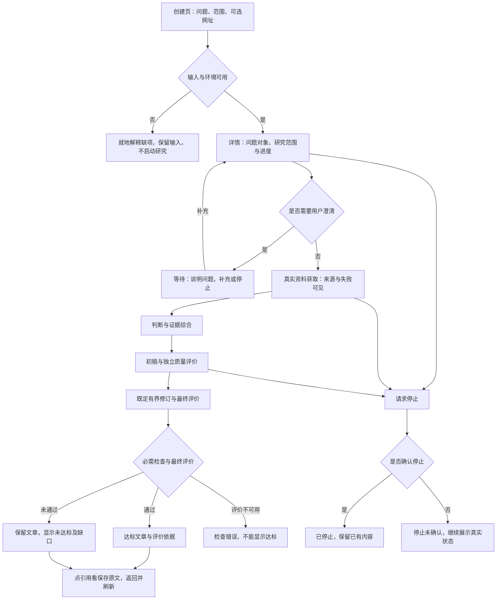
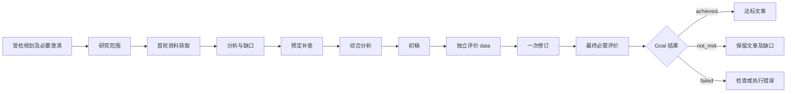

# Inquiry #7：深度文章能力与质量闭环

版本：v0.3；产品基线：已由用户确认；技术契约：本版本；[Issue #7](https://github.com/xforce-io/inquiry/issues/7)。

技术修订v0.3只切换当前执行模型为gpt-6.1-sol/high，依据用户“改成GPT-6.1-Sol”。两页路径和Q1–Q6产品标准不变；此前Astra认证失败与实验记录不改写。

确认来源：用户于 2026-11-13 在本会话回复“沿用这套基线”，确认既有创建/详情两页、仅必要时澄清，以及 Q1–Q6 必需项全部通过的标准。此前 Draft 和历史实验不因此改写为已通过。本文件保留项目要求的十三节，是唯一详细设计；Issue 评论只保留 L1 概要。L1: reuse §3/4/5/11；L2: write §6–10。产品确认不等于对尚未产生的交付候选的人审批准。

产品语义映射：背景/范围见§1/3，交互与 Stories 见§4.1，规则见§4.2，完整细验收见§11，取舍见§5；技术语义按§6–10展开。技术实现与运行证据在 `docs/plan/7-deep-article-quality-loop.md`，不在设计内列代码 TODO。

## 1 背景

此前短报告证明部分执行与引用链路，却没有证明复杂问题覆盖、跨源综合和完整论证。源码基线为集成分支所含 `4f19751c9d947eef435d000019feaaf09b94cb39`：`resources/report.schema.json` 的 conclusion 仅要求 minLength=1；`src/domain.rs::check_domain` 的 report 分支检查引用来自已分析证据、引用编号、短引文及保存版本，然后按作者 answer_status 返回 ready/need_input。它不提供独立语义评价。`skills/inquiry-deep-research/SKILL.md` 虽要求完整文章与自检，方法提示不能当作质量已被保证。

TaskLoop #10 负责通用编排、执行与检查接纳；本票负责研究方法、领域质量及应用效果。原 #2 的 S4 门槛与历史 FAIL 保留。

## 2 名词解释

沿用 [名词表](../glossary.md) 的研究问题、资料、证据、判断、报告、深度文章、质量评价及验收规则。本设计新增的定义仅以名词表为准。

## 3 目标与非目标

目标：从代表性复杂问题产出一篇真正达标的深度文章；阅读者能从关键判断回溯来源，识别限制，并看到独立质量评价为何通过或未通过。正常创建、读取、补充与停止仍在 Inquiry 应用中完成。

非目标：通用 DAG 调度、第二套执行状态权威、原生 Harness 接入、Trace 平台、任意运行中重规划、无限搜索/改写、公网部署。一次样例通过不宣称普遍优于所有模型，也不自动使 #2 S4 通过。

## 4 能力

### 4.1 UI/UX 与完整用户路径

继续使用创建与研究详情两类页面。本版本不新增独立监控页面或需要理解 DAG 的业务操作。

S1 使用 A–F：创建页保留问题、范围与可选网址字段，正常入口不要求填写图或运行内部参数。空问题就地提示且不创建实例；错误不清空输入。详情头部始终显示原始问题与研究范围，不能用生成摘要覆盖原始输入。对象含糊时展示歧义和需要补充的信息，不擅自选另一个对象。研究范围随规划形成并展示，只有歧义或决定性缺口需要用户补充；不为所有任务增加一次强制“确认计划”点击。

S2 使用 G–H：详情中资料区展示已保存、失败与限制，判断区展示支持与反驳依据。搜索结果不是已留存证据，人工补网址明确标记为用户输入。服务暂不可用与资料不足分别解释。已有产物仍可阅读，不能以空白页面掩盖失败。跨源判断需解释来源之间的支持、差异、条件或冲突，不能用多个脚注冒充综合。

S3 使用 I–N：文章区保留初稿和最终稿的版本关系，并显示当前版本的质量结果。独立评价不能只显示一个分数；至少给出未达标要求、相关正文位置、证据和修改后复核结果。只有最终产物的必需评价全部通过才显示达标；文章存在时即便未达标也可读。评价服务错误独立展示，不能当成质量失败或成功。不增加人工编辑器；用户可查看结果和显式发起后续研究，本次运行不自动创建新任务刷结果。

S4 使用 A–S：详情进度与已停止等状态直接来自 TaskLoop 公开视图；应用对研究质量提供中文解释，不通过另存一份状态自行推进。报告内容不反复堆叠工具过程日志；工具诊断在过程区。引用沿用保存内容、定位、高亮、关闭/返回交互，关闭后保留阅读位置；刷新仍读取同一报告版本和质量依据。读不到报告时显示读取错误与重试入口，不把错误渲染成“还没有报告”。预算与 Trace 由公开接口关联；未知用量不补零。原单用户授权边界继续适用，越权引用不显示内容。

S5 沿 A–O 的完整真实路径取证；另执行 M 与 N 的负例。代表性研究固定为 Palantir Vertex 产品，首先核对该名称对应的真实产品或功能；若公开资料无法确认对象，正确结果是澄清/限制，不编造独立产品。该例之外的最小题或只读两份资料只能作功能测试。

### 4.2 产品规则与质量要求

R1：验收规则在报告生成前固定版本，执行中不可由写作者修改。引用结构、Schema、执行状态与内容质量独立；必需评价缺失、error、fail 均不能达标。

R2：每个必答问题有明确结论或有依据的不能回答说明；后者如影响用户目标，整体保持未达标。材料不支持时保留未知，不能为凑覆盖虚构。范围变化需显式关联，不能换题后沿用原通过标识。

R3：事实、推论、假设与建议可区分；关键事实有真正支持该主张的来源。来源营销表述不能无条件改写为经过独立验证的效果，来源数量不代表独立性。

R4：质量评价与作者上下文隔离，不让作者自报通过；评价对象包括确切报告版本、原问题、固定验收规则及可读取的保存证据。评价结果绑定内容摘要，修订后旧 pass 不能沿用。

R5：锁定计划无回边，预先规划的资料、综合、初稿、评价、修订与最终评价是有限前向工作。每次执行前声明时间、调用和候选容量上限；失败不自动重开运行，不静默增加额度。

R6：最终内容评价逐项检查下表，必需项不能靠总分平均抵消。条件不适用须在运行前确定，不能事后删项。

| 要求 | 达标依据 | 必须拒绝的情形 |
|---|---|---|
| Q1 问题覆盖 | 对照原问题列出必答点及对应正文位置，关键问题得到回答 | 偷换对象、只答容易部分、以待办代替关键答案 |
| Q2 机制解释 | 解释对象如何工作、关键关系及具体工作路径，能支持读者理解 | 仅罗列功能词、复制厂商宣传或给出无依据内部机制 |
| Q3 跨源综合 | 对关键判断说明多个来源的关系、独立性、条件和差异 | 引用堆叠、逐页摘要拼接、同源转述冒充独立验证 |
| Q4 论证与证据 | 关键结论对应支持它的证据，推导和适用条件可核查 | 有引用但不支持主张、重大无依据结论、猜测写成事实 |
| Q5 反证与边界 | 主动处理可信反例、替代解释、限制及会改变结论的条件 | 只写空泛“存在局限”、隐去冲突、拿缺资料证明不存在 |
| Q6 成稿与结论 | 章节有主线，分析收敛到针对研究问题的综合判断 | 简短摘录、重复填充、仅有事实列表或模板化建议 |

这六项全部作为 #7 的必需评价，不设置“达到某字数即合格”的捷径。长文章仍可能全部失败；短文本也不能绕过复杂问题的完整论证义务。外部事实若不足以支持目标，明确未达标。

## 5 思路与折衷

选择可解释的逐项评价，放弃仅以总字数、引用数量或综合分数判达标。保留技术引用校验作为前置硬条件，避免语义评价放行悬空引用；同时不声称技术校验能证明内容充分。

采用预先声明的有限写作修订路径，放弃锁定后循环返工。固定最终评价且绑定产物摘要，代价是即便执行耗时较长仍可能得到未达标；这是应保留的结果，不能事后缩题。

复用原两页入口，放弃独立编排编辑器和人工润色平台。语义评价需要真实模型且可能误判，因此保存原文和评价依据供复核，不把一次模型 pass 宣称为人工认可或普遍质量保证。

## 6 架构

### 6.1 分层与主路径

Web 沿用创建、详情、来源抽屉；Rust HTTP 层校验本地会话/Origin、输入及研究内产物归属，只投影公开状态。Inquiry 的注册工厂提供固定前向 Workflow、领域 Schema、研究方法、资料工具和检查器。TaskLoop 固定 `daf0fbaae905be555b543063a4e0d477ea522be8`，统一执行、接纳、预算、取消及持久恢复；模型仍经 Milkie/Codex，不能另造执行状态权威。

规划使用 TaskLoop Workflow 及注册模板，真实 Planner 只回显受限模板或通过公开 needs_input 请求澄清，不改图、不执行文章工作。规划至多两次修正/补充，锁定后无回边。歧义补充通过公开 GoalSignalRequest；后续工作读取 signal_facts，原问题保持不变。运行中资料不足不暗中改图：预定补查后仍不足则最终未达标，用户可显式另起并关联历史研究。旧研究不自动迁移为新 Goal。

### 6.2 资料契约

资料获取是受控的原生领域工作：复用现有 Search 有界恢复、URL/DNS/重定向防护、Fetch 和规范化代码。首轮使用范围中的最多八条查询及用户网址；补查只用分析明确列出的查询并排除已经处置的网址。候选从实际搜索结果中按查询轮转去重选择，每轮最多二十条；用户网址明确标为 user-input，失败与限额处置完整保留。搜索不可用和无足够资料分别标记，不把搜索片段当保存证据。

每轮输出两个独立公开产物：资料包 `corpus`（来源索引、实际搜索记录、获取事实和保存段落）以及 `archive`（原始正文的 base64 与 SHA-256）。作者工作节点只获得资料包引用并通过工具取得索引和段落；最终评价的受信 CheckInput 包含授权的规范化资料包正文，总量仍受两包容量限制。原始 HTML/base64 不注入模型上下文。资料包上限 1 MiB，原文档案上限 2.5 MiB；每份规范化保存最多二万字符，截断及变换版本显式记录。无法在边界内完整保存该来源时记录不可用处置，不使其成为引用证据；不静默删除失败记录。

新引用为 `{artifact_id, sha256, source_id, paragraph, quote}`：前两项绑定确切资料包，source_id 选择该包内来源，paragraph 为零基保存段落，quote 必须是精确短引文。显示来源时返回该包的只读来源视图，不伪造新的 Artifact 身份。旧引用格式与旧报告读取不变。每个 URL 在文章中的短引文累计不超过二十五词，沿用现有版权边界。

### 6.3 写作与独立评价

初稿、修订稿分别为不可变报告产物；分析包括证据、支持/反驳判断、必答点、缺口和补查查询。修订只能使用已保存资料、分析和初稿评价，不能自由搜索、重新开研究或增加次数；没有需要改动时仍提交确切最终版本及说明。

初稿评价是 TaskLoop `purpose=data` 的评价节点：fail 是修订输入，不提前终结；error 明确阻止伪成功。最终有两个必需检查：原生引用/版本/血缘检查，以及 Q1–Q6 独立语义检查。所有检查读取确切最终稿、研究范围、综合分析和两份资料包；评价者只接收原问题、必要 scope 和受授权 targets，不读取作者聊天。TaskLoop 生成 nonce、输入摘要和接纳回执，应用不代签。

语义评价逐项提供正文位置、真实来源定位、支持/冲突解释及缺口，不能只给分数或作者 answer_status。结果与版本绑定；改稿后不得复用旧 pass。作者与产品评价按2026-11-13用户指定改为固定 GPT-6.1 Sol/high，但执行上下文隔离；这不等同人工认可。最终效果另按实验协议进行隔离外部核验，避免把产品内评价作为自身效果证明。

### 6.4 预算与失败路径

新 Goal 上限：墙钟和累计活动各三十分钟、十六次 Run、两千次状态转移、三百次工具调用、六十四 MiB 候选总量、最多两个并发 Run。单 Run 工具上限八十，仍保留两次提交额度；每个入口声明期限与候选容量，TaskLoop 取交集并预留最终检查。原生资料节点在一个Run内逐次调用搜索和单页获取，沿用TaskLoop每次回调45秒上限；单节点最多40次工具调用（8次查询+20次获取+授权输入读取+2次提交），不改框架核心。payload中记录查询、搜索fetch_attempts和逐候选获取处置；重定向及未知上游请求不补零，不能把一次工具调用冒充一次网络请求。

单次修订；两次资料轮次在运行前已锁定。单 Run 上限：规划/范围一百八十秒，资料获取四百八十秒，分析/写作/修订三百秒，语义评价二百四十秒，原生引用检查三十秒；它们都是上限，不预支或扩张 Goal 总时限。正文/产物过界、来源缺失、模型/搜索/评价错误均保留可读产物与实际原因。未知用量和检查时间不补零。停止请求先显示确认中，原生停止未确认时不得显示已停止。

## 7 模块

- `article`：领域类型、引用合法性、来源选择/留存/有界读取和确定性检查；不调度后续工作。
- `orchestration`：注册 Schema、方法、能力、模板、Checker 与预算；只使用 TaskLoop 公开 API。
- `execution`：沿用显式模型、Milkie 连接和专用存储校验，装配新 Goal 与旧只读查询所需能力。
- `web` 与前端：公开状态投影、版本/评价展示、澄清及来源抽屉；不持久化第二份执行状态。

已有 `domain/search/net` 的获取与安全逻辑优先复用；旧研究方法与 Schema 保留用于兼容，不全文重写。

## 8 API/CLI

沿用 `/api/research` 创建及 `/api/research/{id}` 读取；新创建返回公开 goal_id 作为研究地址。请求增加可选 parent_goal_id 仅用于显式后续研究；原问题/范围/网址和 request_key 保留，空问题不创建。重复同键同参返回同实例，同键异参明确冲突。

读取返回 engine、公开 Goal 快照、按真实引用读取的输出和评价回执；必要的旧页面字段只是纯展示投影，原始 Goal 同时可读，不单独存状态。展示五类结果按 TaskLoop outcome/check 错误区分。初稿与最终稿可分别选择，并显示绑定该版本的评价。

补充接口沿用 sources 路径，对 Goal 接受 `{urls, clarification, request_key, expected_revision}`，客户端还可保留原wait_id/nonce供响应丢失时幂等重放（须同时提供），至少一项非空；服务端读取公开 waiting 的 wait_id/nonce 后发送公开 signal，不让用户理解内部标识。已锁定/终结时拒绝修改，允许显式另起研究。旧 Flow 记录维持原查询格式，新应用入口不再创建旧 Flow。

暂停记录通过`POST /api/research/{id}/resume`调用公开resume，携带原request_key/expected_revision；等待nonce不被继续操作重建。停止接口使用公开 cancel；每次请求以当前公开 revision 提交，同键重试保留首次提交的请求身份，不因响应丢失换键。预算和 Trace 按 engine 走对应公开接口。来源接口新增 source_id 查询选择资料包内的来源，先核对研究内产物归属，再返回保存段落和包身份；越权或未知来源返回 not_found。

不增加框架 CLI、独立后台或公网接口。Cookie、Host/Origin、本地监听、CSP、原始输入不可信及跨研究隔离沿用现有边界。

环境复核发现系统DNS为搜索域返回保留IPv6，原边界已拒绝且保留失败。为避免改系统配置，宿主可显式选择 `INQUIRY_DNS_MODE=cloudflare-doh`，默认仍为system。指定模式通过固定Cloudflare HTTPS JSON端点、固定1.1.1.1引导IP及正常TLS验证解析A/AAAA；每次最多6秒、64KiB，核对查询身份、状态及完整性，不跟随重定向、不缓存、不在失败后换解析器。两类全部地址仍经过原公开IP集合校验，再逐跳固定目标IP获取正文；不忽略私有答案，不允许页面/Agent选择解析器。模式列入健康信息和运行环境登记。采用[Cloudflare官方JSON契约](https://developers.cloudflare.com/1.1.1.1/encryption/dns-over-https/make-api-requests/dns-json/)，承认增加第三方解析依赖与网络请求；不宣称DNSSEC覆盖未签名域。

## 9 边界

网络、模型、搜索、评价均为不可信或可失败的外部边界，沿用已有公开网络防护。原生资料工作只处理当前研究已声明查询、实际搜索返回及用户输入的 URL，不读取宿主文件或私网。正文是数据，不得改变工具权限或方法。

最终质量 fail 是 not_met；评价执行错误是 failed/check_unavailable，不能当作内容已被否定或已通过。资料不足允许部分文章，不能冒充复杂文章正例。评价要求围绕已固定问题，不把研究建议当已经实测的部署结论，也不因题目明确无实测便要求编造数据。

## 10 迁移/兼容/回滚

旧 Skill 0.3.7、六阶段 Schema 和保存产物保留；新方法独立版本 0.4.0。历史 ready 不获得新质量标识，旧研究通过原公开 Runtime 查询，新的写入口统一走 Goal。已有运行的恢复仍由 TaskLoop 的版本/绑定/原生停止规则处理，不自动重跑未知工作。

依赖升级前已在归档组合 d31671c + TaskLoop 384bad9 上通过三十四项旧测试；那不是新候选验收。正式候选重新跑兼容、持久化、HTTP 和实际研究路径。回滚到旧应用不会理解新 Goal，不能以旧应用读取不到新 Goal 为由删除数据；两个版本数据目录隔离验证，正式切换前保留原目录，任何恢复只使用对应版本公开接口。

本票交付按新 #7 验收，保留 #2 原标准及 FAIL；不以新标准倒填旧实验通过。合入目标和独立审查/人工门在最终候选上核对，无包发布或公网部署。

## 11 测试计划与细化验收

以下均为必需项；状态由后续验收表记录 pass/fail/blocked/not_run，当前没有任何通过结论。每项须保存候选、方法/规则版本、环境与时间。E2E 由真实应用入口取证；Integration 注入边界不证明文章质量；Unit 验证局部规则不代替用户路径。

| ID/Story | 前置与入口操作 | 可判定结果及禁止行为 | 证据、执行依赖与层级 | 主要功能地图 |
|---|---|---|---|---|
| S1.A1/S1/R2 | 单用户创建页提交复杂问题与范围，再读取详情 | 原问题、对象与范围保留，必答点可见；不缩题 | 创建/详情驾驶记录及公开产物；agent；E2E | research.md |
| S1.A2/S1/R2 | 空问题提交；另提交含糊对象并补充 | 空输入不启动、不丢输入；歧义有可操作澄清并关联后续结果 | 界面、请求及状态证据；agent/可控输入；E2E | research.md |
| S2.A1/S2/R3 | 从无人工补 URL 的真实研究查看来源与关键判断 | 关键判断可回溯保存版本；无搜索片段当证据 | 来源获取事实、正文定位、判断关系；真实服务；E2E | sources.md |
| S2.A2/S2/R3 | 提供可信冲突/反证，读取分析与最终稿 | 至少1类差异被解释，不隐去反例或伪称一致 | 分析及正文对照、保存证据；真实Agent；E2E | sources.md |
| S2.A3/S2/R3 | 获取失败/搜索不可用，另由用户补 URL | 失败与人工来源分别标记；不得冒充自主首次成功 | 公开回执与界面；真实网络及故障注入分列；Integration/E2E | recovery.md |
| S3.A1/S3/R4/R5 | 阅读初稿、独立评价、修订、最终评价 | 四阶段确实运行、版本与缺口对应；不能作者自评通过 | Run关联、产物摘要及评价原文；真实Agent；E2E | quality.md |
| S3.A2/S3/R1/R6 | 对引用合法但缺少关键论证的报告完成全部工作节点 | 所有节点成功仍目标未达标，文章与缺口保留 | 原报告、逐项评价、最终公开状态；真实语义评价；E2E | quality.md |
| S3.A3/S3/R1/R4 | 评价不可用，或提交旧版本pass/伪造对象摘要 | 显示检查错误或拒绝旧证据；不显示达标 | 公开错误、确切摘要与状态；受控故障；Integration | quality.md |
| S3.A4/S3/R5 | 修订或执行资源到边界 | 明确结束/等待，不自动回环、增额或重开任务 | 公开计划、预算、运行列表；agent；Integration | reliability.md |
| S4.A1/S4 | 从创建到报告，点引用关闭返回并刷新 | 同一版本报告/引用/评价仍可读，阅读路径不中断 | 真实computer use、保存内容及截图；E2E | web.md |
| S4.A2/S4/R1 | 分别查看成功、未达标、检查错误、等待、停止未确认 | 五类结果各可判定，不互相冒充 | 真实界面及公开状态，注入边界另列；E2E/Integration | reliability.md |
| S4.A3/S4 | 两实例、越权引用、响应丢失和读取失败 | 不串数据；越权拒绝；同键不重复启动；读取失败可重试 | 公开请求/状态/驾驶；agent；Integration/E2E | reliability.md |
| S4.A4/S4 | 通过应用关联阶段、Agent及工具Trace与预算 | 使用公开接口；未知保持unknown；观测不能推进业务 | 查询/导出对照与状态证据；agent；E2E | execution.md |
| S5.A1/S5/R6 | 预登记后真实执行Palantir Vertex复杂研究 | 1篇文章六项必需语义要求全部通过，无重大无依据结论 | 正文、来源、独立评价和逐项核查；真实服务/Agent；E2E | quality.md |
| S5.A2/S5 | 在同一真实正例点引用，另执行未达标负例 | 至少1条真实引用回溯及1条未达标路径；不能用小题替正例 | 驾驶、保存内容、负例评价；E2E | quality.md |
| S5.A3/S5 | 核对运行前登记和全部尝试账目 | 模型/输入/截止/规则/预算/介入有据，失败不删，#2门槛不改 | 登记文件、原始Run和失败记录；agent；Integration/E2E | quality.md |

地图路径均指 `.agents/skills/verify-inquiry/features/<文件>`，将在实施前从已集成版本继承并补齐本票路径；缺地图不是已验证。S1主文件research.md，S2主文件sources.md，S3/S5主文件quality.md，S4主文件web.md，其他行补充映射不改变主归属。

文章语义逐项评价至少提供 verdict（pass/fail/error）、对应正文位置、支持依据和决定性缺口。内容涉及事实核查时必须实际核对保存来源，而非只阅读作者的引用清单。外部评分与争议处理的精确执行配置须按§12在正式运行前登记，未冻结前不生成正式验收报告。

## 12 开放问题

P-A/P-B 已由用户 2026-11-13“沿用这套基线”解决，采用§4及全部六项必需门槛。

正式实验前仍须登记确切问题、UTC 截止、候选/依赖、模型、隔离外部评价及裁决规则、总次数/时间/工具上限；这是执行登记，不把本次确认扩展为无限实验。实验协议沿用 `docs/experiments/7-quality-protocol-draft.md` 的收益/损失对照原则，冻结时补齐精确执行值。当前没有新质量验收或模型实验通过结论。

## 13 关联

- [Inquiry #7](https://github.com/xforce-io/inquiry/issues/7)
- [TaskLoop #10](https://github.com/xforce-io/taskloop/issues/10)：通用编排依赖与集成验证
- [Inquiry #2](https://github.com/xforce-io/inquiry/issues/2)：原质量门槛、历史失败及Web基线
- [Inquiry #3](https://github.com/xforce-io/inquiry/issues/3)：统一执行与Trace迁移
- [Inquiry #5](https://github.com/xforce-io/inquiry/issues/5)：检索恢复与证据缺口
