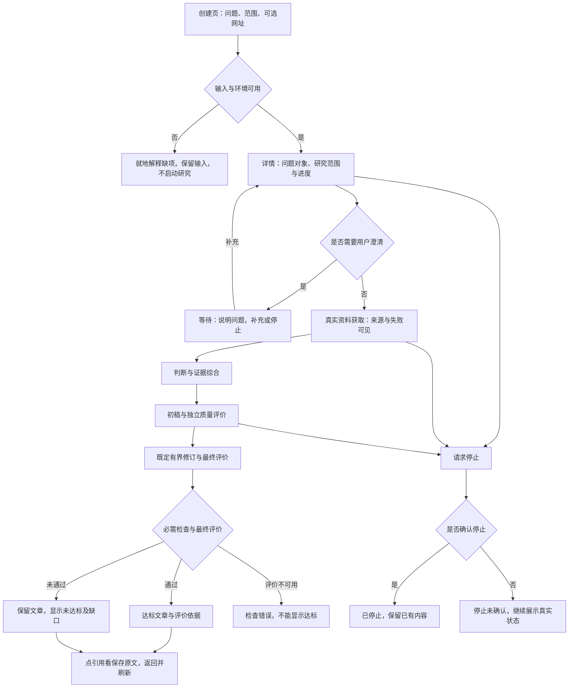

# Inquiry #7：深度文章能力与质量闭环

版本：产品草稿 v0.1；状态：Draft；[Issue #7](https://github.com/xforce-io/inquiry/issues/7)。

本阶段落实可评审产品路径与验收，不预先批准新增取舍或展开实现契约。按用户给定格式：L1 只在 Issue 评论提供概要，本文件为唯一详细规格的工作稿；用户要求的十三节保留，技术部分待产品基线明确后补全。不使用 Skill 默认的 product.md / technical.md 双文件布局。产品语义映射：背景/范围见§1/3，交互与 Stories 见§4.1，产品规则见§4.2，完整细验收见§11，取舍及待确认见§5/12。

确认来源：用户已确认应用与框架职责分离，并要求“直接调整”“go”。这些指令支持继续设计与调查；不能代填为对下文新增界面、评价细则或预算数值的提前批准。

## 1 背景

此前短报告证明部分执行与引用链路，却没有证明复杂问题覆盖、跨源综合和完整论证。源码基线为集成分支所含 `4f19751c9d947eef435d000019feaaf09b94cb39`：`resources/report.schema.json` 的 conclusion 仅要求 minLength=1；`src/domain.rs::check_domain` 的 report 分支检查引用来自已分析证据、引用编号、短引文及保存版本，然后按作者 answer_status 返回 ready/need_input。它不提供独立语义评价。`skills/inquiry-deep-research/SKILL.md` 虽要求完整文章与自检，方法提示不能当作质量已被保证。

TaskLoop #10 负责通用编排、执行与检查接纳；本票负责研究方法、领域质量及应用效果。原 #2 的 S4 门槛与历史 FAIL 保留。

## 2 名词解释

沿用 [名词表](../glossary.md) 的研究问题、资料、证据、判断、报告、深度文章、质量评价及验收规则。本设计新增的定义仅以名词表为准。

## 3 目标与非目标

目标：从代表性复杂问题产出一篇真正达标的深度文章；阅读者能从关键判断回溯来源，识别限制，并看到独立质量评价为何通过或未通过。正常创建、读取、补充与停止仍在 Inquiry 应用中完成。

非目标：通用 DAG 调度、第二套执行状态权威、原生 Harness 接入、Trace 平台、任意运行中重规划、无限搜索/改写、公网部署。一次样例通过不宣称普遍优于所有模型，也不自动使 #2 S4 通过。

## 4 能力

### 4.1 UI/UX 与完整用户路径

继续使用创建与研究详情两类页面。产品草案不新增独立监控页面或需要理解 DAG 的业务操作。

S1 使用 A–F：创建页保留问题、范围与可选网址字段，正常入口不要求填写图或运行内部参数。空问题就地提示且不创建实例；错误不清空输入。详情头部始终显示原始问题与研究范围，不能用生成摘要覆盖原始输入。对象含糊时展示歧义和需要补充的信息，不擅自选另一个对象。提案：研究范围随规划形成并展示，只有歧义或决定性缺口需要用户补充；不为所有任务增加一次强制“确认计划”点击。

S2 使用 G–H：详情中资料区展示已保存、失败与限制，判断区展示支持与反驳依据。搜索结果不是已留存证据，人工补网址明确标记为用户输入。服务暂不可用与资料不足分别解释。已有产物仍可阅读，不能以空白页面掩盖失败。跨源判断需解释来源之间的支持、差异、条件或冲突，不能用多个脚注冒充综合。

S3 使用 I–N：文章区保留初稿和最终稿的版本关系，并显示当前版本的质量结果。独立评价不能只显示一个分数；至少给出未达标要求、相关正文位置、证据和修改后复核结果。只有最终产物的必需评价全部通过才显示达标；文章存在时即便未达标也可读。评价服务错误独立展示，不能当成质量失败或成功。提案：不增加人工编辑器；用户可查看结果和显式发起后续研究，本次运行不自动创建新任务刷结果。

S4 使用 A–S：详情进度与已停止等状态直接来自 TaskLoop 公开视图；应用对研究质量提供中文解释，不通过另存一份状态自行推进。报告内容不反复堆叠工具过程日志；工具诊断在过程区。引用沿用保存内容、定位、高亮、关闭/返回交互，关闭后保留阅读位置；刷新仍读取同一报告版本和质量依据。读不到报告时显示读取错误与重试入口，不把错误渲染成“还没有报告”。预算与 Trace 由公开接口关联；未知用量不补零。原单用户授权边界继续适用，越权引用不显示内容。

S5 沿 A–O 的完整真实路径取证；另执行 M 与 N 的负例。代表性研究固定为 Palantir Vertex 产品，首先核对该名称对应的真实产品或功能；若公开资料无法确认对象，正确结果是澄清/限制，不编造独立产品。该例之外的最小题或只读两份资料只能作功能测试。

### 4.2 产品规则与质量要求

R1：验收规则在报告生成前固定版本，执行中不可由写作者修改。引用结构、Schema、执行状态与内容质量独立；必需评价缺失、error、fail 均不能达标。

R2：每个必答问题有明确结论或有依据的不能回答说明；后者如影响用户目标，整体保持未达标。材料不支持时保留未知，不能为凑覆盖虚构。范围变化需显式关联，不能换题后沿用原通过标识。

R3：事实、推论、假设与建议可区分；关键事实有真正支持该主张的来源。来源营销表述不能无条件改写为经过独立验证的效果，来源数量不代表独立性。

R4：质量评价与作者上下文隔离，不让作者自报通过；评价对象包括确切报告版本、原问题、固定验收规则及可读取的保存证据。评价结果绑定内容摘要，修订后旧 pass 不能沿用。

R5：锁定计划无回边，预先规划的资料、综合、初稿、评价、修订与最终评价是有限前向工作。每次执行前声明时间、调用和候选容量上限；失败不自动重开运行，不静默增加额度。

R6：最终内容评价逐项检查下表，必需项不能靠总分平均抵消。条件不适用须在运行前确定，不能事后删项。

| 要求 | 达标依据 | 必须拒绝的情形 |
|---|---|---|
| Q1 问题覆盖 | 对照原问题列出必答点及对应正文位置，关键问题得到回答 | 偷换对象、只答容易部分、以待办代替关键答案 |
| Q2 机制解释 | 解释对象如何工作、关键关系及具体工作路径，能支持读者理解 | 仅罗列功能词、复制厂商宣传或给出无依据内部机制 |
| Q3 跨源综合 | 对关键判断说明多个来源的关系、独立性、条件和差异 | 引用堆叠、逐页摘要拼接、同源转述冒充独立验证 |
| Q4 论证与证据 | 关键结论对应支持它的证据，推导和适用条件可核查 | 有引用但不支持主张、重大无依据结论、猜测写成事实 |
| Q5 反证与边界 | 主动处理可信反例、替代解释、限制及会改变结论的条件 | 只写空泛“存在局限”、隐去冲突、拿缺资料证明不存在 |
| Q6 成稿与结论 | 章节有主线，分析收敛到针对研究问题的综合判断 | 简短摘录、重复填充、仅有事实列表或模板化建议 |

提案：这六项全部作为 #7 的必需评价，不设置“达到某字数即合格”的捷径。长文章仍可能全部失败；短文本也不能绕过复杂问题的完整论证义务。外部事实若不足以支持目标，明确未达标。

## 5 思路与折衷

选择可解释的逐项评价，放弃仅以总字数、引用数量或综合分数判达标。保留技术引用校验作为前置硬条件，避免语义评价放行悬空引用；同时不声称技术校验能证明内容充分。

采用预先声明的有限写作修订路径，放弃锁定后循环返工。固定最终评价且绑定产物摘要，代价是即便执行耗时较长仍可能得到未达标；这是应保留的结果，不能事后缩题。

复用原两页入口，放弃独立编排编辑器和人工润色平台。语义评价需要真实模型且可能误判，因此保存原文和评价依据供复核，不把一次模型 pass 宣称为人工认可或普遍质量保证。

## 6 架构

本阶段仅固定责任边界：Inquiry 提供研究与质量规则，TaskLoop 提供受控规划、执行及状态接纳；真实模型与公开资料工具是外部依赖。主路径及失败路径见§4.1。数据与进程层详细架构待产品基线明确后设计，当前不伪称已完成 L2。

## 7 模块

N/A：本阶段仅交付产品草案；尚不拆分实现模块。旧源码用于调查，不被自动认定可直接满足新能力。

## 8 API/CLI

N/A：本阶段不新增对外接口契约。应用入口为§4.1 的 Web 路径，通用 CLI 产品约定属于 TaskLoop #10；不把框架 CLI 当作 Inquiry Web 验证。

## 9 边界

模型、搜索、来源获取、评价分别可能不可用。获取失败和人工介入保留原始事实；人工提供 URL 不算自主发现成功。无法获取资料时报告允许保留部分结果，Epic 仍不得宣称深度文章正例完成。网络授权、内容保存与引用权限沿用既定公开资料边界，不借此读取内网或宿主凭据。

## 10 迁移/兼容/回滚

产品要求：旧固定流程研究和历史产物继续只读可查；旧 ready 不自动升级为新标准达标；新运行显式绑定新方法及规则。现有集成分支尚未进入 main，不隐式批准旧 #2 合入。数据与版本迁移、兼容及回滚契约待技术设计补齐。

## 11 测试计划与细化验收

以下均为必需项；状态由后续验收表记录 pass/fail/blocked/not_run，当前没有任何通过结论。每项须保存候选、方法/规则版本、环境与时间。E2E 由真实应用入口取证；Integration 注入边界不证明文章质量；Unit 验证局部规则不代替用户路径。

| ID/Story | 前置与入口操作 | 可判定结果及禁止行为 | 证据、执行依赖与层级 | 主要功能地图 |
|---|---|---|---|---|
| S1.A1/S1/R2 | 单用户创建页提交复杂问题与范围，再读取详情 | 原问题、对象与范围保留，必答点可见；不缩题 | 创建/详情驾驶记录及公开产物；agent；E2E | research.md |
| S1.A2/S1/R2 | 空问题提交；另提交含糊对象并补充 | 空输入不启动、不丢输入；歧义有可操作澄清并关联后续结果 | 界面、请求及状态证据；agent/可控输入；E2E | research.md |
| S2.A1/S2/R3 | 从无人工补 URL 的真实研究查看来源与关键判断 | 关键判断可回溯保存版本；无搜索片段当证据 | 来源获取事实、正文定位、判断关系；真实服务；E2E | sources.md |
| S2.A2/S2/R3 | 提供可信冲突/反证，读取分析与最终稿 | 至少1类差异被解释，不隐去反例或伪称一致 | 分析及正文对照、保存证据；真实Agent；E2E | sources.md |
| S2.A3/S2/R3 | 获取失败/搜索不可用，另由用户补 URL | 失败与人工来源分别标记；不得冒充自主首次成功 | 公开回执与界面；真实网络及故障注入分列；Integration/E2E | recovery.md |
| S3.A1/S3/R4/R5 | 阅读初稿、独立评价、修订、最终评价 | 四阶段确实运行、版本与缺口对应；不能作者自评通过 | Run关联、产物摘要及评价原文；真实Agent；E2E | quality.md |
| S3.A2/S3/R1/R6 | 对引用合法但缺少关键论证的报告完成全部工作节点 | 所有节点成功仍目标未达标，文章与缺口保留 | 原报告、逐项评价、最终公开状态；真实语义评价；E2E | quality.md |
| S3.A3/S3/R1/R4 | 评价不可用，或提交旧版本pass/伪造对象摘要 | 显示检查错误或拒绝旧证据；不显示达标 | 公开错误、确切摘要与状态；受控故障；Integration | quality.md |
| S3.A4/S3/R5 | 修订或执行资源到边界 | 明确结束/等待，不自动回环、增额或重开任务 | 公开计划、预算、运行列表；agent；Integration | reliability.md |
| S4.A1/S4 | 从创建到报告，点引用关闭返回并刷新 | 同一版本报告/引用/评价仍可读，阅读路径不中断 | 真实computer use、保存内容及截图；E2E | web.md |
| S4.A2/S4/R1 | 分别查看成功、未达标、检查错误、等待、停止未确认 | 五类结果各可判定，不互相冒充 | 真实界面及公开状态，注入边界另列；E2E/Integration | reliability.md |
| S4.A3/S4 | 两实例、越权引用、响应丢失和读取失败 | 不串数据；越权拒绝；同键不重复启动；读取失败可重试 | 公开请求/状态/驾驶；agent；Integration/E2E | reliability.md |
| S4.A4/S4 | 通过应用关联阶段、Agent及工具Trace与预算 | 使用公开接口；未知保持unknown；观测不能推进业务 | 查询/导出对照与状态证据；agent；E2E | execution.md |
| S5.A1/S5/R6 | 预登记后真实执行Palantir Vertex复杂研究 | 1篇文章六项必需语义要求全部通过，无重大无依据结论 | 正文、来源、独立评价和逐项核查；真实服务/Agent；E2E | quality.md |
| S5.A2/S5 | 在同一真实正例点引用，另执行未达标负例 | 至少1条真实引用回溯及1条未达标路径；不能用小题替正例 | 驾驶、保存内容、负例评价；E2E | quality.md |
| S5.A3/S5 | 核对运行前登记和全部尝试账目 | 模型/输入/截止/规则/预算/介入有据，失败不删，#2门槛不改 | 登记文件、原始Run和失败记录；agent；Integration/E2E | quality.md |

地图路径均指 `.agents/skills/verify-inquiry/features/<文件>`，将在实施前从已集成版本继承并补齐本票路径；缺地图不是已验证。S1主文件research.md，S2主文件sources.md，S3/S5主文件quality.md，S4主文件web.md，其他行补充映射不改变主归属。

文章语义逐项评价至少提供 verdict（pass/fail/error）、对应正文位置、支持依据和决定性缺口。内容涉及事实核查时必须实际核对保存来源，而非只阅读作者的引用清单。评分与争议处理的执行细则属于§12待确认事项，未定前不生成正式验收报告。

## 12 开放问题

P-A：是否采用§4.1 的既有两页入口、仅歧义时补充、不加全量计划强制确认、不加人工编辑器的应用路径？

P-B：是否以§4.2 Q1–Q6全项通过作为本票语义质量门槛，并按§11负例验证；不以字数替代、不改原#2 SOTA标准？

实际模型、隔离评价人数及分歧裁决、代表性问题的最终原文与截止、运行次数/时间/工具预算须在正式执行前登记；不能把“go”记录为对尚未提出的数字批准。本阶段零模型网络探针不属于正式深度文章验收。

## 13 关联

- [Inquiry #7](https://github.com/xforce-io/inquiry/issues/7)
- [TaskLoop #10](https://github.com/xforce-io/taskloop/issues/10)：通用编排依赖与集成验证
- [Inquiry #2](https://github.com/xforce-io/inquiry/issues/2)：原质量门槛、历史失败及Web基线
- [Inquiry #3](https://github.com/xforce-io/inquiry/issues/3)：统一执行与Trace迁移
- [Inquiry #5](https://github.com/xforce-io/inquiry/issues/5)：检索恢复与证据缺口
